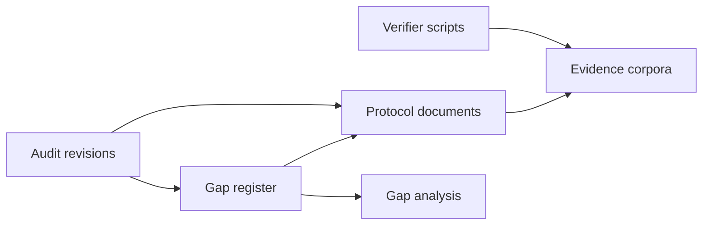

# Hotline 1.9 protocol documentation

This repository documents the Hotline 1.9 wire protocol from retained evidence.
The evidence includes captures and stopped-disk records from the native
[Hotline Server 1.9](docs/glossary.md#hotline-server-19), decompilation query
records, sessions with identified peers, and the validation of a separate
server implementation, [mxd](docs/glossary.md#mxd). Protocol documents state
only what the cited evidence supports, and they label anything else as
unresolved. The documents were written investigation by investigation, and they
are grouped here into nine subject sets under `docs/`.

## What it is not

- It is not a specification with normative force beyond its evidence.
- It does not publish the Hotline Server 1.9 binary. Forks of that binary are
  withheld, and the evidence records their sizes and hashes instead; see
  [Withheld file](docs/glossary.md#withheld-file).
- It is not the capture toolset. The general-purpose toolset that captures this
  repository's evidence is a separate repository, linked by commit permalink:
  [mothra](https://github.com/leynos/mothra/blob/57aeaac4f12065bfb2de3d47943f4b45622392a9/README.md).

## Start here

1. **Implementing a client or server.** Open the
   [protocol guide](docs/protocol/protocol.md), which describes observed
   behaviour of the native server and marks the gaps where the evidence is
   incomplete. Then read the overview of each set, listed in
   [the document sets](#the-document-sets). The
   [baseline validity ledger](docs/baseline-validity-ledger.md) records, claim
   by claim, which evidence each of the guide's statements rests on.
2. **Checking a claim against its evidence.** Open the
   [provenance overview](docs/provenance/README.md), then the
   [guide to recreating the evidence](docs/native-evidence/recreating-evidence.md),
   which states how each retained corpus was produced and how to re-verify it
   offline.
3. **Picking up the remaining investigation.** Open the
   [ledger of remaining evidence work](docs/provenance/remaining-evidence-work.md),
   then the [gap analysis](gap-analysis.md). The
   [gap register](gap-register.json) is the canonical list of open questions,
   and it governs where the ledger and the register differ.
4. **Contributing to the repository.** Read [AGENTS.md](AGENTS.md) before
   changing anything. It sets out the rules for contributors and agents,
   including the rules that protect the evidence. The
   [developers' guide](docs/developers-guide.md) then explains how to change a
   document, add evidence, or change a script or tool, and which gates to run.

## How the pieces fit

The protocol documents cite the evidence corpora. Verifier scripts verify those
corpora. The gap register lists open questions against document sections, and
each audit revision pins the register to the exact text of the documents it
reviewed.

For screen readers: the following flowchart shows protocol documents and
verifier scripts both pointing to evidence corpora, the gap register pointing
to protocol documents, the audit revisions pointing to the gap register and to
the protocol documents, and the gap analysis produced from the gap register.



_Figure 1: How the protocol documents, evidence, verifiers, gap register and
audit revisions relate._

## The document sets

Each set has its own overview, which describes what the set covers and how its
documents relate.

| Set                     | Covers                                                                                                                                         | Overview                                           |
| ----------------------- | ---------------------------------------------------------------------------------------------------------------------------------------------- | -------------------------------------------------- |
| Protocol                | The baseline guide to Hotline 1.9 transactions, with the registries and contracts that refine it                                               | [Overview](docs/protocol/README.md)                |
| Presence and messaging  | Presence, type-104 notifications, messages and the rate-304 settings path                                                                      | [Overview](docs/presence-and-messaging/README.md)  |
| Accounts and privileges | Account records, the privilege bitmap, the ban file format and configured bans                                                                 | [Overview](docs/accounts-and-privileges/README.md) |
| Files and transfers     | Transfer contracts, the download send path, path fields and alias records                                                                      | [Overview](docs/files-and-transfers/README.md)     |
| News                    | Nested news contracts and the legacy board format                                                                                              | [Overview](docs/news/README.md)                    |
| Peers                   | Identified client peers, the Classic login proxy and field-tolerance matrices                                                                  | [Overview](docs/peers/README.md)                   |
| mxd                     | Validation of the mxd server against the protocol documents: status, corrections and client trials                                             | [Overview](docs/mxd/README.md)                     |
| Native evidence         | [Preparations](docs/glossary.md#preparation) and [witnesses](docs/glossary.md#witness) for the native server, and how to recreate the evidence | [Overview](docs/native-evidence/README.md)         |
| Provenance              | The evidence baseline, the handoff, the remaining work and the working records                                                                 | [Overview](docs/provenance/README.md)              |

_Table 1: The nine document sets and their overviews._

## Checking the repository

The [Makefile](Makefile) defines every gate. `make help` lists each target with
its comment. The commands below establish the following.

```sh
make all              # The gates that must pass at every commit
make docs-gates       # Markdown layout, markdownlint, spelling and Mermaid validation
make evidence-verify  # Every retained Hotline corpus, through its legacy verifier
make audit-check      # The gap register against the audit revision and gap-analysis.md
make links-check      # Every Markdown link, fragment and mothra reference
make goldens-check    # The legacy scripts against tests/goldens (three to ten minutes)
make help             # Every target, with its comment
```

`make all` runs its evidence checks only when `evidence/` is present.
`make docs-gates` joins `make all` once every document conforms, and
`make goldens-check` is not part of `make all`.

Captures and images in `evidence/` are stored in Git LFS: the PNG, PCAP and
gzip files are listed in `.gitattributes`, and `make lfs-check` verifies that
exactly those files are stored that way. A shallow clone is not enough for
`make withheld-scan`, which reads every blob in the Git history, or for
`make import-check`, which compares the imported files with a mothra checkout
at a pinned commit.

## Licence and provenance of inputs

The repository has no licence file, and its own text does not state a licence
for the documents or the scripts.

The evidence includes third-party material. Forks of the Hotline Server 1.9
binary are withheld; see [Withheld file](docs/glossary.md#withheld-file). The
[shx peer](docs/peers/shx-peer.md) document records that the frozen build
inputs for the shx client include the complete source archive and its licence
notices. The upstream SynHX source archive is not retained, so the
[glossary](docs/glossary.md) names the archive files that each entry used.

Imported corpora are pinned to a commit of the mothra repository, which
`evidence/curation.json` records.
