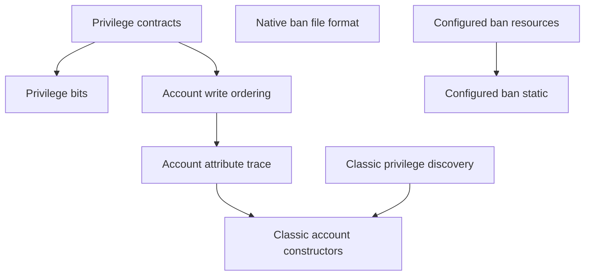

# Accounts and privileges

This set covers the access bitmap in field 110 and the checks that use it, the
stored account record and the native writer that saves it, the Classic client's
account requests and privilege editor, and the native server's ban store and
configured-ban application. Most documents are static readings of the native
binary or the Classic client. The privilege bits index also joins captured
readbacks from single owned accounts. The set states which bits and fields are
[observed](../glossary.md#observed), which are read from source, and which
remain [unresolved](../glossary.md#unresolved). It deliberately leaves the wire
layout of the transactions that carry these fields to the
[protocol](../protocol/README.md) set, the notices that a ban produces to the
presence and messaging set, and the transfer and news transactions to their own
sets. The identified client evidence is in the peers set, and the validation of
the mxd implementation is in the [mxd](../mxd/README.md) set.

## Where to start

The [privilege contracts](privilege-contracts.md) document is the entry point.
It gives the bitmap numbering, the known use of each bit, and the rules for
creating and updating accounts. Read the [privilege bits](privilege-bits.md)
index next when a single bit needs its evidence.

The account writer and the stored record come next. The
[account write ordering](account-write-ordering.md) document records the order
of the direct writer. The [account attribute trace](account-attribute-trace.md)
document records the stored layout and consumers of field 111.

The Classic client is a separate line of reading. The
[Classic privilege discovery](classic-privilege-discovery.md) document records
the editor strings. The
[Classic account constructors](classic-account-constructors.md) document
records how the client builds account requests.

The ban store is a further line. The
[native ban file format](native-ban-file-format.md) document describes the
stored file. The
[configured-ban Options resources](native-configured-ban-ui-resources.md)
document identifies the menu entry. The
[configured-ban static preparation](native-configured-ban-static.md) document
gives the raw text and source path of the notice.

For screen readers: the diagram shows the privilege contracts at the top.
Arrows lead from them to the privilege bits and to the account write ordering.
From the account write ordering, an arrow leads to the account attribute trace,
and from there to the Classic account constructors. The Classic privilege
discovery also leads to the constructors. A separate branch runs from the
configured-ban resources to the configured-ban static preparation. The native
ban file format stands alone.

_Figure 1: Suggested reading order of the accounts and privileges set, in three
lines: the privilege and account writer line, the Classic client line, and the
ban store and configured-ban line._

## Documents

The kind names what a document is: a contract states the rules that its
evidence supports, a schema gives byte or field layouts, a trace records a
static reading of code, a matrix sets cases against their outcomes, and a
reference is a guide or catalogue.

| Document                                                                  | What it covers                                                                                                                                                           | Kind      |
| ------------------------------------------------------------------------- | ------------------------------------------------------------------------------------------------------------------------------------------------------------------------ | --------- |
| [Privilege contracts](privilege-contracts.md)                             | The numbering of the eight-byte access bitmap, the known use of each bit, and the account creation and update rules, from a call-site review of the privilege accessors. | contract  |
| [Privilege bits](privilege-bits.md)                                       | An index of each of the 64 access-bitmap positions, with its native readback case and any source-observed use, and the unknown positions marked as unknown.              | matrix    |
| [Account write ordering](account-write-ordering.md)                       | The call order of the direct account writer relative to the acknowledgement and the live account update, from read-only decompilation.                                   | trace     |
| [Account attribute trace](account-attribute-trace.md)                     | The stored record and consumers of account field 111, traced from read-only queries against existing account fixtures.                                                   | trace     |
| [Classic privilege discovery](classic-privilege-discovery.md)             | Three defined-string queries against the identified Classic client's privilege editor, from a fresh independent import.                                                  | trace     |
| [Classic account constructors](classic-account-constructors.md)           | A read-only trace of how the identified Classic client builds its account requests.                                                                                      | trace     |
| [Native ban file format](native-ban-file-format.md)                       | The version-2 layout of the native server's stored ban file, observed in three stopped-image files.                                                                      | schema    |
| [Configured-ban Options resources](native-configured-ban-ui-resources.md) | A catalogue of the native server resource fork, identifying the Options menu entry and not the ban editor's encoding.                                                    | reference |
| [Configured-ban static preparation](native-configured-ban-static.md)      | Static evidence on the raw text and source path of the configured-ban notice. It is not a network fixture.                                                               | trace     |

_Table 1: The documents of the accounts and privileges set._

## Evidence

The documents in this set cite gap-remediation corpora most often, and the
privilege documents also cite decompilation query records under the
`hotline-server-1.9` evidence directory. Each corpus is recorded with a
manifest. Examples are the
[ban file format corpus](../../evidence/gap-remediation/2026-11-14/ban-file-format-01/manifest.json),
the
[account write ordering corpus](../../evidence/gap-remediation/2026-11-14/account-write-ordering-01/manifest.json)
and the
[Classic privilege discovery corpus](../../evidence/gap-remediation/2026-11-14/classic-privilege-discovery-01/manifest.json).
The procedure for re-verifying the retained evidence is in the
[guide to recreating the evidence](../native-evidence/recreating-evidence.md).

## Open questions

The
[ledger of remaining evidence work](../provenance/remaining-evidence-work.md)
lists the gaps that are not Resolved. The [gap analysis](../../gap-analysis.md)
holds the full text of each gap.

The ledger lists these gaps as not Resolved, and this set cites them or names
its documents as the prepared work:

- [GAP-021]: ACK versus completion, durability
  and retry. The ledger names the account write ordering document as the
  prepared work.
- [GAP-031]: complete privilege bitmap registry.
- [GAP-071]: account field 111.
- [GAP-072]: account update, placeholder and
  identity rules.

The documents also cite the following gaps. The ledger does not list them as
not Resolved, and this overview does not restate their status: [GAP-032],
[GAP-044], [GAP-047] and [GAP-074].

## Related sets

- [Protocol](../protocol/README.md): the transactions that carry field 110 and
  the account fields. Go there for the request and reply layouts.
- [Presence and messaging](../presence-and-messaging/README.md): the notices
  that a ban or a deletion produces. Go there for the text and fields of a
  type-104 notice.
- [Files and transfers](../files-and-transfers/README.md): the file and folder
  privilege bits, such as upload and download, as they are used by the file
  transactions. Go there for file behaviour.
- [News](../news/README.md): the news privilege bits, and the news contracts
  that the privilege contracts cite. Go there for article behaviour.
- [Peers](../peers/identified-client-source.md): the identified Classic client
  and how it behaves against the native server.
- [mxd](../mxd/README.md): the separate server implementation and its checks of
  privileges and account writes.
- [Native evidence](../native-evidence/recreating-evidence.md): the preparation
  and witness documents for the bitmap and ban runs, and how to re-verify them.
- [Provenance](../provenance/remaining-evidence-work.md): the ledger of
  remaining evidence work and the open gaps.

[GAP-021]: ../../gap-analysis.md#gap-021
[GAP-031]: ../../gap-analysis.md#gap-031
[GAP-032]: ../../gap-analysis.md#gap-032
[GAP-044]: ../../gap-analysis.md#gap-044
[GAP-047]: ../../gap-analysis.md#gap-047
[GAP-071]: ../../gap-analysis.md#gap-071
[GAP-072]: ../../gap-analysis.md#gap-072
[GAP-074]: ../../gap-analysis.md#gap-074
