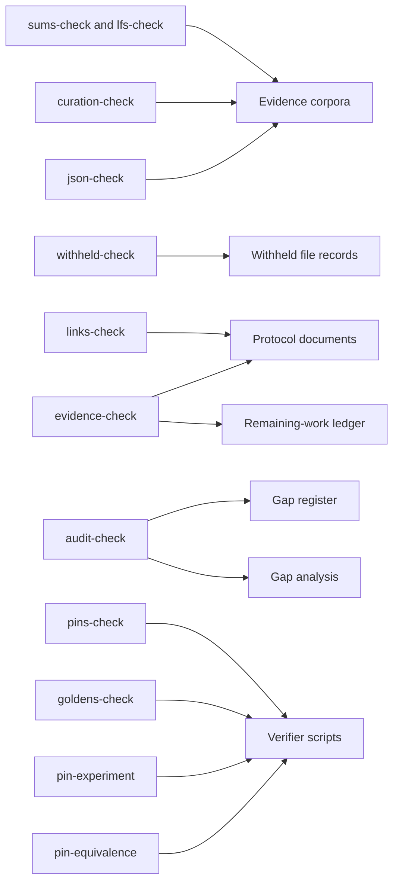

# Developers' guide

This guide is for maintainers and contributors who change the protocol
documents, the evidence, the [verifier](glossary.md#verifier) scripts or the
tools in this repository. It explains how to make each kind of change so that
the gates pass the first time. It adds no protocol claim.
[AGENTS.md](../AGENTS.md) states the rules in brief, and this guide expands
them. The [repository layout](repository-layout.md) gives the purpose of each
path. Decision references such as D4 are entries in the decision log of
`docs/execplans/documentation-reconcilliation.md`.

## 1. What the gates protect

The repository guarantees four things by mechanical checks. Each guarantee has
a make target that enforces it. `make all` runs most of those targets, and a
change that breaks one of them is not committed.

- Every citation resolves. `make evidence-check` checks the ledger and gap
  identifiers, the script paths, the gap statuses that sentences state, the
  remaining-work ledger, the corpus families and the evidence indexes.
  `make links-check` checks every Markdown link and fragment.
  `make curation-check` checks that every evidence path that a citing file
  names resolves.
- Evidence bytes do not change. `make sums-check` verifies every `SHA256SUMS`
  file under `evidence/`. `make lfs-check` verifies which evidence files Git
  Large File Storage (LFS) stores. `make curation-check` verifies the imported
  corpora against `evidence/curation.json`. `make json-check` verifies the
  canonical layout of tracked JavaScript Object Notation (JSON) files, and it
  exempts listed evidence files by hash instead of rewriting them.
- The gap register stays pinned to the text it reviewed. `make audit-check`
  validates `gap-register.json` against the audit revision that it names and
  against `gap-analysis.md`. It fails when an audited document has changed
  since that revision was cut.
- The verifier scripts behave as they did when their evidence was captured.
  `make pins-check` verifies that each pinned script is in the local history
  with its recorded hash. `make goldens-check` compares the legacy scripts with
  recorded outputs. `make pin-experiment` and `make pin-equivalence` check that
  changes to pinned scripts leave the recorded behaviour unchanged (decision
  D29).

For screen readers: the following flowchart shows which gate guards which
artefact. Each arrow runs from a gate to the artefact that it guards.



_Figure 1: The gates, and the artefacts that each one guards._

## 2. Prerequisites

The repository depends on the tools in Table 1. This section states what each
one is needed for. It gives no installation steps, except that `make build`
creates the project environment.

| Prerequisite                                        | Needed for                                                                             | What the repository states                                                                                                                                                                                                                                                                                                                                                                                 |
| --------------------------------------------------- | -------------------------------------------------------------------------------------- | ---------------------------------------------------------------------------------------------------------------------------------------------------------------------------------------------------------------------------------------------------------------------------------------------------------------------------------------------------------------------------------------------------------- |
| Full Git clone                                      | `pins-check`, which is part of `make all`; `withheld-scan`; `import-check`             | A shallow clone cannot supply the pinned commits, and `pins-check` names the shallow clone as the cause. The README says a shallow clone is not enough for `withheld-scan` or `import-check`.                                                                                                                                                                                                              |
| Git LFS                                             | `sums-check`, `lfs-check` and the evidence checks                                      | PNG, packet-capture (PCAP) and gzip files under `evidence/` are stored through Git LFS, as `.gitattributes` says. `sums-check` reports an LFS pointer where content belongs and names `git lfs pull`.                                                                                                                                                                                                      |
| `uv` and Python 3.14                                | Every Python target, through `make build`                                              | `make build` runs `uv sync --group dev`. The Makefile puts `.venv/bin` first on `PATH`. `pyproject.toml` requires Python `>=3.14`.                                                                                                                                                                                                                                                                         |
| `markdownlint-cli2`, `nixie` and `mdtablefix` 0.6.1 | `docs-gates`, `markdownlint`, `nixie` and `fmt`                                        | The Makefile names them with the variables `MDLINT`, `NIXIE` and `MDTABLEFIX`. `check-fmt-markdown` fails unless `mdtablefix --version` reports `mdtablefix 0.6.1`.                                                                                                                                                                                                                                        |
| Python lint and spelling tools                      | `lint-python`, `typecheck` and `spelling`                                              | The Makefile pins Ruff 0.16.8, pylint 4.0.9 and `typos-config-builder` v0.1.3. `pyproject.toml` pins `ty` 0.0.56. The df12 Python lints are fetched from Git at v0.4.0.                                                                                                                                                                                                                                    |
| `jq`                                                | `evidence-verify`                                                                      | The GAP-011 recipes run two `verify.jq` filters with `jq -e`. The tool must be available on `PATH`.                                                                                                                                                                                                                                                                                                        |
| A local clone of mothra                             | `links-check`, `goldens-check`, `pin-experiment`, `import-check` and `evidence-verify` | `MOTHRA` names the clone, and it defaults to `../mothra` or `../../mothra` when one exists. `import-check` stops without it. The Makefile exports `MOTHRA_ROOT` when `MOTHRA` is set, and the legacy verifiers that read mothra's general tooling use it. The link check requires links into mothra to be commit permalinks, and it confirms that each permalink's path exists at its commit in the clone. |

_Table 1: Prerequisites, and the targets that depend on them._

### Withheld files

The forks of the Hotline Server 1.9 binary are withheld, because they are not
this project's to publish (decision D20). `evidence/withheld.json` records
eight files: four copies of the data fork, three of the resource fork and one
AppleDouble container. Each entry records the file's size, its SHA-256 (Secure
Hash Algorithm, 256-bit) hash and its fork. The withheld files are never
committed. `.gitignore` lists each path, and `tools/check_withheld.py` fails
when a withheld path is tracked or is not covered by `.gitignore`. A local copy
may sit at each path.

The checks behave as follows when a local copy is absent.

- `make withheld-check` runs in `make all` once `evidence/withheld.json` exists.
  It checks the manifest, the `.gitignore` coverage and the patches. A local
  copy is verified when it is present, and an absent copy is not a failure. A
  patch is rebuilt only when its base is present. Before the manifest exists,
  `make withheld-skip` prints
  `withheld-check skipped: evidence/withheld.json does not exist yet`.
- `make sums-check` reports an absent withheld entry as `withheld`, which the
  manifest allows.
- `make evidence-verify` does not behave in this way. Its recipe runs
  `sha256sum --quiet -c evidence/hotline-server-1.9/SHA256SUMS`, and that file
  lists the data fork at `inputs/HLserver19.pef`. The recipe therefore fails,
  and `make all` stops at that line, in a clone without the local copy. The
  execution plan records this as an open finding, with the fix to use
  `tools/check_sums.py`.
- `make withheld-scan` reads every blob in the history, so it needs a full
  clone.

## 3. The gates

Every gate is a make target. `make help` lists every target with its comment.
Table 2 lists the targets that a maintainer runs. It states what each one
checks, when to run it, whether `make all` includes it and, where the Makefile
or the plan gives one, how long it takes.

| Target                           | What it checks                                                                                                                                                                           | When to run it                                                        | In `make all`                                                  | Time            |
| -------------------------------- | ---------------------------------------------------------------------------------------------------------------------------------------------------------------------------------------- | --------------------------------------------------------------------- | -------------------------------------------------------------- | --------------- |
| `make all`                       | The gates that must pass before every commit                                                                                                                                             | Before every commit                                                   | Not applicable                                                 | Not stated      |
| `make build`                     | Creates `.venv` and installs the development group with `uv sync --group dev`                                                                                                            | On a new clone, or after a change to `pyproject.toml` or `uv.lock`    | No; the Python targets depend on it                            | Not stated      |
| `make fmt`                       | Formats Python with Ruff, sorts imports, rewrites authored JSON outside `evidence/` and reflows authored Markdown with mdtablefix. It never touches `evidence/`                          | After every edit, before the gates                                    | No                                                             | Not stated      |
| `make check-fmt`                 | Python formatting, and the Markdown table and wrap layout                                                                                                                                | Before a commit                                                       | Only `check-fmt-python` is included                            | Not stated      |
| `make docs-gates`                | `check-fmt-markdown`, `markdownlint` and `nixie`                                                                                                                                         | After every Markdown change                                           | No; it joins `make all` once every inherited document conforms | Not stated      |
| `make markdownlint`              | markdownlint-cli2 over the Markdown files, after `spelling`                                                                                                                              | Through `docs-gates`                                                  | No                                                             | Not stated      |
| `make spelling`                  | en-GB-oxendict spelling, through `typos-config-builder`                                                                                                                                  | Through `markdownlint`                                                | No                                                             | Not stated      |
| `make nixie`                     | Mermaid diagrams validate                                                                                                                                                                | After a change to a diagram                                           | No                                                             | Not stated      |
| `make json-check`                | Every tracked JSON file is in canonical layout; evidence files are exempt by hash                                                                                                        | After editing JSON                                                    | Yes                                                            | Not stated      |
| `make pins-check`                | Each pinned script and evidence `.py` file is in the local history, and carries its recorded hash or only docstrings                                                                     | After a change to `scripts/pinned-sources.json` or to a pinned script | Yes                                                            | Not stated      |
| `make links-check`               | Every Markdown link, fragment and mothra reference. The run must examine at least 2000 links                                                                                             | After any Markdown change                                             | Yes                                                            | Not stated      |
| `make evidence-check`            | Cited identifiers, scripts, gap statuses, the remaining-work ledger, corpus families and the evidence indexes. The run must examine at least 400 ledger citations and 700 evidence links | After changing a citation or a status                                 | Yes                                                            | Not stated      |
| `make evidence-index`            | Regenerates `docs/<set>/evidence.md` for every set. It writes files                                                                                                                      | After citations change                                                | No                                                             | Not stated      |
| `make audit-check`               | `gap-register.json` against the audit revision it names, and `gap-analysis.md`. It fails when an audited document has changed since the revision was cut                                 | After a document, register or audit revision changes                  | Yes                                                            | Not stated      |
| `make withheld-check`            | The withheld manifest, the `.gitignore` coverage and the patches                                                                                                                         | After a change to the withheld records                                | Yes, once `evidence/withheld.json` exists                      | Not stated      |
| `make withheld-scan`             | As `withheld-check`, and every blob of the history for withheld content                                                                                                                  | Not stated; needs a full clone                                        | No                                                             | Not stated      |
| `make sums-check`                | Every `SHA256SUMS` file under `evidence/`                                                                                                                                                | After changing evidence                                               | Yes, when `evidence/` exists                                   | Not stated      |
| `make lfs-check`                 | Exactly the PNG, PCAP and gzip evidence is stored through Git LFS                                                                                                                        | After adding evidence                                                 | Yes, when `evidence/` exists                                   | Not stated      |
| `make curation-check`            | The imported corpora against `evidence/curation.json`, and that every citation resolves                                                                                                  | After changing evidence or citing text                                | Yes, once `evidence/curation.json` exists                      | Not stated      |
| `make import-check`              | As `curation-check`, and every included file against the mothra commit named by `IMPORT_COMMIT`                                                                                          | After an import; needs `MOTHRA`                                       | No                                                             | Not stated      |
| `make evidence-verify`           | Every retained corpus, through its legacy verifier, one recipe line at a time. The GAP-011 recipes use `jq` to verify seven static query records and a stopped-disk fork summary         | After a verifier or a corpus changes                                  | Yes, when `evidence/` exists                                   | Not stated      |
| `make evidence-verify-known-red` | The verifier that is known to fail (decision D18)                                                                                                                                        | To see the known failure                                              | No                                                             | Not stated      |
| `make lint-python`               | Ruff, docstring coverage at 100 per cent, pylint and the df12 plugin messages, on the Python that meets the standard                                                                     | After a change to Python                                              | Yes                                                            | Not stated      |
| `make typecheck`                 | `ty` on the Python that meets the standard                                                                                                                                               | After a change to Python                                              | Yes                                                            | Not stated      |
| `make test`                      | `pytest -v` over `tests` and `scripts/tests`                                                                                                                                             | After a change to a tool or a test                                    | Yes                                                            | Not stated      |
| `make test-legacy`               | Unittest discovery of `scripts/`, which runs the one file left beside them                                                                                                               | To check that file                                                    | No                                                             | Not stated      |
| `make goldens-check`             | The three oracles of Table 4, compared with `tests/goldens`. `GOLDENS_FILTER` limits the run to keys that contain its text                                                               | After each change to a script family                                  | No                                                             | 3 to 10 minutes |
| `make pin-experiment`            | Appends a comment to each pinned script, compares the goldens and restores the scripts                                                                                                   | After a change to a pinned script (decision D29)                      | No                                                             | 3 to 10 minutes |
| `make pin-equivalence`           | The tests that reach each changed pinned script, run against its pinned bytes and its current bytes                                                                                      | After a change to a pinned script, with `goldens-check`               | No                                                             | Several minutes |
| `make help`                      | Lists every target with its comment                                                                                                                                                      | When needed                                                           | No                                                             | Not stated      |

_Table 2: The make targets that a maintainer runs, and what each checks._

The field-161 reader corpus has a `make evidence-verify` recipe. Its archived
`discover-reads.py.as-run.txt` takes no CLI arguments: it reads the identified,
checksum-pinned server PEF from its fixed ignored path, checks the code section
bounds and alignment, and prints JSON with the input digest, section byte
count, and candidate instruction addresses, opcodes, base registers,
displacements, and read widths. The recipe compares that output byte-for-byte
with `read-candidates.json`, then runs `verify.jq` over five retained query
records. The scan covers direct PowerPC loads overlapping the four-byte field at
`0x41c` and nonzero-base `addi` address formation within it. It does not rule
out indexed, derived, or aliased accesses. The query gate requires the exact
candidate, server image, and retained code and reference observations.
`tests/test_field161_readers_verify.py` exercises the archived scanner with
synthetic offline sections and checks that copied false records fail the Make
recipe. The archived scanner remains checksum-pinned as run.

The Classic privilege label corpus keeps a checksum-pinned `ClassicLabels.java`
extractor. It takes the identified Classic client DATA fork, uses Ghidra's
`ContainerHeader` to unpack its PEF `PackedData` section, and prints the input
and unpacked-section hashes, class and label addresses, and each label's
preceding Pascal length byte. `locations.txt` retains that output.
`length-byte-crosscheck.json` pairs packed text offsets with loaded text and
length-byte addresses. The `make evidence-verify` recipe runs the retained
`verify.jq` against those records, the section manifest, and the earlier
segment and class-byte queries. The offline tests in
`tests/test_classic_privilege_labels_verify.py` run the exact recipe on copied
inputs and require false observations to fail. The
[Classic privilege discovery](accounts-and-privileges/classic-privilege-discovery.md#bounded-follow-up-of-the-class-data-reference)
explains the evidence and its limits.

The GAP-011 static verifier, `receive-limit-preferences-01/verify.jq`, takes
seven query JSON records from `queries/`. It checks the identified server
image, the single startup caller, its call arguments, the two observed input
names (`Prefs` and `Banned`), and the following helper call fragment. The
stopped-disk verifier, `post-session-preferences-01/verify.jq`, takes
`fork-summary.json`, the catalogue record, the application and staging
directory listings, and the retained loader query. It checks the observed
119-byte file, format word 5, fork digest, the loader's outer guard, the
catalogue's `Allocated` entry, the application-directory `Prefs` entry, and the
absence of `Banned` and staged `Prefs` entries. A false verdict exits nonzero
under `jq -e`. The tests in `tests/test_receive_limit_preferences_verify.py`
run both original inputs and falsified copies through those recipes. The
immutable corpus files, including both verifier programs, retain their recorded
checksums.

`make all` runs its evidence gates only when `evidence/` is present, and its
curation gate only when `evidence/curation.json` exists. One target is known
red by design (decision D18). `make evidence-verify-known-red` is expected to
fail with `ValueError: capture gate source identity`. The cause is a recorded
hash of the toolset's `capture_readiness.py` that no longer matches. The target
is not in `make all`.

### Order of the gates

Run the gates in this order, and run each one to completion before the next.

1. Run `make fmt`. The later gates check formatting, so format first.
2. For a Markdown change, run `make docs-gates`. It runs `check-fmt-markdown`,
   then `markdownlint`, which runs `spelling` first, then `nixie`.
3. Run `make links-check`, then `make evidence-check`. When the register or an
   audited document has changed, run `make audit-check` after them. The
   execution plan uses this order for its Markdown milestones.
4. Run `make all`.
5. For a change to a script, run `make goldens-check`. For a change to a pinned
   script, also run `make pin-experiment` and then `make pin-equivalence`.

Run the gates one at a time and never in parallel. AGENTS.md states the rule,
and the Makefile sets `.NOTPARALLEL` because the gates share build caches.
Commit only when the gates for the change pass.

## 4. Changing a protocol document

### Procedure

Every protocol document is a hashed input to the gap audit. The steps below
expand the rules in AGENTS.md into a procedure.

1. Edit the document in its set directory under `docs/`. Keep each claim to
   what its cited evidence supports, and label anything else as unresolved. Use
   the terms that [the glossary](glossary.md) defines.
2. Run `make fmt`. It reflows the Markdown, except `gap-analysis.md` and
   `docs/baseline-validity-ledger.md`, which are never reflowed. The validity
   ledger is hash-pinned by the evidence index.
3. If a heading changes or moves, or a file moves, prepare a section map before
   the refresh. The refresh refuses a heading change that has no section-map
   entry, and it writes nothing when it refuses.
4. Cut an audit revision with the refresh command below. AGENTS.md requires
   the refresh before the commit.

   ```sh
   uv run --group dev python tools/refresh_audit.py refresh \
      --revision N --reason "TEXT" [--baseline PATH] [--section-map PATH]
   ```

   - `--revision N` is the revision number. Use the next unused number.
     `evidence/local-corpora.json` lists revisions 90 to 94 in this checkout.
   - `--reason TEXT` lists the revision in `evidence/local-corpora.json`. The
     plan records that a revision not listed there is reported by the curation
     check as present but not included.
   - `--baseline PATH` names a register whose protected fields the refreshed
     register must match. The refresh refuses, and writes nothing, when a
     protected field would change. Pass the register as last committed, saved
     to a temporary file with `git show HEAD:gap-register.json`, so that an
     accidental change to a gap made while editing is caught.
   - `--section-map PATH` names the JSON file of reviewed section
     correspondences. Use it when a document has moved or a heading has changed.
   - `--today` sets the audit date, which defaults to the UTC date. The refresh
     writes `evidence/protocol-gap-analysis/<date>/revision-N` and updates the
     register's source and coverage locations. It refuses when the gap count is
     wrong or the revision directory already exists.

   A section map is a JSON object with a `files` object and a `sections` list.
   Ordinals count from one, and the paths below are placeholders.

   ```json
   {
     "files": {"docs/old/name.md": "docs/new/name.md"},
     "sections": [
       {"old": ["docs/old/name.md", 3], "new": ["docs/new/name.md", 3]},
       {"old": ["docs/old/name.md", 4], "new": ["docs/new/name.md", 5],
        "also": [["docs/new/other.md", 2]]}
     ]
   }
   ```

   Several old sections may map to one new section. When an old section has
   been split, its entry adds `also`, which lists the other parts. `new` is the
   part that gap sources follow, and every part receives a copy of the old
   section's review coverage.

5. Regenerate the report with `python3 scripts/render-protocol-gap-analysis.py`.
   It validates the register and then writes `gap-analysis.md`, which is
   generated and never edited by hand. The form `make audit-check` runs,
   `python3 scripts/render-protocol-gap-analysis.py --check`, fails with
   `Generated gap analysis is stale; run without --check` when the report is
   out of date.
6. When a citation has changed, run `make evidence-index`. It regenerates each
   `docs/<set>/evidence.md`, and `make evidence-check` reports an index that is
   stale.
7. Run the gates in the order given in section 3, and then commit. The commit
   holds the document change, the register, the new revision directory,
   `evidence/local-corpora.json` and `gap-analysis.md`.

The register is changed only by the audit. AGENTS.md forbids adding, removing,
re-statusing or re-wording a gap as a side effect of other work.

### Status notes and record notes

Decision D4 governs a statement that the register has since overtaken. Stale
status statements in dated preparation and witness records are not rewritten. A
dated note is added beneath each one, giving the register's current status, and
the statement stays as written. Table 3 compares the two note kinds.

| Note        | Used when                                                                                                                    | Required form                                                                                                                                                                                  | Checked by                                                                                                                                                      |
| ----------- | ---------------------------------------------------------------------------------------------------------------------------- | ---------------------------------------------------------------------------------------------------------------------------------------------------------------------------------------------- | --------------------------------------------------------------------------------------------------------------------------------------------------------------- |
| Status note | A dated preparation or witness record states a gap status that the register has since changed                                | A blockquote paragraph in the same section as the statement. It begins `> Status note (YYYY-MM-DD):`, gives the register's current status and links the gap                                    | `make evidence-check`. A contradicting statement with no status note after it in the same section is a finding, and so is a status note that is not well formed |
| Record note | A working record under `docs/provenance/records/` is kept as written, and its title needs a pointer to the current gap audit | A blockquote paragraph beneath the title. It begins `> Record note (YYYY-MM-DD):`, says that the record is kept as written, and refers the reader to the gap register for the current revision | No gate reads record notes                                                                                                                                      |

_Table 3: Status notes and record notes, and how each is checked._

The exact form of a status note is this. The paths are for a document in a set
directory.

```markdown
> Status note (2026-11-16): the register now lists
> [GAP-044](../../gap-analysis.md#gap-044) as Resolved. Its closure text
> records it as met at known-producer scope.
```

The reconciliation log records each note that a pass adds, as a row of its
table.

### Spelling

`make spelling` checks the Markdown against the en-GB-oxendict configuration,
and `make markdownlint` runs it first. Inline code spans are ignored by the
spelling gate, so a wire token, a hash, an address or an identifier that
appears in a sentence goes in backticks. Where a token cannot be quoted, add an
exact pattern to `typos.local.toml` under `[patterns]`. Never alter a quoted
byte string, hash, address or wire token to satisfy the spelling gate.
`typos.toml` is generated from `typos.local.toml`, and it is never edited.

## 5. Adding or correcting evidence

### How evidence enters the repository

Evidence enters as whole corpora. A corpus is a dated directory, such as
`evidence/gap-remediation/2026-11-13/native-pm-01`, kept with its manifest and
`SHA256SUMS` so that they stay valid (decision D22). A corpus is included when
a protocol document, the register, the validity ledger, a capture or verifier
script, or a retained check recipe cites a path inside it. It is also included
when the manifest, plan, verification, review, README, index or sums file of an
included corpus cites a path inside it. Files inside an included corpus are not
pruned.

`evidence/curation.json` records the import. Its header fields are
`schema_version`, `source` (the `repository` and the mothra `commit` that the
import was taken from), `rule` (the inclusion rule in prose) and `corpora`.
Each entry of `corpora` gives the `path`, the `disposition`, the `files`,
`bytes`, `withheld` count, `cited_by`, `required_by` and `reason`.

The import is run by the subcommands `select`, `copy` and `check` of
`tools/curate_evidence.py`. `select` writes the record named by `--output`.
`copy` copies the included corpora byte for byte from the source tree, without
the withheld files. The check runs in the Makefile in the following form, and
its `--citing` kinds are `document`, `ledger`, `register` and `script`.

```sh
uv run --group dev python tools/curate_evidence.py check --root . \
  --citing document=PATH --citing ledger=PATH --citing register=PATH \
  --citing script=PATH
```

`make import-check` adds `--source-root` and `--source-commit`, so that every
included file is compared with the mothra commit named by `IMPORT_COMMIT`.

### Evidence is never edited

AGENTS.md forbids rewriting, reformatting or linting a file under `evidence/`,
because the bytes are covered by recorded hashes. `make fmt` never touches that
directory. `.gitattributes` marks `evidence/**` as not text and turns off
whitespace handling, so Git does not convert its line endings. A new revision
of an audit adds a directory. It does not change an earlier one.

### Git LFS and canonical JSON

`.gitattributes` assigns Git LFS to `evidence/**/*.png`, `evidence/**/*.pcap`
and `evidence/**/*.gz`. JSON and text stay in ordinary Git. `make lfs-check`
verifies that exactly those files are stored through LFS. It checks that the
index holds a pointer for each of them and that the working tree holds their
content.

Canonical JSON is `json.dumps(value, indent=2, ensure_ascii=False)` followed by
one newline, with key order preserved. A duplicate key is a failure.
`make json-check` verifies the layout. `make fmt` rewrites authored JSON outside
`evidence/`. Evidence files are never rewritten, so a listed exception is the
only route for a non-canonical evidence file. `json-exceptions.txt` lists those
files, one per line, as the SHA-256 hash of the exact bytes and the path, with
two spaces between them. A change to the file breaks its exception.

### Withheld files and patches

A withheld fork is recorded, not committed. Its path is listed in `.gitignore`,
and `evidence/withheld.json` records its size, SHA-256 hash, fork and reason.
`write-manifest` builds the manifest from real files. The `FORK` values in the
`--entry` options are the fork names that `evidence/withheld.json` uses, which
are `data`, `resource` and `container`.

```sh
uv run --group dev python tools/check_withheld.py write-manifest \
  --root . --source-root SOURCE_DIR --reason "REASON" --entry FORK=PATH
```

A modified or wrapped copy of a withheld fork is published as a binary patch
against the withheld original, not as the file (decision D21). The format is
BSDIFF40. The patch sits beside the original path, with the suffix `.bsdiff`.
`evidence/withheld.json` records the `base_sha256`, the `patch_sha256` and the
`result_sha256`. The `--patch-base PATH=BASE` option names a file that is
stored as a patch and the withheld original that it patches. An exact identical
copy needs no patch, and its hash is the base hash. One file uses a patch
today: the AppleDouble container, which is an 82-byte header followed by the
resource fork.

```sh
uv run --group dev python tools/check_withheld.py write-manifest \
  --root . --source-root SOURCE_DIR --reason "REASON" \
  --entry container=PATH --patch-base PATH=BASE
```

`make withheld-check` verifies that each patch is tracked and hashes as
recorded. When its base is present, it rebuilds the result.

### Packet captures and produced evidence

Packet captures are not opened or inspected by hand. Evidence is produced by
the procedures in
[the recreation guide](native-evidence/recreating-evidence.md), which states
how each retained corpus was made and how to verify it offline. This guide does
not repeat those procedures. Toolset set-up is linked from the recreation guide
by permalink only. `tools/check_evidence.py` reports a cited corpus that no
family of the recreation guide covers.

## 6. Changing a script

### The standard

New and changed Python follows the df12 standard that `pyproject.toml`
configures (AGENTS.md). In practice that means the following.

- Ruff 0.16.8 runs with the full rule selection. The configuration sets a
  line length of 88, the target version `py314`, the numpy docstring
  convention, a maximum McCabe complexity of 8, and Ruff's pylint limits of
  four arguments and ten locals.
- A module is under 400 lines, which is the pylint `max-module-lines` limit.
- Every function has a numpy-style docstring and complete type annotations,
  and `ty` checks the annotations.
- Modules import `typing`, `datetime`, `collections.abc`, `dataclasses`, `enum`,
  `unittest.mock` and `msgspec` as modules, not with `from`. The configured
  aliases are `typ`, `dt`, `cabc` and `mock`.
- A test is killed after 30 seconds (the pytest `timeout` setting).
- A lint suppression is scoped to one line and states its reason, as in this
  line of `scripts/pinned_source.py`.

  ```python
  subprocess.run(  # ruff: ignore[subprocess-without-shell-equals-true]  # fixed argv
  ```

Write the failing test first (AGENTS.md).

`make lint-python` runs Ruff, requires docstring coverage of 100 per cent
through `interrogate`, and runs pylint with the configured messages and the
df12 plugin. It runs them on every Python file in `tools/`, `tests/`,
`scripts/` and `scripts/tests/`. `make typecheck` runs `ty` on the same files.

All Python in the repository, including the inherited scripts and their tests,
is held to the rules in the root `pyproject.toml`.

### Migrating a family

The plan records the procedure that the pilot and the waves used.

1. Survey the family's imports and its hash comparisons.
2. Move its tests to `scripts/tests/` with `git mv`, keeping class and method
   names.
3. Name a wire constant in `scripts/native_wire_names.py` only where a document
   fixes its meaning. Leave any other constant local and unnamed.
4. Reduce each function to the complexity limits. Split a module that exceeds
   400 lines into a module of the same name and helper modules. Measure the
   400-line limit after formatting.
5. Lint the touched files on their own.
6. Run `make all`, then `make goldens-check`, filtered to the family with
   `GOLDENS_FILTER` set to its name.

The plan lists these pitfalls, which the waves confirmed.

- Do not run `make fmt` for one file.
- Cyclopts reads parameter annotations at run time. Take a `str` parameter and
  build the `Path` in the body.
- A new helper module must not be named `*_cases.py`, because the golden
  coverage treats that name as a planner.
- A split module re-exports its public names, with a comment that names the
  consumer, as `scripts/render-protocol-gap-analysis.py` does through `__all__`.
- A recipe line is a golden key. Changing its text needs the golden to be
  re-keyed, so change it between script waves.
- Anything new under `scripts/tests/` is reported by the test golden. A new test
  goes in `tests/`.
- Error paths are not observable on the retained corpora. Order-of-check tests
  in `tests/` pin which error a restructured function raises first, and each
  one is observed on the pristine script before the refactor.

### Behaviour oracles

Three oracles check that a script still behaves as it did. Table 4 states what
each compares, when it is required and what a passing run prints.

| Oracle                 | What it compares                                                                                                                                                                                                                                                                             | When it is required                                                                                                                                                  | Passing result                                                                                                                    |
| ---------------------- | -------------------------------------------------------------------------------------------------------------------------------------------------------------------------------------------------------------------------------------------------------------------------------------------- | -------------------------------------------------------------------------------------------------------------------------------------------------------------------- | --------------------------------------------------------------------------------------------------------------------------------- |
| `make goldens-check`   | Three oracles under `tests/goldens/`: the exit code and a digest of the normalized output of each recipe line of `evidence-verify` and `evidence-verify-known-red`; the bytes of each plan that each `*_cases.py` planner emits offline; and the name and outcome of each inherited unittest | After each change to a script family. `GOLDENS_FILTER` names a family to compare alone                                                                               | `0 differences`. The command prints `N differences` and exits 1 when N is above zero                                              |
| `make pin-experiment`  | Appends a comment to each pinned script, compares the goldens and restores the scripts whatever happens                                                                                                                                                                                      | Decision D29 requires that a comment appended to any pinned script leaves the goldens unchanged. The plan records it run after each script wave with `goldens-check` | `0 differences`                                                                                                                   |
| `make pin-equivalence` | Runs each test that can reach a changed pinned script against that script's pinned bytes and its current bytes, and lists each test whose outcome differs                                                                                                                                    | After a change to a pinned script, with `goldens-check`. The test carries the `pin_equivalence` marker, which the default pytest options exclude                     | An empty list of differences. A script that no test reaches is an error, unless a command line that runs it as a program is named |

_Table 4: The three behaviour oracles, and when each is required._

### Pinned sources

`scripts/pinned-sources.json` pins sixteen scripts (schema version 1). Each
entry gives the file's `path`, the `commit` at which its bytes carry the
recorded hash, the `sha256` hash, the corpora that record the hash in
`recorded_in`, and the verifier constants that record it in `recorded_by`.
Thirteen pins name commit `4e62e00` and three name commit `efea44a`, as the
plan records.

`scripts/pinned_source.py` returns a pinned script's bytes at its commit, and
it checks the hash before it returns them. A comparison site asks it for the
bytes or for their hash and compares the result with the recorded value. For
example, `scripts/verify_native_settings_corpus.py` calls `pinned_bytes(name)`
and compares the hash of the result with `recorded[name]`. The module's command
line has two forms: `python3 scripts/pinned_source_cli.py check` verifies every
pin, and `stage DIRECTORY` writes the pinned bytes into a directory. The
`in_legacy_layout` macro in the Makefile stages the pinned bytes for the
verifiers held under `evidence/`, which cannot be edited.

The commit must be in the local history, so a shallow clone fails, and the
module reports the shallow clone as the cause. A pin also depends on its commit
remaining in the history. The plan lists a pushed tag on `efea44a` as a step
that is still to be done before a squash merge, which would otherwise leave the
three scripts pinned to that commit without it.

### Pinned evidence scripts

Every `.py` file under `evidence/` is named by hashes that were recorded when
it was captured: in the corpus's `SHA256SUMS`, in manifests and reports, and in
constants held by the verifiers. `scripts/pinned-evidence.json` (schema version
one) names, for each of those files, the `commit` whose copy carries the
recorded hash. All of them were added by the import commits `7e85eae` and
`efea44a`. The recorded hashes are unchanged and remain true statements about
the bytes at that commit, so a file may gain docstrings without any record
being rewritten.

Four pieces use the record:

- `tools/pinned_evidence_cli.py check` (part of `make pins-check`) requires
  every tracked `evidence/**/*.py` file to be in the record, reads its bytes
  from the pinned commit, and accepts the working file only when it equals them
  or differs only by docstrings, that is, when the two syntax trees are equal
  once every docstring is removed and the shebang and encoding lines match. Any
  other edit fails, so documenting a capture cannot change what it does. The
  `generate` command rebuilds the record from the history of a tree whose
  evidence files are still as imported.
- `tools/check_sums.py` hashes a pinned file as the pinned commit holds it, so
  `make sums-check` and the `SHA256SUMS` files are unchanged.
  `make import-check` does the same before it compares a file with mothra.
- `tools/evidence_pin_view.py` serves the capture-time bytes to the verifiers
  and the tests: every read, size, copy and hard link of a pinned file inside
  this checkout, or a hard link of one (as in the scratch tree of the
  `in_legacy_layout` macro), returns the pinned bytes. The targets that run
  verifiers or tests load it through `tools/pinview/sitecustomize.py` and the
  root `conftest.py`, so neither the verifiers nor the evidence-held scripts
  change. A test's own scratch corpus, which may reuse a real corpus name, is
  not redirected.
- Every other recorded hash stays as it is: the non-Python evidence (images,
  packet captures, decompiler output and binaries), and the hashes of the
  pinned scripts in `scripts/pinned-sources.json`.

The pinned commits must be in the local history, so a shallow clone fails.

A verifier that is run by hand, outside `make` and outside `pytest`, reads the
documented files as they are, so its hash checks of an evidence `.py` file
fail. Run it with the view on the path, for example
`PYTHONPATH=tools/pinview python3
scripts/verify_native_roster_overlap.py --corpus <corpus>`,
or through the `make` target that already does.

### Capture identity

A script that records its own identity in a capture declares a literal
`CAPTURE_MODULES` tuple: the script's own file name first, then its helper
modules, each named `<script>_*.py`. `tests/test_capture_modules_declared.py`
fails when the tuple differs from the modules that the script imports. The
record comes from `capture_identity.identity` in `scripts/capture_identity.py`.

A verifier accepts either the single-file hash of an earlier capture or the
record of a new one through `driver_in`, `driver_is` or `role_in` in
`scripts/capture_acceptance.py`. The call stands where the old comparison
stood, so the order of checks is unchanged.
`tests/test_driver_acceptance_sites.py` lists the verifiers that still compare
a constant for specific retained runs.

### Running scripts

Migrated scripts run under the project interpreter. Decision D13 states that
scripts run in the project environment through `uv run`. The Makefile puts
`.venv/bin` first on `PATH`, so the `python3` that its recipes call is the
project interpreter once `make build` has created `.venv`. Outside `make`, run
a migrated script with `uv run --group dev python` followed by the script's
path under `scripts/`. A command quoted in a document with a bare `python3`
needs the project interpreter once its script has been migrated.

Library modules must still import under a bare `python3`.
`scripts/pinned_source.py` uses only the standard library, and
`scripts/script_cli.py` imports Cyclopts lazily, so the modules that use it
still import (the plan records this).

### Names that evidence-held verifiers import

Verifiers held under `evidence/` cannot be edited. They import helper modules
from `scripts/`. The `in_legacy_layout` macro runs some of them from a scratch
tree named `hotline-protocol-docs` that holds a copy of `scripts/`. The public
names that those verifiers import must keep their names. When a module is
split, the module that remains re-exports those names, so that the verifiers
still import them.

## 7. Changing a tool under tools/

### Testing a tool

Write the failing test first, in `tests/`, and name it `test_<tool>.py`.
`tests/conftest.py` places `tools/` on the import path, so a test imports a
tool as a top-level module, for example `import check_links`. Shared fixtures
and helpers live beside the tests, for example the `make_tree` fixture and the
helper modules such as `tests/tree_helpers.py`.

### House conventions

The tools in `tools/` follow conventions that the existing modules share.

- A tool's module docstring states what it checks or generates, and the
  command that runs it. The entry points state their exit codes: 0 for success,
  1 for findings and 2 for missing inputs. The codes are named in
  `tools/tool_support.py`.
- A command-line tool uses a Cyclopts application created with
  `cyclopts.App(result_action="return_value")`. Each subcommand is declared with
  `@app.command(name=...)`. Its `main(argv)` returns `invoke(app, argv)`, and
  `invoke` routes usage errors and missing inputs to one shared exit code, which
  `tools/tool_support.py` defines.
- A command with several options takes a dataclass decorated with
  `@cyclopts.Parameter(name="*")`, and each option is documented under
  `Attributes`.
- Functions use numpy-style `Parameters`, `Returns` and `Raises` sections.
- Pure logic is separated from file-system access. `tools/audit_model.py` makes
  no file-system calls. `tools/evidence_rules.py` takes data that has already
  been read, so its tests need no repository on disk.
- Git runs without a shell, through `tools/repo_files.py` and the cuprum
  library. The plan records that the cuprum release it uses reads a `cwd=`
  keyword as a command-line flag, so the tools call `git -C <dir>`.

### Size budget

Decision D28, which settles the question that D24 raised, limits new Python
tooling to 12,000 lines excluding tests. The count includes docstrings and
blank lines. The current total is not measured in this guide.

### One-off tools

A tool written for a single migration is deleted once the migration is done and
verified, so that the tooling stays within its size budget. The document
relocation tool was removed in this way; `docs/repository-layout.md` keeps the
table of where each document moved.

## 8. Orientation files

### The contents page and set overviews

`docs/contents.md` indexes every document. Each document appears once, with an
inline link and a line that says why a reader would open it.
`tools/check_reach.py` enforces the reachability rule, and `make links-check`
runs it whenever `docs/contents.md` exists. Every Markdown document under
`docs/` must appear exactly once in the contents page, as the link that opens a
list item (a line that begins `- [`). A document inside a set must also appear
exactly once in `docs/<set>/README.md`, the set's overview, as the first cell
of a table row.

A link in a description or in a later cell is a reference, and it does not
count. Execution plans, the contents page, the set overviews and any working
record that is explicitly exempt are not required to be listed. When a document
is added to a set, add it to the contents page and to the set's overview. The
check fails when either is missing.

### Generated evidence indexes

Each `docs/<set>/evidence.md` is generated by `make evidence-index`, which runs
`tools/check_evidence.py index --root . --write`. Each file states that it is
generated and that it must not be edited by hand. Regenerate it after citations
change. `make evidence-check` reports an index that is stale.

### The glossary

`docs/glossary.md` defines the terms that the documents use. Decision D25 sets
its content. Each entry gives a one- or two-sentence definition, the document
that is authoritative for the term and, for a factual claim, a citation of
retained evidence. No check reads the glossary's content, and
`make links-check` checks only its links, so the glossary is kept in step by
review.

### The remaining-evidence ledger

`docs/provenance/remaining-evidence-work.md` lists the evidence work that
remains. It decides nothing, and the gap register governs where the two differ.
Every gap whose status is not Resolved must appear exactly once in the ledger's
first table, and no Resolved gap may appear in it. `tools/check_evidence.py`
enforces this, and `make evidence-check` runs the check. When the register
changes, update the ledger to match. Never edit the register to match the
ledger.

### The reconciliation log

`docs/reconciliation-log.md` records each discrepancy that the reconciliation
pass examined and what was done about it. Each row takes one of six
dispositions, which the log's headings name. The log resolves nothing by
choosing a side. The file does not state whether later changes add rows.

## 9. Accepted findings

### What an entry is

`evidence-known.json` is a JSON list of objects. Each object has a `rule`, a
`path`, a `key` and a `reason`. An entry accepts every finding that has the
same rule, path and key, so that `make evidence-check` reports only the
findings that are not accepted. An entry is legitimate only when the finding is
a deliberate current state and the reason says why. The six current entries are
of two kinds. Four entries cover one working record kept as written, which
names scripts of the capture toolset
(`docs/provenance/records/missing-target-alias.md`). Two entries cover dated
records that quote a command whose test has moved to `scripts/tests/`.

An accepted finding never changes the meaning of a protocol claim to make a
check pass. AGENTS.md requires that a disagreement the evidence does not decide
is recorded, and that work on that item stops.

### Stale entries

An entry that matches no finding is itself a finding. The list therefore
shrinks as documents are corrected. When a correction makes an entry
unnecessary, delete the entry in the same commit, and `make evidence-check`
passes again.

## 10. Commits and review

### Commits

Commit a change only when its gates pass (AGENTS.md). The plan's pattern is one
document set per commit during the documentation milestones, and one script
family per commit during the script waves. Write each subject line in the
imperative mood, in British English. Recent subjects read, for example,
`Bring the planner dispatcher to the standard`. No file states a message format.

Nothing under `evidence/` is reformatted. `make fmt` never touches it, and a
change to that directory is an import or a new revision, not a reformat. Check
the paths in the diff before committing.

### Links

Links from documents to mothra are absolute GitHub permalinks, pinned to a
commit, as decision D11 requires. The repository's README uses the permalink
[mothra](https://github.com/leynos/mothra/blob/2278968b622eab731e4ba2be0484cedfbab73bb7/README.md).
A relative link into a toolset checkout is forbidden, and `make links-check`
rejects it through `--forbid-relative-mothra`.

### Review

The gates do not check every rule that a reviewer must see. No tool under
`tools/` checks captions or the person of a sentence, so review those by hand.
Each table and each figure has a caption beneath it. Every Mermaid diagram has
a paragraph that begins "For screen readers:" before it. Headings use sentence
case. Prose uses no first or second person outside `README.md`. These rules
come from the [documentation style guide](documentation-style-guide.md), which
is a verbatim upstream copy and is never edited.
