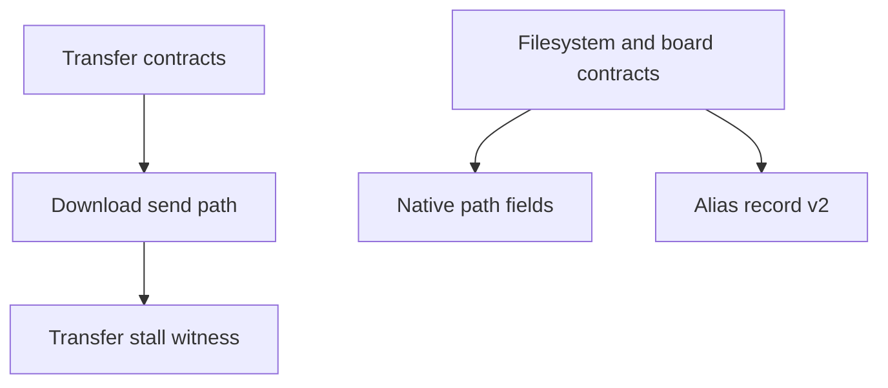

# Files and transfers

This set covers the file and folder transactions of the native Hotline Server
1.9 and the transfer connections that carry their data. It records the transfer
contracts for ordinary, folder and banner transfers and their HTXF connections,
the send path of an ordinary download, the filesystem operations of list, info,
rename, move, delete, folder creation and alias creation, the structured path
fields 212 and 325, and the recorded identity of an alias. It also records a
failed baseline transfer. The documents mark which statements are
[observed](../glossary.md#observed), which are read from source, and which
remain [unresolved](../glossary.md#unresolved). The set deliberately leaves the
wire layouts of the request and reply fields to the
[protocol](../protocol/README.md) set, the access bits that gate each operation
to the accounts and privileges set, and the threaded news transactions to the
news set. The identified client evidence is in the peers set, and the
validation of the mxd implementation is in the [mxd](../mxd/README.md) set.

## Where to start

The [transfer contracts](transfer-contracts.md) document is the entry point for
transfers. It covers the HTXF connection header, dispatch, the queue, the
folder states and the captured boundaries. The
[native download send path](native-download-send-path.md) document follows a
successful ordinary download through its producer, and the
[native transfer stall](native-transfer-stall.md) document records the failed
baseline that a later reading must explain.

The filesystem operations form a second line. The
[filesystem and board contracts](filesystem-and-board-contracts.md) document is
the entry point for them. Read the [native path fields](native-path-fields.md)
witness after it. The protocol guide's move and folder creation sections point
to the path contracts for fields 212 and 325, which that witness covers. The
[alias record v2](alias-record-v2.md) schema is a separate decoder for an
extracted alias payload, and it can be read after the filesystem contracts when
alias identity is the question.

For screen readers: the diagram shows the transfer contracts at the top of one
line, which leads to the download send path and then to the transfer stall. A
second line starts at the filesystem and board contracts, which lead to the
native path fields and to the alias record.

_Figure 1: Suggested reading order of the files and transfers set, in two
lines: transfers from the contracts to the stall, and filesystem operations
from the contracts to the path fields and the alias record._

## Documents

The kind names what a document is: a contract states the rules that its
evidence supports, a schema gives byte or field layouts, a trace records a
static reading of code, and a witness records an observed run.

| Document                                                            | What it covers                                                                                                                                                                   | Kind      |
| ------------------------------------------------------------------- | -------------------------------------------------------------------------------------------------------------------------------------------------------------------------------- | --------- |
| [Transfer contracts](transfer-contracts.md)                         | The HTXF connection header and dispatch, the queue, the folder transfer states and captured transfer boundaries, from static analysis and captured fixtures.                     | contract  |
| [Filesystem and board contracts](filesystem-and-board-contracts.md) | File-info presence by target kind, and the rename, move, delete, folder creation and alias outcomes, from preserved handlers and captures.                                       | contract  |
| [Native ordinary-download send path](native-download-send-path.md)  | A static trace of a successful request 202 into an attached HTXF ordinary download, with the variables that a future stall investigation could measure.                          | trace     |
| [Disposable lab transfer stall](native-transfer-stall.md)           | A failed disposable-lab baseline, which stopped at 98,304 bytes and so cannot count as a ban result.                                                                             | witness   |
| [Native 1.9 structured path observations](native-path-fields.md)    | One disposable run of the structured path fields 212 and 325, with the direct replies and listing readbacks recorded for each case.                                              | witness   |
| [Recorded Alias Record v2 identity](alias-record-v2.md)             | The layout and fail-closed decoder rules for an extracted version-2 alias payload, which records identity without resolving a live target.                                       | schema    |
| [Evidence index](evidence.md)                                       | The corpora, ledger identifiers and gap identifiers that the documents of this set cite, with the documents and sections that cite each. Generated by `tools/check_evidence.py`. | reference |

_Table 1: The documents of the files and transfers set._

## Evidence

The documents in this set cite gap-remediation corpora, each recorded with a
manifest, and the static traces also cite decompilation query records under the
`hotline-server-1.9` evidence directory. Examples are the
[native transfer stall corpus](../../evidence/gap-remediation/2026-11-13/native-transfer-stall-01/manifest.json),
the
[native path fields corpus](../../evidence/gap-remediation/2026-11-14/native-path-fields-01/manifest.json)
and the
[native download send path corpus](../../evidence/gap-remediation/2026-11-13/native-download-send-path-01/manifest.json).
The procedure for re-verifying the retained evidence is in the
[guide to recreating the evidence](../native-evidence/recreating-evidence.md).

## Open questions

The
[ledger of remaining evidence work](../provenance/remaining-evidence-work.md)
lists the gaps that are not Resolved. The [gap analysis](../../gap-analysis.md)
holds the full text of each gap.

The ledger lists these gaps as not Resolved, and this set cites them or names
its documents as the prepared work:

- [GAP-005]: connection timers and liveness.
- [GAP-020]: date and timestamp semantics.
- [GAP-021]: ACK versus completion, durability
  and retry.
- [GAP-033]: identifier lifetimes.
- [GAP-050]: delete semantics and failures.
- [GAP-053]: move collision and metadata
  behaviour.
- [GAP-054]: alias creation and resolution.
- [GAP-064]: transfer completion, failure and
  persistence.

The documents also cite the following gaps. The ledger does not list them as
not Resolved, and this overview does not restate their status: [GAP-010],
[GAP-037], [GAP-044], [GAP-046], [GAP-047], [GAP-049], [GAP-051], [GAP-052],
[GAP-055], [GAP-057], [GAP-059], [GAP-062] and [GAP-063].

## Related sets

- [Protocol](../protocol/README.md): the request and reply layouts of
  transactions 200 to 214 and the HTXF header. Go there for field-level detail.
- [Presence and messaging](../presence-and-messaging/README.md): the notices
  that a transfer or a ban produces, and the presence documents that cite the
  transfer contracts. Go there for transfer state seen by other users.
- [Accounts and privileges](../accounts-and-privileges/README.md): the file and
  folder privilege bits that gate each operation. Go there for who may act.
- [News](../news/README.md): the legacy message board, which the filesystem
  contracts also cover. Go there for board behaviour.
- [Peers](../peers/identified-client-source.md): identified client evidence for
  how a client handles transfers.
- [mxd](../mxd/README.md): the separate server implementation and its checks of
  file and transfer behaviour.
- [Native evidence](../native-evidence/recreating-evidence.md): the preparation
  and witness documents for the transfer and path runs, and how to re-verify
  them.
- [Provenance](../provenance/remaining-evidence-work.md): the ledger of
  remaining evidence work and the open gaps.

[GAP-005]: ../../gap-analysis.md#gap-005
[GAP-010]: ../../gap-analysis.md#gap-010
[GAP-020]: ../../gap-analysis.md#gap-020
[GAP-021]: ../../gap-analysis.md#gap-021
[GAP-033]: ../../gap-analysis.md#gap-033
[GAP-037]: ../../gap-analysis.md#gap-037
[GAP-044]: ../../gap-analysis.md#gap-044
[GAP-046]: ../../gap-analysis.md#gap-046
[GAP-047]: ../../gap-analysis.md#gap-047
[GAP-049]: ../../gap-analysis.md#gap-049
[GAP-050]: ../../gap-analysis.md#gap-050
[GAP-051]: ../../gap-analysis.md#gap-051
[GAP-052]: ../../gap-analysis.md#gap-052
[GAP-053]: ../../gap-analysis.md#gap-053
[GAP-054]: ../../gap-analysis.md#gap-054
[GAP-055]: ../../gap-analysis.md#gap-055
[GAP-057]: ../../gap-analysis.md#gap-057
[GAP-059]: ../../gap-analysis.md#gap-059
[GAP-062]: ../../gap-analysis.md#gap-062
[GAP-063]: ../../gap-analysis.md#gap-063
[GAP-064]: ../../gap-analysis.md#gap-064
