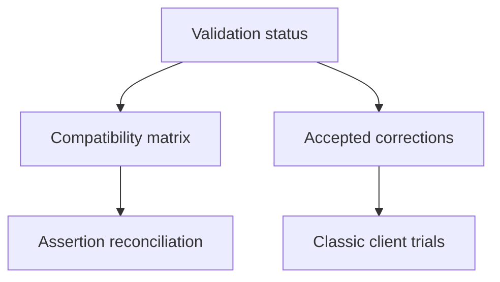

# mxd validation

This set records how the mxd server has been checked against the Hotline 1.9
protocol documentation, what was corrected as a result, and where the work
stopped. mxd is a separate implementation kept outside this repository; the
[glossary](../glossary.md#mxd) says what it is. Nothing here is a release
sign-off or a claim that mxd is fully compatible with the native server.

## State of the work

Validation has been on hold since 13 November 2026. Three corrections were
accepted before the hold: framing limits, direct replies and successful login
extras. Two Classic client trials were run against an isolated fixture, and one
failed and one reached a partial startup. The
[validation status](validation-status.md) is the place to resume from: it
records the gate results, what remains and a bounded proposal for the next
correction.

The documents in this set were consolidated from eight earlier notes. Where
those notes disagreed and the evidence does not decide, both statements are
kept, each attributed to the note it came from, in a paragraph that begins
"Unreconciled:". Such paragraphs record open questions; they are not errors in
this set.

## Reading order

For screen readers: the following diagram shows the five documents of the set
and the order in which to read them. The validation status comes first. From
it, one path leads to the compatibility matrix and then to the assertion
reconciliation, and another leads to the accepted corrections and then to the
Classic client trials.

_Figure 1: Reading order of the mxd validation set._

| Document                                                | Question it answers                                                                                      |
| ------------------------------------------------------- | -------------------------------------------------------------------------------------------------------- |
| [Validation status](validation-status.md)               | What has been validated, at which revision, with which results, and what remains?                        |
| [Compatibility matrix](compatibility-matrix.md)         | How do native behaviour, the SynHX and identified client evidence, and mxd policy compare, item by item? |
| [Assertion reconciliation](assertion-reconciliation.md) | Which mxd test assertions agree with the corrected baseline, and which do not?                           |
| [Accepted corrections](corrections.md)                  | What did each of the three corrections change, and what evidence accepted it?                            |
| [Classic client trials](classic-client-trials.md)       | What did the two trials show, what do they not establish, and how is a trial run?                        |

_Table 1: The documents of the mxd validation set._

## Revisions examined

The documents name the mxd revisions and the binary below. Each row gives the
document that records what was done at that revision.

| Identifier                                                         | Kind           | What the documents record                                                           | Recorded in                                                                                     |
| ------------------------------------------------------------------ | -------------- | ----------------------------------------------------------------------------------- | ----------------------------------------------------------------------------------------------- |
| `2e4c9c1df20b37a6f98a1369e0a8f09f9ee2a131`                         | mxd revision   | The focused review of test assertions, and the base before the corrections          | [Assertion reconciliation](assertion-reconciliation.md), [accepted corrections](corrections.md) |
| `481294915b48f4db06943c8af86cf31b7e47597a`                         | mxd commit     | The accepted framing and memory-limit correction                                    | [Accepted corrections](corrections.md)                                                          |
| `20e891a059de7dd9dec5a657d7099570987d860d`                         | mxd commit     | The direct-reply correction                                                         | [Accepted corrections](corrections.md)                                                          |
| `50360bebff2c79a54272453ce734251be619c274`                         | mxd commit     | The watchdog test made to wait for actual cancellation                              | [Accepted corrections](corrections.md)                                                          |
| `cb907885cc2a61df2d708f38a3cf42da85c2a016`                         | mxd revision   | The source after the login-extras correction, from which the trial binary was built | [Validation status](validation-status.md), [Classic client trials](classic-client-trials.md)    |
| `3da44eac362e1a5433eee4cace8f030e383a9c4a8ea8f587055610299c879375` | Binary SHA-256 | The `mxd-wireframe-server` trial binary                                             | [Validation status](validation-status.md), [Classic client trials](classic-client-trials.md)    |

_Table 2: mxd revisions and the trial binary named in this set._

The earlier notes do not agree on which revision is canonical; the
[validation status](validation-status.md) states each of them under
"Unreconciled:".

## Related material

- The gaps that concern mxd are listed, with what each still needs, in the
  [ledger of remaining evidence work](../provenance/remaining-evidence-work.md).
- The procedure for re-verifying the retained mxd evidence is in the
  [guide to recreating the evidence](../native-evidence/recreating-evidence.md).
