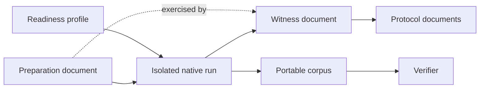

# Native evidence

This set holds the documents for runs against the
[native](../glossary.md#native) Hotline Server 1.9 binary, executed in an
emulator inside an isolated and owned lab. A
[preparation](../glossary.md#preparation) sets up one run offline. A
[witness](../glossary.md#witness) records what that run produced. Other
documents describe the procedure for producing and re-verifying the evidence,
the readiness profile that control-only runs apply, one recovery, and one
source trace. The set does not restate the protocol claims that cite it, and it
does not record which of those claims are settled. Those are in the
[protocol guide](../protocol/protocol.md). Peer runs are in the
[peers](../peers/README.md) set, and the gaps that these runs bear on are
listed in the [provenance](../provenance/README.md) set.

## Where to start

1. Read [Recreating the evidence](recreating-evidence.md) first. It states, for
   each retained corpus, how it was produced and how to re-verify it offline.
2. Read [Reproducing native protocol captures](native-capture-workflow.md)
   next. It gives the capture procedure and the fixture groups that the
   protocol areas record.
3. Read [Native control readiness](native-control-readiness.md) before any
   control-only witness. It is the profile those witnesses name, and it
   requires their reports to record the full-file baseline as not exercised.
4. Choose a topic from the [Documents](#documents) section and read its
   preparation before its witness. The preparation says what was planned. The
   witness says what ran, and what the run did not establish.

## Documents

The 44 documents, each listed once, are grouped by topic. Most topics have a
preparation, which is the plan for a capture, and one or more witnesses, which
record what the run produced. Some documents have neither: the workflow
documents, the readiness profile, the recovery record and the source trace.
Each topic heading below states plainly whether its run has happened, or
whether it is prepared only. That status follows the pairing recorded in the
[ledger of remaining evidence work](../provenance/remaining-evidence-work.md).

The kinds of document, as they are used in the tables, are these.

- A preparation is an offline packet that sets up a fixture, a plan and operator
  checks before a run. It does not run the case.
- A witness is the retained record of an executed run. It may record a run that
  failed or stopped part way, and its document says so.
- A workflow is a procedure for producing, checking or cleaning up evidence.
- A trace is a reading of the server's code, from read-only queries, with no
  live run.
- A reference is a profile or rule that other documents apply.
- A record is a retained account of a recovery or an aborted run, kept as
  written.

The diagram below shows how a capture moves from preparation to witness, and
then to the protocol documents that cite the witness.

For screen readers: the diagram reads from left to right. A preparation
document and a readiness profile both lead to an isolated native run. The run
produces a witness document and a portable corpus. The corpus goes to a
verifier. The preparation is exercised by its witness, and protocol documents
cite the witness.

_Figure 1: How a capture moves from preparation to witness, and then to the
protocol documents that cite it._

### Workflow, readiness, recovery and focus

These documents have no preparation and witness pair, except the focus witness,
which the ledger lists without a preparation document. The focus witness
records a run that has happened. The recovery record and the readiness profile
are not paired, and the workflow documents describe procedure.

| Document                                                           | What it covers                                                                                                                                               | Kind      |
| ------------------------------------------------------------------ | ------------------------------------------------------------------------------------------------------------------------------------------------------------ | --------- |
| [Recreating the evidence](recreating-evidence.md)                  | How each retained corpus was produced, how to re-verify it offline and how to produce it again where the sources allow.                                      | workflow  |
| [Reproducing native protocol captures](native-capture-workflow.md) | The capture procedure, the emulator and application preparation, and the fixture groups recorded for each protocol area.                                     | workflow  |
| [Native control readiness](native-control-readiness.md)            | The readiness profile for control-operation fixtures on an owned disposable native server, which reports must name as control-only.                          | reference |
| [Runtime recovery, 13 November 2026](runtime-recovery-20261113.md) | The restoration of a native oracle after a host restart, from a preserved stopped image, as a bounded readiness check.                                       | record    |
| [One Log focus event](native-ui-focus-witness.md)                  | The failed mandatory full-file baseline of a stalled native download on 14 November 2026, and one verified Log focus event with no resumed output during it. | witness   |

_Table 1: Workflow, readiness, recovery and focus documents._

### Temporary-ban expiry

The run has happened. The ledger pairs the preparation with both the first and
the later epoch witnesses. Both witnesses are control-only.

| Document                                                             | What it covers                                                                                                                       | Kind        |
| -------------------------------------------------------------------- | ------------------------------------------------------------------------------------------------------------------------------------ | ----------- |
| [Temporary-ban expiry preparation](native-ban-expiry-preparation.md) | The offline packet for a separately authorized control-only expiry run, on a new disposable runtime, with two owned accounts.        | preparation |
| [Temporary-ban first epoch](native-ban-expiry-first-witness.md)      | The first epoch of a temporary ban on a disposable lab. The document states that it does not establish the expiry boundary.          | witness     |
| [Temporary-ban later epoch](native-ban-expiry-later-witness.md)      | The later epoch on the same disposable virtual machine (VM) and working image, after the pre-window that the record says was missed. | witness     |
| [Ban-expiry cleanup](native-ban-expiry-cleanup.md)                   | The stage that restores the two owned accounts after the final probe, through guard and delete plans.                                | workflow    |

_Table 2: Documents on temporary-ban expiry._

### Configured-address ban and permanent-ban control

The run has happened for both pairs. The ledger pairs each preparation with its
witness. The persisted-ban reload witness has no preparation in this set.

| Document                                                                   | What it covers                                                                                                                         | Kind        |
| -------------------------------------------------------------------------- | -------------------------------------------------------------------------------------------------------------------------------------- | ----------- |
| [Configured-address ban preparation](native-configured-ban-preparation.md) | The control-only packet for one Options > Ban save that adds the configured address, which tests the connected-client notice producer. | preparation |
| [Configured-address ban witness](native-configured-ban-witness.md)         | The connected-client notice path when an administrator adds the address in Options > Ban and saves once.                               | witness     |
| [Permanent-ban control preparation](native-ban-control-preparation.md)     | The isolated permanent-ban control fixture (C52), prepared from a stopped owned runtime.                                               | preparation |
| [Permanent-ban control witness](native-ban-control-witness.md)             | One option 2 ban in a disposable lab, under the control-only profile.                                                                  | witness     |
| [Persisted-ban reload witness](native-ban-reload-witness.md)               | One read-only restart observation of the disposable image that held the control ban. It does not validate the configured-ban producer. | witness     |

_Table 3: Documents on the configured-address ban and permanent-ban control._

### Roster overlap

The run has happened. The ledger pairs the preparation with the witness.

| Document                                                           | What it covers                                                                                                             | Kind        |
| ------------------------------------------------------------------ | -------------------------------------------------------------------------------------------------------------------------- | ----------- |
| [Roster overlap preparation](native-roster-overlap-preparation.md) | The control-only preparation for one outstanding roster request, made while another session changes its own name and icon. | preparation |
| [Roster overlap witness](native-roster-overlap-witness.md)         | The lab run of that case: one outstanding 300 request while a session-only 304 request changed a peer's name and icon.     | witness     |

_Table 4: Documents on roster overlap._

### Liveness

The run has happened. The ledger pairs the preparation with the witness, which
records a control-only run.

| Document                                               | What it covers                                                                                                                                                   | Kind        |
| ------------------------------------------------------ | ---------------------------------------------------------------------------------------------------------------------------------------------------------------- | ----------- |
| [Liveness preparation](native-liveness-preparation.md) | The control-only fixture for the liveness gaps: a seven-flow schedule inside an isolated server namespace, with its failure gates tested without native contact. | preparation |
| [Liveness witness](native-liveness-witness.md)         | One finite lab run of that schedule against an isolated Mac server, with the readiness control passed before and after.                                          | witness     |

_Table 5: Documents on liveness._

### Settings

The run has happened for all three pairs. The ledger pairs each preparation
with its witness.

| Document                                                                       | What it covers                                                                                                         | Kind        |
| ------------------------------------------------------------------------------ | ---------------------------------------------------------------------------------------------------------------------- | ----------- |
| [Settings preparation](native-settings-preparation.md)                         | Ten independent plans for field 113 of transaction 304, with the predicted outcomes not treated as results.            | preparation |
| [Settings witness](native-settings-witness.md)                                 | The bounded live matrix for field 113 of transaction 304 against the native binary, with the measured effective flags. | witness     |
| [Same-session 304 transition preparation](native-settings-transition-prep.md)  | The offline preparation of an eight-stage sequence of transaction 304 requests within one session.                     | preparation |
| [Same-session 304 transition witness](native-settings-transition-witness.md)   | One eight-stage transaction 304 sequence, between full [A7 readbacks](../glossary.md#a7-readback).                     | witness     |
| [Settings persistence preparation](native-settings-persistence-preparation.md) | The preparation for a bounded before and after restart test on a private working image.                                | preparation |
| [Settings persistence witness](native-settings-persistence-witness.md)         | The restart test on one disposable Mac OS 9 working image, with its before and after states.                           | witness     |

_Table 6: Documents on settings, transitions and persistence._

### Delayed 121 default text

The run has happened. The ledger pairs the preparation with the witness.

| Document                                                             | What it covers                                                                    | Kind        |
| -------------------------------------------------------------------- | --------------------------------------------------------------------------------- | ----------- |
| [Delayed 121 default preparation](native-121-default-preparation.md) | The offline route and fixture plan for a delayed transaction 121 response.        | preparation |
| [Delayed 121 default witness](native-121-default-witness.md)         | One 70-action, two-case delayed agreement observation, between full A7 readbacks. | witness     |

_Table 7: Documents on the delayed 121 default text._

### Private messages

The run has happened. The ledger pairs the preparation with the witness.

| Document                                                        | What it covers                                                                                                       | Kind        |
| --------------------------------------------------------------- | -------------------------------------------------------------------------------------------------------------------- | ----------- |
| [Private-message fixture preparation](native-pm-preparation.md) | The offline packet for two named admin sessions that send private messages, with the expected notices for each case. | preparation |
| [Private-message 104 witness](native-pm-witness.md)             | One seven-request transaction 108 sequence between two full A7 readbacks, with the recorded transaction 104 notices. | witness     |

_Table 8: Documents on private messages._

### Diagnostics

The runs have happened for the existing-file, density and near-boundary cases.
The near-boundary capture failed overall. The final-text boundary is prepared
only. The ledger lists it as not started, and its document is a proposal.

| Document                                                                          | What it covers                                                                                                                                  | Kind        |
| --------------------------------------------------------------------------------- | ----------------------------------------------------------------------------------------------------------------------------------------------- | ----------- |
| [Existing-file diagnostic preparation](native-diagnostic-existing-preparation.md) | The offline packet for bounded transaction 303 observations on a verified existing file.                                                        | preparation |
| [Existing-file diagnostic witness](native-diagnostic-existing-witness.md)         | The first phase: one active and one waiting download, with the General Options settings recorded.                                               | witness     |
| [Density witness](native-diagnostic-density-witness.md)                           | One fixed-density capture with eight simultaneous downloads, and its restoration postflight. It has no preparation in this set.                 | witness     |
| [Near-boundary preparation](native-diagnostic-near-preparation.md)                | The packet for the near-boundary field 101 case, predicted at 995 bytes. It is prepared but has not run.                                        | preparation |
| [Near-boundary witness](native-diagnostic-near-witness.md)                        | The failed near-boundary capture, which recorded two successful transaction 303 replies before it failed, and its restoration postflight.       | witness     |
| [Final-text boundary preparation](native-diagnostic-boundary-preparation.md)      | A proposal for one finite diagnostic cell at the 1024-byte boundary. The packet authorizes no virtual machine, service or native socket action. | preparation |

_Table 9: Documents on diagnostics._

### Rate 304 and the clock

The corrected observer-UID control is prepared only, and the ledger lists it as
not started. The three earlier rate 304 documents record runs that have
happened. The first pair failed, the startup gate stopped before protocol
contact, and the sequence records a measured prefix before a failed final
control. The clock document is a source trace, and its corpus contains no
server binary.

| Document                                                | What it covers                                                                                                                                                                  | Kind        |
| ------------------------------------------------------- | ------------------------------------------------------------------------------------------------------------------------------------------------------------------------------- | ----------- |
| [Rate 304 preparation](native-rate304-preparation.md)   | The offline preparation of the corrected observer-UID control for rate and reset. It has not run against native 1.9.                                                            | preparation |
| [Rate 304 first pair](native-rate304-first-pair.md)     | A failed first pair of rate 304 requests, which stopped at its first response wait. It establishes no limit.                                                                    | witness     |
| [Rate 304 startup gate](native-rate304-startup-gate.md) | The second rate 304 lab, which stopped before protocol contact at the emulator observation gate.                                                                                | witness     |
| [Rate 304 sequence](native-rate304-sequence.md)         | The measured prefix of one disposable run, with a failed final control.                                                                                                         | witness     |
| [Native clock evidence](native-clock-evidence.md)       | The source provenance of the server's clock path, from exact read-only [Ghidra](../glossary.md#ghidra) queries and one retained guest screenshot. It contains no server binary. | trace       |

_Table 10: Documents on rate 304 and the clock._

### Path fields

A witness exists, but it is not in this set. The completed twelve-case run is
recorded in [Native path fields](../files-and-transfers/native-path-fields.md),
in the files and transfers set, and the ledger pairs the preparation with that
witness. The preparation is listed here for the matrix that it describes.

| Document                                                    | What it covers                                                                                                                                          | Kind        |
| ----------------------------------------------------------- | ------------------------------------------------------------------------------------------------------------------------------------------------------- | ----------- |
| [Path-field preparation](native-path-fields-preparation.md) | The offline fixture for the structured path-field matrix, with the prospective endpoint inside the owned emulator namespace. It is not a native result. | preparation |

_Table 11: Documents on path fields._

### Message board

The run has happened. The ledger pairs the preparation with the witness. The
readiness failure is a separate record of an aborted lab, and the ledger does
not pair it.

| Document                                                     | What it covers                                                                                                                                           | Kind        |
| ------------------------------------------------------------ | -------------------------------------------------------------------------------------------------------------------------------------------------------- | ----------- |
| [Message board preparation](native-board-preparation.md)     | The packet for the finite 101, 102 and 103 case, which does not run it.                                                                                  | preparation |
| [Message board witness](native-board-witness.md)             | The finite isolated witness: requests 101 and 103, the 102 update, recipient access, size boundaries and stopped Hierarchical File System (HFS) storage. | witness     |
| [Board readiness failure](native-board-readiness-failure.md) | An aborted board lab on 14 November 2026. The virtual machine booted, but neither the readiness check nor the board case ran.                            | record      |

_Table 12: Documents on the message board._

### Missing-target alias

The positive rehearsal is prepared only. This set holds no witness for it and
no positive result. The ledger lists the rehearsal among the runs that have not
started, and it records the stopped attempts under the alias plan.

| Document                                                                | What it covers                                                                                                                    | Kind        |
| ----------------------------------------------------------------------- | --------------------------------------------------------------------------------------------------------------------------------- | ----------- |
| [Missing-target alias preparation](native-missing-alias-preparation.md) | The packet for the positive rehearsal (M2) only. It does not remove a target, run a server, or establish a missing-target result. | preparation |

_Table 13: Documents on the missing-target alias._

## Evidence

Each preparation and witness cites a portable corpus under
`evidence/gap-remediation/`. The corpora are listed in the
[curation file](../../evidence/curation.json). Three representative corpora:

- [Liveness corpus](../../evidence/gap-remediation/2026-11-14/native-liveness-01/manifest.json),
  a control-only run with its readiness checks.
- [Permanent-ban control corpus](../../evidence/gap-remediation/2026-11-14/native-ban-control-01/manifest.json).
- [Message board corpus](../../evidence/gap-remediation/2026-11-14/native-board-01/manifest.json).

The server binary's identity is in the
[program manifest](../../evidence/hotline-server-1.9/manifest.json). How each
corpus is produced and re-verified is set out in
[Recreating the evidence](recreating-evidence.md).

## Open questions

The gaps below are those that the documents of this set name, with the status
and title that the
[ledger of remaining evidence work](../provenance/remaining-evidence-work.md)
gives them. The ledger states neither for a gap outside its table of unresolved
gaps, and this overview states neither.

| Gap                                      | Status in the ledger | Title in the ledger                            |
| ---------------------------------------- | -------------------- | ---------------------------------------------- |
| [GAP-001](../../gap-analysis.md#gap-001) | Open                 | Define the supported 1.9 subset                |
| [GAP-003](../../gap-analysis.md#gap-003) | Not in the ledger    | Not stated in the ledger                       |
| [GAP-005](../../gap-analysis.md#gap-005) | Investigating        | Connection timers and liveness                 |
| [GAP-008](../../gap-analysis.md#gap-008) | Not in the ledger    | Not stated in the ledger                       |
| [GAP-015](../../gap-analysis.md#gap-015) | Not in the ledger    | Not stated in the ledger                       |
| [GAP-016](../../gap-analysis.md#gap-016) | Investigating        | Absent, empty and zero-valued fields           |
| [GAP-017](../../gap-analysis.md#gap-017) | Not in the ledger    | Not stated in the ledger                       |
| [GAP-018](../../gap-analysis.md#gap-018) | Investigating        | Text encoding and transformations              |
| [GAP-019](../../gap-analysis.md#gap-019) | Investigating        | Semantic length limits and truncation          |
| [GAP-020](../../gap-analysis.md#gap-020) | Investigating        | Date and timestamp semantics                   |
| [GAP-021](../../gap-analysis.md#gap-021) | Investigating        | ACK versus completion, durability and retry    |
| [GAP-026](../../gap-analysis.md#gap-026) | Investigating        | Meaning and lifetime of login extras           |
| [GAP-029](../../gap-analysis.md#gap-029) | Not in the ledger    | Not stated in the ledger                       |
| [GAP-030](../../gap-analysis.md#gap-030) | Not in the ledger    | Not stated in the ledger                       |
| [GAP-035](../../gap-analysis.md#gap-035) | Not in the ledger    | Not stated in the ledger                       |
| [GAP-036](../../gap-analysis.md#gap-036) | Investigating        | Disconnect notification and cleanup            |
| [GAP-037](../../gap-analysis.md#gap-037) | Not in the ledger    | Not stated in the ledger                       |
| [GAP-044](../../gap-analysis.md#gap-044) | Not in the ledger    | Not stated in the ledger                       |
| [GAP-045](../../gap-analysis.md#gap-045) | Investigating        | Flood, spam and throttling outcomes            |
| [GAP-046](../../gap-analysis.md#gap-046) | Not in the ledger    | Not stated in the ledger                       |
| [GAP-047](../../gap-analysis.md#gap-047) | Not in the ledger    | Not stated in the ledger                       |
| [GAP-050](../../gap-analysis.md#gap-050) | Investigating        | Delete semantics and failures                  |
| [GAP-053](../../gap-analysis.md#gap-053) | Investigating        | Move collision and metadata behaviour          |
| [GAP-054](../../gap-analysis.md#gap-054) | Investigating        | Alias creation and resolution                  |
| [GAP-065](../../gap-analysis.md#gap-065) | Not in the ledger    | Not stated in the ledger                       |
| [GAP-071](../../gap-analysis.md#gap-071) | Investigating        | Account field 111                              |
| [GAP-072](../../gap-analysis.md#gap-072) | Investigating        | Account update, placeholder and identity rules |
| [GAP-074](../../gap-analysis.md#gap-074) | Not in the ledger    | Not stated in the ledger                       |
| [GAP-084](../../gap-analysis.md#gap-084) | Not in the ledger    | Not stated in the ledger                       |
| [GAP-087](../../gap-analysis.md#gap-087) | Not in the ledger    | Not stated in the ledger                       |

_Table 14: Gaps named by the native evidence documents, with the status and
title that the ledger gives them._

## Related sets

- [Protocol guide](../protocol/protocol.md): cites many of these witnesses for
  its claims.
- [Rate path contract](../presence-and-messaging/rate304-contract.md): the
  source prediction that the rate 304 documents test.
- [Native path fields](../files-and-transfers/native-path-fields.md): the
  witness for the path-field preparation.
- [Native transfer stall](../files-and-transfers/native-transfer-stall.md): the
  record of the 98,304-byte stall that the failed full-file baselines show.
- [Peers](../peers/README.md): the Classic client and shx records.
- [mxd validation](../mxd/README.md): the mxd checks, which are on hold.
- [Provenance](../provenance/README.md): the ledger of remaining evidence work
  and the handoff note.
- [Glossary](../glossary.md): the defined terms used here.
