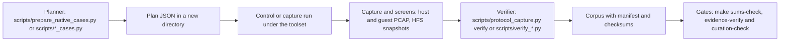

# Recreating the evidence

This guide states, for each retained corpus in this repository, how it was
produced, how to re-verify it offline, and how to produce it again where the
sources allow. The toolset that captured the evidence is
[mothra](https://github.com/leynos/mothra/blob/2278968b622eab731e4ba2be0484cedfbab73bb7/README.md).
General set-up of that toolset is not restated here. Each step that needs it
links to the toolset guide that covers it. Terms such as
[corpus](../glossary.md#corpus), [witness](../glossary.md#witness), [preparation](../glossary.md#preparation)
and [verifier](../glossary.md#verifier) follow the [glossary](../glossary.md).

The corpora are listed in `evidence/curation.json`. That file records 203
included corpora, which [Table 5](#11-corpus-families) covers, and 155 excluded
corpora, which this guide does not need to recreate. Commands are written from
the root of this repository. The source documents run the same commands from an
adjacent mothra checkout, with `../hotline-protocol-docs/scripts/` as the path
prefix. Only that prefix differs. The flags and arguments are as the sources
record them.

In prose and tables, dates are written as `11-12` to `11-15`, which stand for
2026-11-12 to 2026-11-15. File paths always give the full date.

## 1. Scope and levels of recreation

The word "recreate" has three levels here. Each level needs a different set of
prerequisites. The guide names the prerequisites without explaining them.

1. Re-verify retained evidence offline. The reader checks a corpus against its
   recorded hashes and claims. The emulator, Ghidra and the network are not
   needed. The prerequisites are a checkout of this repository, the Make
   targets in [Table 1](#3-re-verifying-retained-evidence-offline), and, for
   one check, a local copy of the withheld server binary described in
   [Table 2](#withheld-files).
2. Regenerate a plan offline. A planner writes the capture plans for a corpus
   into a new directory. The planner reads a runtime record. This repository
   consumes that record but does not create it. The record comes from the
   toolset's readiness and receipt guides, such as
   [native capture receipt](https://github.com/leynos/mothra/blob/2278968b622eab731e4ba2be0484cedfbab73bb7/docs/native-capture-receipt.md)
   and
   [phased native emulator readiness](https://github.com/leynos/mothra/blob/2278968b622eab731e4ba2be0484cedfbab73bb7/docs/native-emulator-readiness.md).
3. Re-run a capture. The plans run against a native server or a peer inside an
   emulator. This needs the whole toolset: an emulator, a staged application,
   packet recorders, Sleuth Kit for stopped-disk reads and Ghidra for static
   queries. The steps for each kind of evidence are in sections
   [4](#4-native-captures) to [9](#9-static-decompilation-evidence).

## 2. Orientation

For screen readers: The following flowchart runs from a planner, through a plan
and a capture run under the toolset, to a verified corpus that the gates check.



_Figure 1: Pipeline from planner to verified corpus._

## 3. Re-verifying retained evidence offline

Run the targets from the root of this repository. Each target is defined in the
`Makefile`, so the commands are the same commands that the gates run. Table 1
gives what each target runs and what a successful run reports.

| Target                           | What it runs                                                                                  | Success and expected output                                                                                                                                                                     | Gate status                                 |
| -------------------------------- | --------------------------------------------------------------------------------------------- | ----------------------------------------------------------------------------------------------------------------------------------------------------------------------------------------------- | ------------------------------------------- |
| `make evidence-verify`           | 88 recipe lines in the `evidence-verify` target, one for each corpus verifier or unittest run | Exit status 0. Several verifiers print a JSON verdict of their checks, for example `verify_native_core.py`. The sources record no single success string for all of them.                        | In `make all`                               |
| `make evidence-verify-known-red` | `scripts/verify_classic_field161_matrix.py` on `classic-field161-01`                          | Expected to fail with `ValueError: capture gate source identity`. This is the known condition under decision D18.                                                                               | Not in `all`                                |
| `make test-legacy`               | `python3 -m unittest discover -s scripts -p 'test_*.py'`                                      | Runs only `scripts/test_verify_native_path_fields.py`, the unittest file left beside the scripts. The test `test_original_corpus_replays` is in `scripts/tests/` and is not run by this target. | Not in `all`                                |
| `make goldens-check`             | Re-runs the legacy planners, verifiers and tests and compares them with `tests/goldens`       | A comparison verdict from `tools/capture_goldens.py compare`. It takes three to ten minutes.                                                                                                    | Not in `all`                                |
| `make sums-check`                | `tools/check_sums.py check` over every `SHA256SUMS` under `evidence/`                         | A summary of the form `N sums files, M entries: A ok, W withheld, X not imported, …`, as the module documents it.                                                                               | In `all`                                    |
| `make lfs-check`                 | `tools/check_sums.py lfs`                                                                     | Checks that exactly the PNG, PCAP and gzip evidence is stored in Git LFS.                                                                                                                       | In `all`                                    |
| `make withheld-check`            | `tools/check_withheld.py check --root .`                                                      | Exit status 0 on success, 1 for findings and 2 for missing inputs. Table 2 describes the withheld files.                                                                                        | In `all`; skipped if the manifest is absent |
| `make audit-check`               | `scripts/render-protocol-gap-analysis.py --check`                                             | Validates the gap register against the audit revision and `gap-analysis.md`.                                                                                                                    | In `all`                                    |
| `make curation-check`            | `tools/curate_evidence.py check` with the citation arguments                                  | Confirms that the imported corpora match `evidence/curation.json` and that every citation resolves.                                                                                             | In `all`                                    |
| `make import-check`              | `curation-check`, plus a comparison with the mothra commit `IMPORT_COMMIT`                    | As `curation-check`, and each included file is compared with a local mothra checkout at the import commit. It needs `MOTHRA` to be set.                                                         | Not in `all`                                |

_Table 1: Make targets that re-verify retained evidence, with what each runs
and the success it reports._

The `evidence-verify` recipes are the authoritative mapping from a verifier to
its corpus. A recipe that is not listed there is not run by `make all`. Some
recipes run inside a temporary copy of `scripts/` and `evidence/`, in a
directory named `hotline-protocol-docs`, through the `in_legacy_layout` macro.
The macro lets legacy verifiers that expect that directory name pass in any
checkout.

### Withheld files

The Hotline Server 1.9 binary and the forks derived from it are third-party
material that the project does not publish. `evidence/withheld.json` records
their size, hash and fork kind, so that a reader who holds a copy can verify
it. The `.gitignore` file names each withheld path, and it says that a local
copy may sit at each path.

| Path                                                                                                  | Bytes  | SHA-256                                                            | Fork       | Read by                                                                                                                            |
| ----------------------------------------------------------------------------------------------------- | -----: | ------------------------------------------------------------------ | ---------- | ---------------------------------------------------------------------------------------------------------------------------------- |
| `evidence/hotline-server-1.9/inputs/HLserver19.pef`                                                   | 616821 | `ad7040db4eb67aef1308d915d80305dc96b4aa437a5b3654ea9bb76ab2e4cd1b` | Data (PEF) | The `sha256sum` recipe in `evidence-verify`; `scripts/peer_tolerance_run.py`; the `--oracle-binary` argument of the capture runner |
| `evidence/gap-remediation/2026-11-12/batch-09/inputs/HLserver19.appledouble`                          | 38542  | `9ab8b9ec708ccdb8a4fed99b00162fd087c108b6039c7acc5943145bad419c2f` | Container  | Rebuilt from the tracked BSDIFF40 patch when its base is present (`tools/check_withheld.py`)                                       |
| `evidence/gap-remediation/2026-11-13/native-ban-one-01/preparation/preboot-app/catalog-11183.data`    | 616821 | `ad7040db4eb67aef1308d915d80305dc96b4aa437a5b3654ea9bb76ab2e4cd1b` | Data       | `scripts/verify_native_ban_one.py`                                                                                                 |
| `evidence/gap-remediation/2026-11-13/native-ban-one-01/preparation/preboot-app/catalog-11183.rsrc`    | 38460  | `fe83a2cfaacd80e998a8ca274a828a0196d5cd5c4db59b06c1763cb3c1c48b12` | Resource   | `scripts/verify_native_ban_one.py`                                                                                                 |
| `evidence/gap-remediation/2026-11-13/native-runtime-recovery-01/preboot-app/catalog-11183.data`       | 616821 | `ad7040db4eb67aef1308d915d80305dc96b4aa437a5b3654ea9bb76ab2e4cd1b` | Data       | No verifier in `scripts/` reads it                                                                                                 |
| `evidence/gap-remediation/2026-11-13/native-runtime-recovery-01/preboot-app/catalog-11183.rsrc`       | 38460  | `fe83a2cfaacd80e998a8ca274a828a0196d5cd5c4db59b06c1763cb3c1c48b12` | Resource   | No verifier in `scripts/` reads it                                                                                                 |
| `evidence/gap-remediation/2026-11-14/native-ban-expiry-later-01/raw/post/stopped-hfs/server-data.bin` | 616821 | `ad7040db4eb67aef1308d915d80305dc96b4aa437a5b3654ea9bb76ab2e4cd1b` | Data       | No verifier in `scripts/` reads it                                                                                                 |
| `evidence/gap-remediation/2026-11-14/native-ban-expiry-later-01/raw/post/stopped-hfs/server-rsrc.bin` | 38460  | `fe83a2cfaacd80e998a8ca274a828a0196d5cd5c4db59b06c1763cb3c1c48b12` | Resource   | No verifier in `scripts/` reads it                                                                                                 |

_Table 2: Withheld files, with their recorded sizes and hashes from
`evidence/withheld.json`, and the readers that the search of `scripts/` found._

The withheld-files check treats a missing withheld file as a note, reported as
`withheld (absent)`, and not as a failure. When a local copy is present, the
check requires its size and SHA-256 to match the manifest. The `sha256sum`
recipe in `evidence-verify` does not have that tolerance. It checks
`evidence/hotline-server-1.9/SHA256SUMS`, which lists the binary, so that
recipe fails with a missing-file error unless a local copy is at the recorded
path. The sources do not record, for each verifier in `evidence-verify`,
whether it reads a withheld file. Table 2 gives the readers that the search of
`scripts/` found.

### Known conditions

- **Field 161 verifier (decision D18).** `make evidence-verify-known-red` runs
  `scripts/verify_classic_field161_matrix.py` on
  `evidence/gap-remediation/2026-11-14/classic-field161-01`. The expected
  result is `ValueError: capture gate source identity`. The corpus records the
  SHA-256 of the toolset's `capture_readiness.py`, the gate described in the
  [capture readiness guide](https://github.com/leynos/mothra/blob/2278968b622eab731e4ba2be0484cedfbab73bb7/docs/capture-readiness.md),
  which has changed since the corpus was recorded. Decision D18 says that "the
  red baseline is recorded, not repaired"
  (`docs/execplans/documentation-reconcilliation.md`). The target is not in
  `make all`.
- **Legacy unittest run.** `make test-legacy` runs only the unittest file left
  beside the scripts, `scripts/test_verify_native_path_fields.py`. The test
  `test_original_corpus_replays` now lives in
  `scripts/tests/test_verify_classic_field161_matrix.py`, which `make test`
  runs.

### Pinned scripts and full history

Some corpora record the SHA-256 of a script that took part in their capture.
The verifiers compare that hash with the script as it stood at a recorded
commit, listed in `scripts/pinned-sources.json`, and not with the working copy,
so a script can be maintained without invalidating the evidence it produced.
`make pins-check` confirms that each recorded commit still holds the recorded
bytes. These checks read Git history, so they need a full clone; in a shallow
clone they fail with a message that names the missing commit.

## 4. Native captures

Native captures are runs of the Hotline Server 1.9 binary in its emulator, with
host and guest packet recordings. The procedure is in
`native-capture-workflow.md`. The emulator and guest set-up is general toolset
work, and the steps below link to it.

### Procedure

The order below follows `native-capture-workflow.md`. The steps that are
general toolset work are linked, not restated.

1. Prepare the stopped runtime and the application. The runtime and disk
   preparation is toolset work. See
   [Build the emulator and prepare a runtime](https://github.com/leynos/mothra/blob/2278968b622eab731e4ba2be0484cedfbab73bb7/docs/preparing-a-capture-run.md#build-the-emulator-and-prepare-a-runtime)
   and
   [Prepare and launch](https://github.com/leynos/mothra/blob/2278968b622eab731e4ba2be0484cedfbab73bb7/sheepshaver.md#prepare-and-launch).
   The project step is to copy the exact application into the shared folder.
   The source records this command, with its arguments written as placeholders
   here. It is under "Prepare the emulator and application" in
   `native-capture-workflow.md`:

   ```sh
   uv run --group dev python scripts/prepare_hotline_server.py \
     <extracted-server-archive> \
     <runtime>/shared/Hotline19
   ```

   The script verifies the oracle data-fork hash and the bounded AppleDouble
   entries. The data fork has SHA-256
   `ad7040db4eb67aef1308d915d80305dc96b4aa437a5b3654ea9bb76ab2e4cd1b` and
   616821 bytes. The resource fork has SHA-256
   `fe83a2cfaacd80e998a8ca274a828a0196d5cd5c4db59b06c1763cb3c1c48b12` and 38460
   bytes (Table 2). `HLserver19.Classic` has a different data fork and is not a
   substitute.
2. Launch the server and check its identity in stages. The stages are the
   toolset's. See
   [Verify the guest in stages](https://github.com/leynos/mothra/blob/2278968b622eab731e4ba2be0484cedfbab73bb7/docs/preparing-a-capture-run.md#verify-the-guest-in-stages)
   and
   [Launch the recorders](https://github.com/leynos/mothra/blob/2278968b622eab731e4ba2be0484cedfbab73bb7/docs/capture-readiness.md#launch-the-recorders).
   A listening proxy is not proof that the server runs.
3. Obtain the current runtime record. The planners take it through
   `--runtime-record`. The sources do not record the command that creates it,
   so it is not recorded here.
4. Generate the plans into a new directory. The generator refuses an existing
   directory for the framing suite. The shape of the command is recorded under
   "Recorded native framing fixtures" in `native-capture-workflow.md`:

   ```sh
   uv run --group dev python scripts/prepare_native_cases.py framing \
     --runtime-record state/native-sessions/runtime-05/runtime.json \
     --output state/native-sessions/framing-repeat-plans
   ```

   Each family takes its own suite names (Table 3). The planner writes one plan
   JSON file for each case.
5. Start the host loopback recorder and the guest Ethernet recorder before the
   first plan. Both are toolset work. The guest boundary is described in
   [Observe the guest Ethernet boundary](https://github.com/leynos/mothra/blob/2278968b622eab731e4ba2be0484cedfbab73bb7/sheepshaver.md#observe-the-guest-ethernet-boundary),
   and the recorders in
   [Launch the recorders](https://github.com/leynos/mothra/blob/2278968b622eab731e4ba2be0484cedfbab73bb7/docs/capture-readiness.md#launch-the-recorders).
6. Run each plan into a fresh directory. The capture runner is recorded as:

   ```sh
   uv run --group dev python scripts/protocol_capture.py capture \
     state/native-sessions/framing-repeat-plans/<case>.json \
     --oracle-binary evidence/hotline-server-1.9/inputs/HLserver19.pef \
     --output state/native-sessions/<fresh-directory>
   ```

   The `--oracle-binary` argument names the withheld binary in Table 2. Use a
   new output directory for each plan. Families whose plans need a control
   script run that script, as their preparation document records (Table 3).
   Some families run their control scripts under `sudo` or `nsenter`, as the
   documents record.
7. Stop the host recorder after the connections close. Take a complete guest
   snapshot of the recorded packets. Keep an unread control suffix separate
   from the application report.
8. Take the positive stopped-disk observations that the family requires, as
   [section 5](#5-native-stopped-disk-evidence) describes.
9. Verify the capture and then the family. The two recorded checks are:

   ```sh
   uv run --group dev python scripts/protocol_capture.py verify state/native-sessions/<fresh-directory>
   uv run --group dev python scripts/verify_native_forks.py evidence/gap-remediation/2026-11-12/native-forks-01
   ```

   The first is the capture runner's own check. The second is a family
   verifier, which runs against a retained corpus. Table 3 lists the family
   verifiers.
10. Assemble the corpus directory with the plans, reports, packet views,
    screens, stopped-disk outputs and checksums. The corpus must be a dated
    directory kept whole, as `evidence/curation.json` defines it.

### Families

Table 3 lists every native-capture corpus in this repository, grouped by
family. Each row gives the planner or suite, the control script where one
exists, and the verifier that the `evidence-verify` target runs. A verifier not
listed in `evidence-verify` is not run by `make all`.

| Family                                 | Included corpora (dates as `11-12` to `11-15`)                                                                                                                                                                           | Planner or suite                                                                                                                                                | Control script                                                                                                                      | Verifier (in `evidence-verify`)                                                                                                                                                                                                                                        | Document                                                                                                        |
| -------------------------------------- | ------------------------------------------------------------------------------------------------------------------------------------------------------------------------------------------------------------------------ | --------------------------------------------------------------------------------------------------------------------------------------------------------------- | ----------------------------------------------------------------------------------------------------------------------------------- | ---------------------------------------------------------------------------------------------------------------------------------------------------------------------------------------------------------------------------------------------------------------------- | --------------------------------------------------------------------------------------------------------------- |
| Capture runner transcript              | 11-12 `capture-tooling-01`                                                                                                                                                                                               | Synthetic plan (not recorded)                                                                                                                                   | None                                                                                                                                | `protocol_capture.py verify` on its transcript                                                                                                                                                                                                                         | `native-capture-workflow.md`                                                                                    |
| Transport and handshake                | 11-12 `native-handshake-01` (transcript) and `native-transport-01`                                                                                                                                                       | Not recorded; the plans are retained in each corpus                                                                                                             | None                                                                                                                                | `protocol_capture.py verify`; `verify_native_handshakes.py`                                                                                                                                                                                                            | `native-capture-workflow.md`                                                                                    |
| Core login and password                | 11-12 `native-core-01`                                                                                                                                                                                                   | Not recorded; the plans are retained                                                                                                                            | None                                                                                                                                | `verify_native_core.py`                                                                                                                                                                                                                                                | `native-capture-workflow.md`                                                                                    |
| Framing and correlation                | 11-12 `native-framing-01` and `native-correlation-01`                                                                                                                                                                    | `prepare_native_cases.py framing`; `prepare_native_cases.py correlation`                                                                                        | None                                                                                                                                | `verify_native_framing.py`; `verify_native_correlation.py`                                                                                                                                                                                                             | `native-capture-workflow.md`                                                                                    |
| HTXF headers                           | 11-12 `native-htxf-01`                                                                                                                                                                                                   | `prepare_native_cases.py htxf`                                                                                                                                  | None                                                                                                                                | `verify_native_htxf.py`                                                                                                                                                                                                                                                | `native-capture-workflow.md`                                                                                    |
| Ordinary files and folders             | 11-12 `native-forks-01` and `native-folder-01`                                                                                                                                                                           | `prepare_native_cases.py transfers`, then `downloads`; the `folder-*` suites                                                                                    | None                                                                                                                                | `verify_native_forks.py`; `verify_native_folders.py`                                                                                                                                                                                                                   | `native-capture-workflow.md`                                                                                    |
| Resume, queues and cleanup             | 11-12 `native-resume-01`, `native-queue-01` and `native-cleanup-01`                                                                                                                                                      | `resume-*` suites; `queues` and `queue-timer`; `cleanup-seed`, `cleanup-downloads` and `cleanup-upload`                                                         | None                                                                                                                                | `verify_native_resume.py`; `verify_native_queues.py`; `verify_native_cleanup.py`                                                                                                                                                                                       | `native-capture-workflow.md`                                                                                    |
| Banners                                | 11-12 `native-banner-01` and `native-banner-02`                                                                                                                                                                          | `banner-*` suites; `banner-format-seed`, `banner-recovery` and `banner-recovery-early`                                                                          | None                                                                                                                                | `verify_native_banners.py`; `verify_native_banner_formats.py`                                                                                                                                                                                                          | `native-capture-workflow.md`                                                                                    |
| Authentication, agreements and extras  | 11-13 `native-auth-01`, `native-agreement-01` and `native-login-extras-01`; 11-14 `native-121-defaults-01`                                                                                                               | `auth-*`, `agreement-*` and `login-extras-*` suites; `native_121_default_cases.py`                                                                              | None                                                                                                                                | `verify_native_auth.py`; `verify_native_agreements.py`; `verify_native_login_extras.py`; 121 defaults in the legacy layout                                                                                                                                             | `native-capture-workflow.md`; `native-121-default-preparation.md`                                               |
| Directories, aliases, metadata, moves  | 11-13 `native-mkdir-01`, `native-alias-01`, `native-metadata-01` and `native-move-01`                                                                                                                                    | `mkdir-*`, `alias-*`, `metadata-*` and `move-*` suites                                                                                                          | None                                                                                                                                | `verify_native_mkdir.py`; `verify_native_aliases.py`; `verify_native_metadata.py`; `verify_native_moves.py`                                                                                                                                                            | `native-capture-workflow.md`                                                                                    |
| News                                   | 11-13 `native-news-01`, `native-news-boundary-01` and `native-article-delete-01`                                                                                                                                         | `news-*`, `news-boundary-*` and `article-delete-*` suites                                                                                                       | None                                                                                                                                | `verify_native_news.py`; `verify_native_news_boundary.py`; `verify_native_article_deletion.py`                                                                                                                                                                         | `native-capture-workflow.md`                                                                                    |
| Accounts                               | 11-13 `native-account-update-01`, `native-live-accounts-01`, `native-account-batch-01` and `native-account-identity-01`                                                                                                  | `account-update-*`, `account-live-*`, `account-batch-*` and `account-identity` suites                                                                           | None                                                                                                                                | `verify_native_account_updates.py`; `verify_native_live_accounts.py`; `verify_native_account_batches.py`; `verify_native_account_identity.py`                                                                                                                          | `native-capture-workflow.md`                                                                                    |
| Rooms, messages and boards             | 11-13 `native-rooms-01`, `native-pm-01` and `native-console-broadcast-01`; 11-14 `native-board-01` and `native-board-readiness-failure-01`                                                                               | `rooms` suites; `native_pm_cases.py`; a saved console plan; `native_board_cases.py`                                                                             | `native_board_control.py` (board)                                                                                                   | `verify_native_rooms.py`; `verify_native_pm_packet.py`; `verify_native_console_broadcast.py`; `verify_native_board.py`. The readiness failure is not in `evidence-verify`.                                                                                             | `native-capture-workflow.md`; `native-board-preparation.md`                                                     |
| Diagnostics                            | 11-13 `native-diagnostics-01`, `native-diagnostic-load-01`, `native-diagnostic-existing-preflight-01`, `native-diagnostic-existing-01`, `native-diagnostic-near-01` and `native-diagnostic-density-01`                   | `native_diagnostic_cases.py`; `native_diagnostic_load_cases.py`; `native_diagnostic_existing_cases.py`; `native_diagnostic_near_cases.py`; density not recorded | None                                                                                                                                | `verify_native_diagnostics.py`; `verify_native_diagnostic_load.py`; the corpus's legacy `verify.py`, `verify_packets.py`, `verify_density.py` and `verify_partial.py`                                                                                                  | `native-diagnostic-existing-preparation.md`; `native-diagnostic-near-preparation.md`                            |
| Settings                               | 11-13 `native-settings-01` and `native-settings-transitions-01`; 11-14 `native-settings-persistence-01`                                                                                                                  | `native_settings_cases.py`; `native_settings_transition_cases.py`; `native_settings_persistence_cases.py`                                                       | `native_settings_persistence.py --run`                                                                                              | `verify_native_settings_corpus.py`; the legacy layout for `native-settings-transitions-01`; `verify_native_settings_persistence.py`                                                                                                                                    | `native-settings-preparation.md`; `native-settings-persistence-preparation.md`                                  |
| Bans                                   | 11-13 `native-ban-one-01`; 11-14 `native-ban-control-01`, `native-ban-expiry-first-01`, `native-ban-expiry-later-01`, `native-ban-expiry-preparation-01`, `native-ban-reload-01` and `native-configured-ban-01`          | `native_ban_expiry_cases.py`; `native_ban_control_cases.py`; `native_configured_ban_cases.py` (four plans); the plans of `native-ban-one-01` are not recorded   | `native_ban_expiry_control.py` (`--run --phase first` and `--phase pre`); `native_configured_ban_control.py`                        | `verify_native_ban_one.py`; `verify_native_ban_control.py`; `verify_native_ban_expiry_first.py`; `verify_native_ban_expiry_later.py`; `verify_native_ban_reload.py`; `verify_native_configured_ban.py`. The expiry preparation has no verifier in `evidence-verify`.   | `native-ban-expiry-preparation.md`; `native-ban-control-preparation.md`; `native-configured-ban-preparation.md` |
| Liveness, roster and rate limiting     | 11-13 `native-transfer-stall-01`; 11-14 `native-liveness-01`, `native-roster-overlap-01`, `native-rate304-sequence-01`, `native-rate304-first-pair-01`, `native-rate304-startup-gate-01` and `native-transfer-repeat-01` | `native_liveness_cases.py`; `native_roster_overlap_cases.py`; `native_rate304_cases.py`; transfer suites not recorded                                           | `native_liveness_control.py` (under `sudo`); `native_roster_overlap_control.py`; `native_rate304_control.py` (under `sudo nsenter`) | `verify_native_liveness.py`; `verify_native_roster_overlap.py`; `verify_native_rate304_sequence.py`; `verify_native_rate304_partial.py`; `verify_native_transfer_repeat.py`; `verify_native_transfer_stall.py`. The startup gate has no verifier in `evidence-verify`. | `native-liveness-preparation.md`; `native-roster-overlap-preparation.md`; `native-rate304-preparation.md`       |
| Bitmaps, downloads, paths and UI focus | 11-13 `native-bitmaps-01` and `native-download-send-path-01`; 11-14 `native-path-fields-01` and `native-ui-focus-01`                                                                                                     | `native_bitmap_cases.py`; `native_path_fields_cases.py`; download-send path not recorded; the UI focus plan is a document, not a script                         | `native_path_fields_control.py`                                                                                                     | `verify_native_bitmaps.py`; `verify_native_download_send_path.py`; `verify_native_path_fields.py`; `verify_native_ui_focus.py`                                                                                                                                         | `native-path-fields-preparation.md`; `native-ui-focus-witness.md`                                               |
| Missing-target alias preparations      | 11-14 `native-alias-positive-first-01`, `native-alias-preparation-04`, `native-alias-prestage-01`, `native-alias-prestage-abort-01` and `native-alias-prestage-abort-02`                                                 | `native_missing_alias_cases.py` for the rehearsal; the prestage plans are not recorded in the documents read                                                    | `native_missing_alias_control.py` (each step needs separate root approval)                                                          | None in `evidence-verify`                                                                                                                                                                                                                                              | `native-missing-alias-preparation.md`; `docs/execplans/missing-target-alias.md`                                 |
| Guard receipt                          | 11-14 `native-runner-namespace-guard-01`                                                                                                                                                                                 | Not applicable                                                                                                                                                  | None                                                                                                                                | None in `evidence-verify`                                                                                                                                                                                                                                              | Cited by the register; no document read names it                                                                |

_Table 3: Native-capture families, the corpora in each, and the planner,
control and verifier that the sources record. The 67 corpora in this table make
up family F10 in Table 5._

The sources do not give a planner or a control script for every family. The
gaps are recorded in [section 13](#13-steps-not-recorded). Several corpora,
notably the banner, account and news families, describe their plans only
through the suite names in `scripts/prepare_native_cases.py`. Each suite name
in the table is the name that the document records.

### Proof of success

A native capture is evidence when all of the following hold, as the sources
describe them:

- `protocol_capture.py verify` passes. That check covers identities, stream
  reconstruction and decoded-frame consistency. It does not make a synthetic
  test or a matching checksum into native conformance.
- The family verifier returns its verdict for the corpus. Expected failures
  stay recorded as failures. A corpus does not replace an original failed
  report with a passing one.
- Each stream reconciles in both packet views: the host loopback capture and
  the guest Ethernet capture. Unread control suffixes are kept separately, and
  each is recorded with its packet evidence.
- Positive observations are taken where the family requires them. An absent
  catalogue probe is not proof of absence.
- The runtime and application identity are recorded. The tool's local hash
  check does not identify a running process, so the operator-reported runtime
  record is kept alongside it.

### Corpus contents

The sources do not give a schema for the `manifest.json` that each native
corpus carries. They do record what a corpus must hold, and the requirement is
the same for every family:

- The exact plans as run, the reports, and the host and guest packet views.
- The runtime record: the running executable hash, the application identity
  and fork hashes, the guest environment and the server limits.
- The checksums that `protocol_capture.py capture` writes. Its output includes
  the exact plan, the report and a directory-relative `checksums.sha256`.
- For stopped-disk outputs, the command status and stderr of each read.

`evidence/curation.json` includes a corpus when a protocol document, the gap
register, the validity ledger, a capture or verifier script, or a retained
check recipe cites a path equal to or inside it. It also includes a corpus when
that corpus's manifest, plan, verification, review, README, index or sums file
cites a path inside it. The corpus directory must therefore be kept whole, with
those files in it.

## 5. Native stopped-disk evidence

Stopped-disk evidence is the file-system state of a stopped server image. The
records use Sleuth Kit to read the HFS image without starting the server. The
kind covers the positive catalogue and fork observations in the native
families, and the recovery and preboot records.

The inputs are a stopped image from the same experiment, Sleuth Kit, and a
guest whose emulator is stopped. The installation of Sleuth Kit is toolset
work. See
[Inspect a stopped disk image with Sleuth Kit](https://github.com/leynos/mothra/blob/2278968b622eab731e4ba2be0484cedfbab73bb7/docs/preparing-a-capture-run.md#inspect-a-stopped-disk-image-with-sleuth-kit).

The sources give these rules, which apply before each read:

- Stop the emulator that owns the image. Verify with a root `fuser` check that
  it exits 1 with no owner and no error output. A failed privilege check is not
  an empty result.
- Never inspect a live working image, even read-only.
- Use the catalogue IDs of the stopped image. The IDs of a historical example
  need not match.

The sources record these commands. They are quoted from
`native-capture-workflow.md`, under "Recorded native core fixtures" and
"Recorded native ordinary-file fixtures", with the catalogue number replaced by
a placeholder:

```sh
export LD_LIBRARY_PATH="$PWD/tools/sleuthkit/usr/lib64"
tools/sleuthkit/usr/bin/ifind -f hfs \
  -n /Hotline19/Files/<fixture-name> \
  "$NATIVE_RUNTIME/working.dsk"
tools/sleuthkit/usr/bin/istat -f hfs \
  "$NATIVE_RUNTIME/working.dsk" <catalogue-id>
tools/sleuthkit/usr/bin/icat -f hfs \
  "$NATIVE_RUNTIME/working.dsk" <catalogue-id>-4352-0
tools/sleuthkit/usr/bin/icat -f hfs \
  "$NATIVE_RUNTIME/working.dsk" <catalogue-id>-4353-1
```

The data fork is read as `<catalogue-id>-4352-0`, and the resource fork as
`<catalogue-id>-4353-1`. Save each output to its own file, and keep the exit
status and stderr. An absent zero-length resource attribute is not a successful
extraction.

The bounded snapshot script is `scripts/snapshot_native_hfs.py`. The folder
family records this invocation under "Recorded native folder fixtures" in
`native-capture-workflow.md`. The command below shows one `--root`. The source
passes two, one for each folder root:

```sh
uv run --group dev python scripts/snapshot_native_hfs.py \
  --image "$NATIVE_RUNTIME/working.dsk" \
  --tsk-bin tools/sleuthkit/usr/bin --catalog-range 11220 11240 \
  --root /Hotline19/Files/<owned-root> \
  --output state/native-sessions/<fresh-directory>
```

The script caps a scan at 4,096 IDs. It refuses an existing output directory
and retains every probe and fork exit code. A range with no match is not proof
of absence.

The sources state these limits, which apply to every stopped-disk observation:

- A stopped-image readback establishes the captured state. It does not prove
  restart durability.
- Record whether application Quit, OS shutdown or forced retirement was observed
  before the image is archived or another disposable disk is prepared (under
  "Recorded native core fixtures" in `native-capture-workflow.md`).
- Do not commit the full disk or the system components. Keep disks outside Git.

## 6. Classic-client and proxy sessions

These corpora record a Classic Mac client, as the sources name it, against the
native server or a controlled receiver, through a fixed login proxy. The
evidence is finite. The sources describe each session as one observation, not
as a general profile.

The general set-up of the emulator, the isolated network and the namespace
guard is toolset work. See
[Opt-in network isolation for a disposable Mac runtime](https://github.com/leynos/mothra/blob/2278968b622eab731e4ba2be0484cedfbab73bb7/docs/network-isolated-mac-runtime.md#before-a-future-client-boot)
and
[Identify the emulator and its namespace](https://github.com/leynos/mothra/blob/2278968b622eab731e4ba2be0484cedfbab73bb7/docs/peer-service-in-network-namespace.md#identify-the-emulator-and-its-namespace).
The proxy's own rules are in `classic-login-proxy.md`. The proxy takes
`--expected-netns-inode` and `--host-netns-inode` as trusted operator values,
and its guard compares them with `/proc/self/ns/net`. A user service that runs
`sudo` or `nsenter` is not an approved substitute.

Corpora and their checks:

- **Classic native baseline (`classic-proxy-baseline-01`, 11-14).** The corpus
  records two Classic attempts through the proxy, B46 and B47, against the
  native server. Its procedure is in `classic-native-baseline.md`. The offline
  replay is recorded there, under "Offline replay", as follows. The sources
  record the live run only as its observations, not as a single command.

  ```sh
  sha256sum --quiet -c evidence/gap-remediation/2026-11-14/classic-proxy-baseline-01/SHA256SUMS
  uv run --group dev python scripts/verify_classic_native_baseline.py \
    evidence/gap-remediation/2026-11-14/classic-proxy-baseline-01
  ```

  The `evidence-verify` target runs the verifier. The document also records a
  unittest run, which the `Makefile` does not run.

- **Classic proxy rehearsal (`classic-proxy-rehearsal-01`, 11-13).** This
  records one synthetic serve-path rehearsal, B29, and two Classic attempts
  that made no connection, B30 and B31. Its offline check is in
  `docs/delegation/classic-proxy-rehearsal.md`, under "Offline check". The
  `evidence-verify` target runs the tests in
  `scripts/tests/test_classic_proxy_rehearsal.py` under pytest and
  `scripts/verify_classic_proxy_rehearsal.py`.
- **First Classic peer session (`mac-peer-first-session-01`, 11-13).** One
  manual connection from the Classic client candidate. The session was stopped
  for safety after automatic HTTP requests to a public address, so it is a
  partial session. The verifier is run from `evidence-verify`, and the
  documents give its command as:

  ```sh
  uv run --group dev python scripts/verify_mac_peer_first_session.py \
    evidence/gap-remediation/2026-11-13/mac-peer-first-session-01
  ```

- **Isolated Classic session (`mac-peer-isolated-session-01`, 11-13).** One
  controlled login in a separate loopback-only namespace. The `evidence-verify`
  target runs its verifier. The document records the checks in full:

  ```sh
  sha256sum --quiet -c evidence/gap-remediation/2026-11-13/mac-peer-isolated-session-01/SHA256SUMS
  uv run --group dev python scripts/verify_mac_peer_isolated_session.py \
    evidence/gap-remediation/2026-11-13/mac-peer-isolated-session-01
  uv run --group dev pytest scripts/tests/test_mac_peer_isolated_session.py
  ```

  The verifier checks byte parity, the dynamic reference, DNS and ICMP pairing,
  the recorded times and the namespace receipts. Screens and manual actions are
  operator observations linked to the retained screenshots.
- **Classic candidate identity (`mac-peer-candidate-01`, 11-13).** Static
  identity only. The candidate was not launched. Its verification is in
  `docs/delegation/mac-peer-candidate.md`, under "Verification". No `Makefile`
  target runs it.
- **Classic roster subject and server name (`classic-roster-subject-115-01` and
  `classic-server-name-162-01`, 11-14).** Both verifiers run from
  `evidence-verify`. Their commands are recorded in
  `classic-roster-subject-115.md` and `classic-server-name-162.md`.
- **Classic field 161 (`classic-field161-01`, 11-14).** Its verifier is the
  known-red target in [Table 1](#3-re-verifying-retained-evidence-offline). Its
  status is the known condition under decision D18.
- **Classic account constructors (`client-account-constructors-01`, 11-13).**
  `scripts/verify_classic_account_constructors.py` takes no corpus argument.
  Its corpus path is fixed in the script. The `evidence-verify` target runs it,
  and a unittest in the same target runs
  `test_verify_classic_account_constructors`.
- **Classic privilege records (`classic-privilege-discovery-01` and
  `classic-privilege-followups-01`, 11-14).** Static records, with no
  `Makefile` target. See [section 9](#9-static-decompilation-evidence).

The live steps for the Classic proxy and the Classic sessions are not all
recorded as single commands in the documents read. The gaps are listed in
[section 13](#13-steps-not-recorded).

## 7. SynHX and identified peer sessions

These corpora record the historical shx client, the SynHX source snapshots and
the identified-peer tolerance runs. The client's build and its source identity
are in `shx-peer.md` and `identified-client-source.md`.

### Build the historical shx client

The sources record a repeatable build from frozen inputs. The build needs a
host compiler, make, patch, Python 3.13 or later, `rpm2cpio` and `cpio`. The
dependency packages are downloaded into `tools/shx-deps`, not installed
system-wide. The package identities and hashes are in
`evidence/gap-remediation/2026-11-13/shx-build-01/dependency-packages.json`.
The build command, recorded under "Local dependencies and build" in
`shx-peer.md`, is:

```sh
uv run --group dev python scripts/build-shx.py --deps-root tools/shx-deps \
  --output tools/shx-peer
```

The output directory must be new. The script verifies the frozen inputs,
applies the compatibility patch, and builds the terminal client. The result
identifies a build of historical source. It is not an original distributed
executable.

### Run a full session

The driver runs the client in a contained process: a read-only system root, a
repository-backed private home, and loopback networking shared with the native
guest. The sources record this command, under "Contained execution" in
`shx-peer.md`:

```sh
uv run --group dev python scripts/capture_shx_session.py \
  state/native-sessions/runtime-17/basic-plan.json \
  --binary tools/shx-peer/source/hx \
  --peer-profile tools/shx-peer/manifest.json \
  --oracle-binary evidence/hotline-server-1.9/inputs/HLserver19.pef \
  --output state/shx-session-new
```

The legacy client always saves `~/.hxvars` on a normal exit, even with `-q`.
The driver records the before-and-after identity of the real file, and it fails
if that identity changes. Run the client only through the driver. An
uncontained probe truncated an existing file in the sources' history, and its
prior contents could not be recovered.

A successful terminal match alone is not native conformance, a completed file
write or peer identity. The packet streams and the downloaded fork bytes are
verified independently.

A capture made with the current scripts records, in `driver_sha256` and the
other `*_sha256` fields, the SHA-256 of the listing
`<sha256>  scripts/<module>` over the driver's declared modules, in order. That
digest does not equal the hash of the single script file. The sibling
`*_identity` record holds the Git commit of the scripts tree, the per-file
hashes and the list of files that differed from that commit. A record with
differing files, or with no commit, is rejected by the verifiers. Checking a
record needs the full local history, not a shallow clone. Captures retained
before this change keep their single-file hash and verify as before.

For ambiguous-byte receive, a controlled receiver runs with
`scripts/serve_shx_fixture.py`, in one of four modes: `control`, `banner`,
`subject` or `banner-subject`. The readiness file identifies localhost port
15510. Verify that the listener process is live before the contained peer
starts (under "Reproducing banner and roster-subject receiver fixtures" in
`native-capture-workflow.md`). The listener's profile is
`controlled-receiver-fixture`, never native-oracle execution.

### Verify the peer corpora

Table 4 lists the peer corpora, their verifiers and the documents that describe
them.

| Corpus                       | Verifier                                                                               | Document                      |
| ---------------------------- | -------------------------------------------------------------------------------------- | ----------------------------- |
| `native-shx-01`              | `scripts/verify_native_shx.py`                                                         | `identified-client-source.md` |
| `native-shx-02`              | `scripts/verify_native_shx_extras.py`                                                  | `identified-client-source.md` |
| `shx-build-01`               | Not in `evidence-verify`. The build is recorded in `shx-peer.md`.                      | `shx-peer.md`                 |
| `synhx-profile-01`           | `scripts/verify-synhx-profiles.py`                                                     | `identified-client-source.md` |
| `delegated-peer-01`          | `scripts/verify_peer_tolerance.py` with `--source evidence/gap-remediation/2026-11-13` | `peer-tolerance-matrix.md`    |
| `peer-profile-acceptance-01` | Not in `evidence-verify`                                                               | Cited by the register         |

_Table 4: Peer corpora, their verifiers and the documents that describe them._

The shx fragment check, `scripts/verify-shx-login-fragment.py`, is run by the
`evidence-verify` target, and so it is part of `make all`. The
`identified-client-source.md` document says, under "Reproducing and checking
full peer sessions", that a check is part of `make check`. The `Makefile`
defines no `check` target, so the gates in this repository are `make all` and
the targets in [Table 1](#3-re-verifying-retained-evidence-offline).

The identified-peer tolerance run uses the withheld binary as its oracle
(`scripts/peer_tolerance_run.py`). Its planner and verifier are recorded in
`peer-tolerance-matrix.md`.

## 8. mxd peer sessions

The mxd peer work is parked. The records state that further mxd validation is
on hold at the user's instruction of 13 November 2026, and that no new
investigation or native run starts without resumption
(`docs/provenance/remaining-evidence-work.md`).

The corpora are listed in family F8 of [Table 5](#11-corpus-families). Their
offline checks are in the `evidence-verify` target:
`verify_mxd_reconciliation.py`, `verify_mxd_limits.py`,
`verify_mxd_correction.py`, `verify_mxd_direct_ack.py` on `mxd-direct-ack-02`
and `verify_mxd_login_extras.py`. The other mxd corpora have no target in
`evidence-verify`. They include `mxd-classic-login-01`,
`mxd-classic-short-login-01`, `mxd-watchdog-h1-01`, `mxd-peer-runtime-01`,
`mxd-build-recovery-01` and `mxd-validation-hold-01`.

Recreating an mxd peer run needs a checkout of the mxd implementation, which is
outside this repository. The procedure is in `mxd-peer-capture-workflow.md`. It
records a locked, offline Cargo build of the wireframe server, a fixture user
created with `create-user`, and a user service in the client's network
namespace. The steps are recorded, but the work is on hold, so this guide does
not repeat them. The namespace rules are in the toolset guide
[Do not enter the namespace from a user service](https://github.com/leynos/mothra/blob/2278968b622eab731e4ba2be0484cedfbab73bb7/docs/peer-service-in-network-namespace.md#do-not-enter-the-namespace-from-a-user-service).

## 9. Static decompilation evidence

Static evidence comes from read-only Ghidra queries against the hashed server
binary, with no network session. The ledger's method is in
`docs/baseline-validity-ledger.md`, under "Evidence method and limits". Each
query record holds its UTC capture time, the exact tool name and arguments, the
loaded program identity and hash, and the complete result. A `D-` record has a
`.c` companion with the decompiler output. An `A-` record keeps the instruction
addresses and bytes.

The toolset's guides for the Ghidra installation, the MCP bridge and the
capture of queries are
[Install GhidraMCP](https://github.com/leynos/mothra/blob/2278968b622eab731e4ba2be0484cedfbab73bb7/docs/ghidra-decompilation.md#install-ghidramcp),
the section
[Connect an MCP client](https://github.com/leynos/mothra/blob/2278968b622eab731e4ba2be0484cedfbab73bb7/docs/ghidra-decompilation.md#connect-an-mcp-client),
and
[Capture queries as evidence](https://github.com/leynos/mothra/blob/2278968b622eab731e4ba2be0484cedfbab73bb7/docs/ghidra-decompilation.md#capture-queries-as-evidence).

The ledger records this command for replaying a plan, with the same hashed
program open in CodeBrowser and its plugin enabled. It is under "Reproduce and
check the evidence" in `baseline-validity-ledger.md`:

```sh
tools/ghidramcp/.venv/bin/python scripts/capture-ghidra-evidence.py \
  evidence/hotline-server-1.9/plans/03-handshake.json \
  state/ledger-replay/queries
```

The collector refuses to overwrite existing query records. Replays get new
timestamps and may reflect changed Ghidra analysis. Compare the program hash,
the tool arguments and the results, rather than whole-file hashes.

The sources set these limits on static evidence:

- Decompiler output has inferred signatures and missing arguments. Treat
  constant stores, offsets, direct calls and checked branches as evidence. Do
  not turn a guessed C prototype into a wire contract.
- Absence of a string cross-reference is not negative evidence.

The static corpora and their checks are:

- The 17 query batches, `batch-01` to `batch-17` (family F2 in Table 5). The
  sources record each batch's manifest, but not a single command per batch in
  the documents read. The batch 09 AppleDouble is withheld (Table 2).
- `account-attribute-01`, `client-account-constructors-01` and
  `request500-client-source-01`, whose checks are in `evidence-verify`.
- `receive-limit-origin-01`. Its record, under "Reproduce the bounded query" in
  `receive-limit-origin.md`, gives an absolute path to a local checkout, which
  this guide does not reproduce.

The ledger's replay section, under "Reproduce and check the evidence", also
calls `make ledger-check`. The `Makefile` defines no such target. See
[section 13](#13-steps-not-recorded).

## 10. Source-archive extraction and packaging

The SynHX source archive is not retained in this repository. The glossary's
SynHX entry says that the entries which rely on the archive name the archive
files they used. The retained record of the server archives is
`evidence/hotline-server-1.9/synhxd-source/manifest.json`, which records 14
archives.

The extraction script `scripts/extract-synhxd-evidence.py` verifies the saved
archive copies in `evidence/hotline-server-1.9/synhxd-source`. For each saved
archive, it checks the recorded SHA-256 and then extracts the full trunk text.
The `evidence-verify` target runs it. The ledger records that the snapshots can
be verified "without needing an RCS installation" (under "Reproduce and check
the evidence" in `baseline-validity-ledger.md`). The sources do not record how
the saved copies were first made.

The other checks are:

- `scripts/verify-baseline-evidence.py`, the baseline claim verifier.
- `scripts/verify-synhx-profiles.py` and
  `scripts/verify-shx-login-fragment.py`.
- `scripts/render-protocol-gap-analysis.py --check`, through `make audit-check`.

The packaging procedure, GAP-087, builds a pair of archives from both committed
checkouts. Its record is `evidence-portability.md`. The script is
`scripts/package-protocol-evidence.py`, and its document runs it from the
mothra checkout. It refuses tracked changes and an existing destination, and it
writes to `state/protocol-exports/` in mothra. The extraction was verified from
a fresh pair: 22 commands passed, and the verification record is
`evidence/gap-remediation/2026-11-12/package-review/verification.json` (under
"Recorded extraction verification" in `evidence-portability.md`).

## 11. Corpus families

Table 5 covers every included corpus in `evidence/curation.json`. Each family
row gives the count, the kind, the document that describes it, the verifier or
recipe, and either the section that recreates it or the reason it cannot be
recreated. The native row refers to [Table 3](#families), which names each of
the 67 native-capture corpora, including the capture runner transcript. The 155
excluded corpora are outside this guide. Their names begin with
`export-review-`, `export-cache-`, `delegated-integration-` or
`native-integration-`. They also include `protocol-gap-analysis` revisions 08
to 79 and 82 to 84, and a few others. The record gives the reason for each
exclusion.

Two local audit revisions, `revision-90` and `revision-91` under
`evidence/protocol-gap-analysis/2026-11-15/`, are listed in
`evidence/local-corpora.json`. They are not mothra imports and are not in the
curation count. The sources record no recreation procedure for them beyond the
audit check.

| Family                                      | Kind                                     | Included | Corpora                                                                                                                                                                                                                                                                                                                                                                                                                                                                                                                                                                                                                                   | Described by                                                                                                        | Verifier or recipe                                                                                                | Recreate                                                                                                                        |
| ------------------------------------------- | ---------------------------------------- | -------: | ----------------------------------------------------------------------------------------------------------------------------------------------------------------------------------------------------------------------------------------------------------------------------------------------------------------------------------------------------------------------------------------------------------------------------------------------------------------------------------------------------------------------------------------------------------------------------------------------------------------------------------------- | ------------------------------------------------------------------------------------------------------------------- | ----------------------------------------------------------------------------------------------------------------- | ------------------------------------------------------------------------------------------------------------------------------- |
| F1 Oracle inputs and records                | Oracle and SynHX snapshots               | 5        | `evidence/hotline-server-1.9/`: `(root)`, `inputs` (withheld binary), `plans`, `queries` and `synhxd-source`                                                                                                                                                                                                                                                                                                                                                                                                                                                                                                                              | `baseline-validity-ledger.md`; `evidence-portability.md`                                                            | `sha256sum`, `extract-synhxd-evidence.py` and `verify-baseline-evidence.py` in `evidence-verify`                  | Queries: section 9. SynHX snapshots: section 10. `inputs`: not recreated, because it is withheld (Table 2).                     |
| F2 Static query batches                     | Ghidra query records                     | 17       | `evidence/gap-remediation/2026-11-12/batch-01` to `batch-17`                                                                                                                                                                                                                                                                                                                                                                                                                                                                                                                                                                              | `baseline-validity-ledger.md`; the batch manifests                                                                  | None in `evidence-verify`                                                                                         | Section 9. `batch-09` holds a withheld AppleDouble.                                                                             |
| F3 Audit snapshots                          | Hashed document snapshots                | 20       | 11-12: `SHA256SUMS`, `initial-gap-register.json`, `initial-renderer.py.txt`, `inputs`, `manifest.json`, `revision-01` to `revision-07` and `sections.json`; 11-14: `revision-80`, `revision-81`, `revision-85`, `revision-86`, `revision-87` and `revision-88`; 11-15: `revision-89`                                                                                                                                                                                                                                                                                                                                                      | `gap-analysis.md`; `gap-register.json`                                                                              | `make audit-check`                                                                                                | Not recreated. These are dated snapshots, checked by hash, and the sources give no procedure to regenerate an earlier revision. |
| F4 Closure reviews                          | Review records                           | 24       | 11-12: `closure-review-01` to `closure-review-13`; 11-13: `closure-review-14` to `closure-review-24`                                                                                                                                                                                                                                                                                                                                                                                                                                                                                                                                      | Cited by the gap register                                                                                           | None                                                                                                              | Not recreated. These are review records, and no procedure is recorded.                                                          |
| F4b Criterion, acceptance and review        | Review and analysis records              | 14       | 11-13: `failure-criterion-review-01`, `failure-representatives-01`, `multiplicity-acceptance-01`, `multiplicity-criterion-01` and `timer-suspension-01`; 11-14: `criterion-acceptance-03` to `criterion-acceptance-07`, `emulator-readiness-review-01`, `remaining-leaf-audits-01`, `scalar-width-contract-01` and `settings-default-acceptance-01`                                                                                                                                                                                                                                                                                       | The named documents and the register                                                                                | `failure-criterion-review-01` (legacy `verify.py.txt`, in `evidence-verify`); the others have none                | `failure-criterion-review-01`: section 3. The others: not recreated, as recorded review material.                               |
| F5 Static decompilation and source analysis | Static analysis                          | 21       | 11-13: `account-attribute-01`, `account-resource-01`, `client-account-constructors-01`, `native-ban-oracle-01`, `receive-limit-origin-01` and `request500-client-source-01`; 11-14: `account-write-ordering-01`, `account111-alias-trace-01`, `alias-positive-basis-01`, `alias-ui-basis-01`, `ban-file-format-01`, `classic-privilege-discovery-01`, `classic-privilege-followups-01`, `configured-ban-static-01`, `configured-ban-ui-resources-01`, `legacy-board-static-01`, `rate304-recipient-predicate-01`, `rate304-static-01`, `native-ban-reason-static-01`, `native-clock-log-source-01` and `native-format-endpoint-oracle-01` | The named documents; `baseline-validity-ledger.md` for the query method                                             | `account-attribute-01`, `client-account-constructors-01` and `request500-client-source-01` in `evidence-verify`   | Section 9.                                                                                                                      |
| F6 Classic-client and proxy                 | Peer and proxy sessions                  | 8        | 11-13: `classic-proxy-rehearsal-01`, `mac-peer-candidate-01`, `mac-peer-first-session-01` and `mac-peer-isolated-session-01`; 11-14: `classic-field161-01`, `classic-proxy-baseline-01`, `classic-roster-subject-115-01` and `classic-server-name-162-01`                                                                                                                                                                                                                                                                                                                                                                                 | `classic-native-baseline.md`; `mac-peer-first-session.md`; `mac-peer-isolated-session.md`; `classic-login-proxy.md` | In `evidence-verify` for all but `mac-peer-candidate-01`; `classic-field161-01` is in `evidence-verify-known-red` | Section 6.                                                                                                                      |
| F7 SynHX and identified peers               | Peer sessions and builds                 | 6        | 11-13: `shx-build-01`, `synhx-profile-01`, `native-shx-01`, `native-shx-02` and `delegated-peer-01`; 11-14: `peer-profile-acceptance-01`                                                                                                                                                                                                                                                                                                                                                                                                                                                                                                  | `shx-peer.md`; `identified-client-source.md`; `peer-tolerance-matrix.md`                                            | In `evidence-verify` for all but `shx-build-01` and `peer-profile-acceptance-01`                                  | Section 7.                                                                                                                      |
| F8 mxd peer and validation (parked)         | Peer runs and validation                 | 16       | 11-12: `mxd-review`; 11-13: `delegated-mxd-01`, `mxd-build-recovery-01`, `mxd-classic-login-01`, `mxd-classic-short-login-01`, `mxd-correction-01`, `mxd-direct-ack-01`, `mxd-direct-ack-02`, `mxd-direct-ack-import-01`, `mxd-limits-01`, `mxd-login-extras-01`, `mxd-login-extras-import-01`, `mxd-peer-runtime-01`, `mxd-source-import-01`, `mxd-validation-hold-01` and `mxd-watchdog-h1-01`                                                                                                                                                                                                                                          | `mxd-peer-capture-workflow.md`; `remaining-evidence-work.md`                                                        | In `evidence-verify` for five corpora; the others have none                                                       | Section 8 for the offline checks. Live runs are not recreated: they are parked and outside this repository.                     |
| F9 Source-archive packaging                 | Package review                           | 1        | `evidence/gap-remediation/2026-11-12/package-review`                                                                                                                                                                                                                                                                                                                                                                                                                                                                                                                                                                                      | `evidence-portability.md`                                                                                           | Recorded verification (22 commands)                                                                               | Section 10.                                                                                                                     |
| F10 Native capture                          | Native execution, packets and screens    | 67       | The 67 corpora in [Table 3](#families), including `capture-tooling-01`                                                                                                                                                                                                                                                                                                                                                                                                                                                                                                                                                                    | `native-capture-workflow.md` and the preparation documents                                                          | Table 3                                                                                                           | Section 4, with the planner and verifier in Table 3.                                                                            |
| F11 Recovery and stopped-preparation        | Runtime recovery and preparation records | 4        | 11-13: `native-runtime-recovery-01`; 11-15: `native-wire-stopped-preparation-01`, `runtime-retirement-preparation-01` and `wind-down-01`                                                                                                                                                                                                                                                                                                                                                                                                                                                                                                  | `runtime-recovery-20261113.md`; `remaining-evidence-work.md`                                                        | `verify-smoke.txt` for `native-runtime-recovery-01`, in `evidence-verify` (legacy layout)                         | `native-runtime-recovery-01`: section 5, as historical provenance. The 11-15 records: not recreated (section 12).               |

_Table 5: Included corpora grouped into families. The 203 included corpora are
covered as follows: F1 5, F2 17, F3 20, F4 24, F4b 14, F5 21, F6 8, F7 6, F8
16, F9 1, F10 67 and F11 4. The total is the curation count._

## 12. Cannot be recreated from this repository

The following cannot be recreated from this repository alone. The reason is
stated for each.

- **The Hotline Server 1.9 binary and its derived forks.** The project does not
  publish them (`evidence/withheld.json`, `reason`). Re-verifying the hashes
  needs a local copy at each path in Table 2. Every native capture also needs
  the binary as its oracle.
- **The preboot application catalogue records and the stopped server data.**
  These are withheld (Table 2). They are not in the repository. A reader who
  holds the matching images can check them only against the recorded hashes.
- **Base disks, ROMs and working images.** The sources state that ROMs, OS disks
  and working images are local inputs, never Git artefacts. A native re-run
  needs the reader's own copies, prepared as the toolset guides describe.
- **Credential-bearing material.** The sources do not name any corpus as
  private. The native fixture credentials are described as disposable test data
  (under "Prepare the emulator and application" in
  `native-capture-workflow.md`). The sources also say to keep credentials local
  during a run (under "Reproducing isolated article deletion fixtures" in
  `native-capture-workflow.md`).
- **Parked mxd work.** The mxd live runs depend on an mxd checkout outside this
  repository and on work that is on hold (`remaining-evidence-work.md`). Their
  offline checks are in section 8.
- **Operator packets outside the repository.** The R06 run, its stopped runtime
  and the missing-target alias steps are recorded as operator packets outside
  this repository (`remaining-evidence-work.md`, "Material outside this
  repository"). Their corpora are stopped preparation records, and no protocol
  run exists to recreate.
- **Retirement and recovery records.** The `hotline21` input was retired on 15
  November 2026, and `runtime-recovery-20261113.md` says its recipe is
  historical provenance only. `runtime-retirement-preparation-01` and
  `wind-down-01` record hashes and recovery facts, not a procedure.
- **Historical client executables.** The sources record the Classic client's
  hashes (`peer-profile-rules.md`). They do not state whether the executable is
  retained in this repository. A reader needs a copy that matches those hashes.
- **The SynHX CVS archive.** The full upstream archive is not retained. The
  saved copies that are retained are checked by hash (section 10).
- **New live runs.** A corpus records one run's runtime. A new run can differ
  from it, and it does not replace the corpus.

## 13. Steps not recorded

The sources do not record the following steps. The guide does not supply them.

- **The runtime record.** The planners read `--runtime-record`, but the command
  that creates it is not recorded in this repository.
- **Planners for some families.** The sources give no planner for
  `native-core-01`, for the transport corpora `native-handshake-01` and
  `native-transport-01` (their plans are retained), for `native-ban-one-01`,
  `native-download-send-path-01`, `native-transfer-stall-01` and
  `native-transfer-repeat-01`, for `native-diagnostic-density-01`, for
  `native-console-broadcast-01` (a saved plan), for `native-ui-focus-01` (a
  plan document), for `native-board-readiness-failure-01`, for
  `native-rate304-startup-gate-01` and for `native-runner-namespace-guard-01`.
- **The prestage steps for missing-target alias.** Only the rehearsal planner,
  `native_missing_alias_cases.py`, is recorded.
- **The Classic proxy live run.** `classic-login-proxy.md` records the proxy's
  guard and its options, and `classic-native-baseline.md` records the
  observations. A single live command is not recorded.
- **Per-batch commands for the query batches.** The ledger gives one replay
  command, for `plans/03-handshake.json`. The other batches' plans are retained
  in their directories, and their commands are not recorded in the documents
  read.
- **The corpus manifest schema.** The sources record what a corpus must hold,
  but not a schema.
- **The `make ledger-check` target.** `baseline-validity-ledger.md`, under
  "Reproduce and check the evidence", names it, and the `Makefile` does not
  define it.
- **The `make check` target.** `identified-client-source.md`, under
  "Reproducing and checking full peer sessions", says that a check is part of
  `make check`. The `Makefile` defines no `check` target.

## 14. Known document-level differences

These are differences between sources. They are recorded neutrally, and this
guide does not decide them.

- **Native PM verifier.** `native-pm-witness.md` names
  `scripts/verify_native_pm_packet.py`. `native-pm-preparation.md` names
  `scripts/verify_native_pm.py` for an observation capture, and
  `protocol_capture.py verify` for the postflight. Both scripts exist. The
  `evidence-verify` target runs the first.
- **Native 121 default verifier.** `native-121-default-preparation.md` names
  `scripts/verify_native_121_default.py` with `--run` and `--verify`.
  `native-121-default-witness.md` and the `evidence-verify` target run the
  corpus's own `verify_packets.py` in the legacy layout.
- **Diagnostics existing verifier.** `native-diagnostic-existing-witness.md`
  names `scripts/verify_native_diagnostic_existing.py`. The `evidence-verify`
  target runs the corpus's own `verify_packets.py`. Both exist.
- **Near-boundary unittest.** `native-diagnostic-near-preparation.md` runs
  `python3 -m unittest -q test_native_diagnostic_near`. The test module is now
  `scripts/tests/test_native_diagnostic_near.py`, which runs under
  `uv run --group dev pytest`.
- **Ban-expiry preparation.** `native-ban-expiry-preparation.md` says the
  private checkout lacks `native_ban_control_cases.py`. That file is in
  `scripts/`.
- **Classic baseline location.** `classic-native-baseline.md` runs its verifier
  from an adjacent mothra checkout, under "Offline replay". The corpus is an
  import in this repository, and the `evidence-verify` target runs the same
  verifier here.
- **SynHX archive.** `glossary.md` says the upstream SynHX source archive is not
  retained. `scripts/extract-synhxd-evidence.py` reads saved archive copies
  under `evidence/hotline-server-1.9/synhxd-source`. The sources do not say
  whether those copies are the upstream archive or a subset of it.
- **Withheld binary sums.** `make sums-check` tolerates an absent withheld file.
  The `sha256sum` recipe in `evidence-verify` does not. See
  [Withheld files](#withheld-files).
