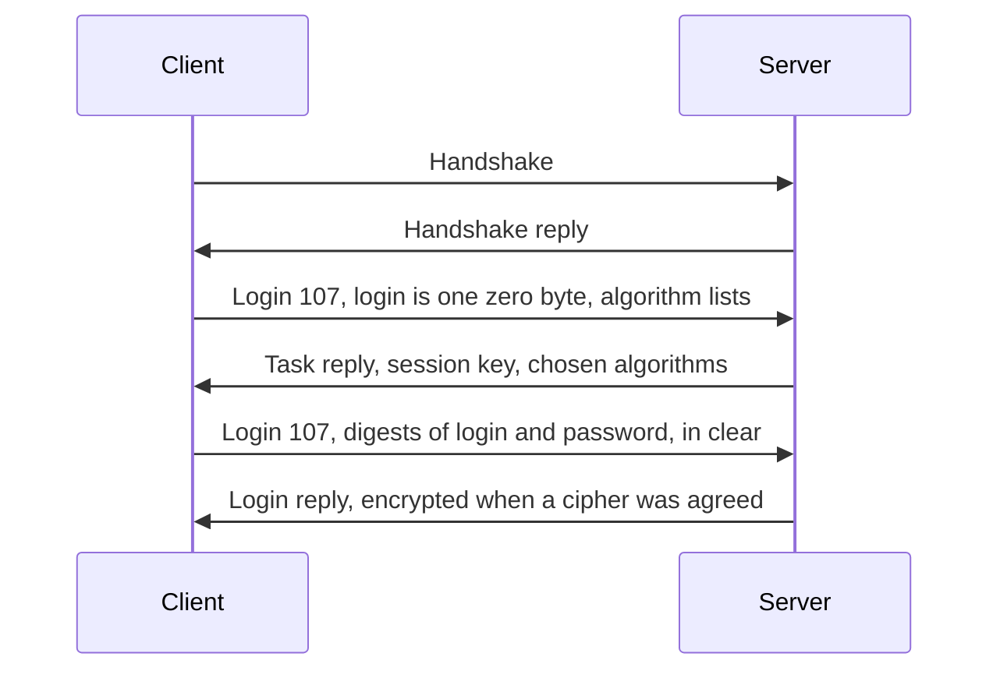

# HOPE extensions in SynHX and GtkHx

HOPE is an unofficial extension to the Hotline login. It replaces the
complemented password of login 107 with a keyed digest over a server-supplied
session key, and it lets the two sides agree a cipher and a compression method
for the rest of the connection. Hotline Server 1.9 does not implement it, so it
is no part of the [native](../glossary.md#native) contract. This document
records how two peer families implement it: the [SynHX](../glossary.md#synhx)
server and its client [shx](../glossary.md#shx), from retained source, and the
current GtkHx client, from its published source.

This document belongs to the [peer implementations](README.md) set; the
[glossary](../glossary.md) defines the terms it uses.

Every statement here is a reading of source code or of a published description.
No HOPE session has been captured, no HOPE-enabled executable has been built or
run, and the retained [shx build](shx-peer.md) was configured with HOPE, cipher
and compression disabled ([build configuration][shx-config], lines 60 to 66).
Nothing in this document is an [observed](../glossary.md#observed) result, and
no [gap](../glossary.md#gap) in the register covers HOPE.

## Sources and their standing

Table 1 lists the sources and how far each can be relied on. A statement
attributed to "SynHX source" rests on retained files that a reader can open in
this repository. A statement attributed to GtkHx rests on source outside this
repository, pinned by commit.

| Source                                    | What it is                                                                                                                                                                           | Standing                                                    |
| ----------------------------------------- | ------------------------------------------------------------------------------------------------------------------------------------------------------------------------------------ | ----------------------------------------------------------- |
| [SynHX server source][server-source]      | `rcv.c`, `hotline.h`, `hlwrite.c`, `decode.c`, `files.c` and `hxd.h` at RCS revision 1.1                                                                                             | Retained; source reading only                               |
| [shx 0.1.48 client source][client-source] | `hx_commands.c`, `hotline.h` and `hlwrite.c` at the converted Git head recorded in the [manifest][client-manifest]                                                                   | Retained; source reading only                               |
| [HOPE source supplement][hope-corpus]     | `hmac.c`, `cipher.c`, `cipher.h`, `cipher_openssl.h`, `compress.c`, `rand.c`, `hxd_config.c`, `configure.in` and `version.c` for the server; the matching client files               | Retained with this document; source reading only            |
| [GtkHx][gtkhx-repo]                       | The GtkHx client at commit `76e2c9391bc1788fe8e23893811e5df38048d5e8`. It holds the field constants and the driver                                                                   | External; not retained                                      |
| [hx-libs][hxlibs-repo]                    | The crates `hxhope`, `hxcrypto`, `hxsession` and `hxproto` at commit `51301be7a5e2df7ec033c05d1245375439ef010d`, which GtkHx pins ([`rust/Cargo.toml`][gtkhx-cargo], lines 90 to 95) | External; not retained                                      |
| [HOPE secure login][fog-login]            | A community description of the extension, at commit `90c658dac4b8e8296e94b53a87acccb3ce76acb0`                                                                                       | External description; compared with the code below          |
| [HOPE ChaCha20-Poly1305][fog-chacha]      | A community description of the AEAD extension, at the same commit                                                                                                                    | External description; compared with the code below          |
| [Hotline Wiki][hlwiki]                    | A list of unofficial identifiers, read on 16 November 2026                                                                                                                           | External description; the page states that it is incomplete |

_Table 1: The sources used, and the standing of each._

The server's `version.c` declares `0.1.48.1` ([`version.c`][server-version]).
The server and client copies of `hmac.c`, `cipher.c`, `compress.c` and `rand.c`
are byte-identical, so one description serves both. The GtkHx examined is the
current Rust client. The original GtkHx 0.9.4 of 2003, which its site says also
had HOPE logins, was not examined.

## The exchange

HOPE defines no transaction of its own for the login. It uses login 107 twice.
The first request, the identification, carries a login of one zero byte. The
server answers with a session key and its choices. The second request, the
authenticated login, carries the digests. Figure 1 shows the exchange as the
SynHX source implements it.

For screen readers: the following sequence diagram shows a client and a server.
The client sends the normal handshake and the server replies. The client sends
login 107 with a login of one zero byte and a list of digest algorithms. The
server replies with a task reply carrying a 64-byte session key and the chosen
algorithm. The client sends login 107 again with the digest of the password.
The server replies with the login reply, which is the first encrypted frame
when a cipher was agreed.

_Figure 1: The HOPE login exchange as read from the SynHX server and shx
source._

## Identifiers

Table 2 gives the identifiers. The SynHX server and client headers define the
same values ([server `hotline.h`][server-hotline], lines 308 to 342). The names
are those of the SynHX headers, where `HTLC` marks the client's direction and
`HTLS` the server's.

| Identifier             | Hex      | Decimal | SynHX name               | Defined or used by                    |
| ---------------------- | -------- | ------- | ------------------------ | ------------------------------------- |
| Application identifier | `0x0E01` | 3585    | None                     | hx-libs and GtkHx only                |
| Application string     | `0x0E02` | 3586    | None                     | hx-libs and GtkHx only                |
| Session key            | `0x0E03` | 3587    | `DATA_SESSIONKEY`        | SynHX, hx-libs                        |
| Digest algorithm       | `0x0E04` | 3588    | `DATA_MAC_ALG`           | SynHX, hx-libs                        |
| Server cipher          | `0x0EC1` | 3777    | `HTLS_DATA_CIPHER_ALG`   | SynHX, hx-libs                        |
| Client cipher          | `0x0EC2` | 3778    | `HTLC_DATA_CIPHER_ALG`   | SynHX, hx-libs                        |
| Server cipher mode     | `0x0EC3` | 3779    | `HTLS_DATA_CIPHER_MODE`  | SynHX parses and ignores it; hx-libs  |
| Client cipher mode     | `0x0EC4` | 3780    | `HTLC_DATA_CIPHER_MODE`  | SynHX parses and ignores it           |
| Server cipher vector   | `0x0EC5` | 3781    | `HTLS_DATA_CIPHER_IVEC`  | SynHX parses and ignores it           |
| Client cipher vector   | `0x0EC6` | 3782    | `HTLC_DATA_CIPHER_IVEC`  | SynHX parses and ignores it           |
| Server checksum        | `0x0EC7` | 3783    | `HTLS_DATA_CHECKSUM_ALG` | SynHX parses and ignores it           |
| Client checksum        | `0x0EC8` | 3784    | `HTLC_DATA_CHECKSUM_ALG` | SynHX parses and ignores it           |
| Server compression     | `0x0EC9` | 3785    | `HTLS_DATA_COMPRESS_ALG` | SynHX, hx-libs                        |
| Client compression     | `0x0ECA` | 3786    | `HTLC_DATA_COMPRESS_ALG` | SynHX, hx-libs                        |
| MD5 hash               | `0x0E80` | 3712    | `DATA_HASH_MD5`          | SynHX file hash                       |
| HAVAL hash             | `0x0E81` | 3713    | `DATA_HASH_HAVAL`        | SynHX file hash                       |
| SHA-1 hash             | `0x0E82` | 3714    | `DATA_HASH_SHA1`         | SynHX file hash                       |
| File hash transaction  | `0x0EE0` | 3808    | `HTLC_HDR_FILE_HASH`     | SynHX; GtkHx defines it without a use |

_Table 2: The HOPE field and transaction identifiers, with where each is
defined or used._

The SynHX headers also define `HTLS_DATA_SID` (`0x0E67`), `HTLC_DATA_CHAT_AWAY`
(`0x0EA1`), `HTLS_DATA_ICON_CICN` and `HTLC_HDR_ICON_GET` (both `0x0E90`) in
the same range. The source does not tie them to HOPE: the first is guarded by
`CONFIG_NETWORK`, the second is used without a HOPE guard, and no use of the
last two was found in the retained files. The Hotline Wiki lists them under
HOPE.

## Algorithm lists

A list of algorithm names is a two-byte big-endian count followed by one entry
per name, each a one-byte length and the name's bytes. The SynHX parser,
`list_n`, skips the two count bytes and never reads the count; it walks entries
until the field's length is exhausted ([server `rcv.c`][server-rcv], lines 902
to 917). hx-libs reads the count and refuses a count above 64.

Names are compared byte for byte in both implementations, so they are
case-sensitive. The one exception is the cipher mode in hx-libs, which is
compared without regard to case.

## Identification request

### shx

The `server` command requests HOPE unless it is given `-o`; the variable
`secure` starts at 1 ([client `hx_commands.c`][client-commands], line 1841).
The request is login 107 with these fields
([client `hx_commands.c`][client-commands], lines 1738 to 1789):

1. Login (105): one zero byte.
2. Password (106): one zero byte.
3. Digest algorithm (`0x0E04`): the list `HMAC-SHA1`, `HMAC-MD5`.
4. Client cipher (`0x0EC2`), in a build with `CONFIG_CIPHER`: a one-entry list
   when `-c` named a cipher, and otherwise a field of length zero.
5. Client compression (`0x0ECA`), in a build with `CONFIG_COMPRESS`: a
   one-entry list when `-z` named a method, and otherwise a field of length
   zero.
6. Session key (`0x0E03`): length zero.

The call passes all of these, but its field count starts at 4 and rises by one
for each of the cipher and compression that was named. The writer emits only as
many fields as the count ([client `hlwrite.c`][client-hlwrite], lines 35 to
54). In a build with both options compiled in, the session-key field is
therefore sent only when both a cipher and a method were named; with neither,
the request ends at the zero-length cipher field. The server does not read the
session-key field of a request, so the omission has no effect on it.

### GtkHx

hx-libs builds the request in `client::step1` ([`client.rs`][hxlibs-client],
lines 67 to 95). In order: login, one zero byte; password, one zero byte; the
digest list `HMAC-SHA256`, `HMAC-SHA1`, `HMAC-MD5`; the application identifier;
the application string when one is set; the client cipher list, always, which
is the two bytes `00 00` when no cipher is offered; the client compression
list, only when a method is offered; and an empty session key. GtkHx sets the
identifier to `GTKx` and the string to `hxnet` followed by a version, and
offers at most one cipher and one compression method, taken from the user's
choice ([`lifecycle.rs`][gtkhx-lifecycle], lines 300 to 306).

GtkHx offers `BLOWFISH` or `CHACHA20-POLY1305` as ciphers and `GZIP`, `LZ4` or
`ZSTD` as compression. It refuses HOPE on a TLS connection.

## Identification reply

### SynHX server

The server treats login 107 as an identification when the login field is
exactly one zero byte ([server `rcv.c`][server-rcv], lines 975 to 977 and
1049). In a build without `CONFIG_HOPE` it answers that request with an error
reply and no fields.

It walks the client's digest list in the client's order and takes the first
name it recognizes: `HMAC-SHA1`, `HMAC-MD5`, `SHA1` or `MD5` (lines 865 to 874
and 1081 to 1098). The server has no preference order of its own. It chooses a
cipher the same way from its configured list, which defaults to `RC4`,
`BLOWFISH`, `IDEA` ([`hxd_config.c`][server-config], line 26), and accepts
`GZIP` as the only compression.

The reply is a task reply, type `0x00010000`, with flag zero and the request's
transaction number. Its fields, in order, are (lines 1171 to 1182):

1. Login (105): the chosen digest name. This is not a login; it is the signal
   that the login is to be sent as a digest.
2. Digest algorithm (`0x0E04`): a one-entry list holding the same name.
3. Server cipher (`0x0EC1`) and client cipher (`0x0EC2`): the same one-entry
   list in both, in a build with `CONFIG_CIPHER`.
4. Server compression (`0x0EC9`) and client compression (`0x0ECA`): the same
   one-entry list in both, in a build with `CONFIG_COMPRESS`.
5. Session key (`0x0E03`): 64 bytes.

Where nothing was chosen, the corresponding field is sent with length zero. The
server records the session key and returns without changing the login state, so
the connection may still log in.

### How the clients read it

shx takes the first entry of the server's digest list as the algorithm and does
not check it against what it offered. It decides whether to send the login as a
digest by comparing the reply's login field with its own preset name,
`HMAC-SHA1`, not with the name the server chose
([client `hx_commands.c`][client-commands], lines 1291 to 1293, 1349 to 1354
and 1740). Against a SynHX server the two agree, because the server picks the
first name shx lists.

hx-libs requires a session key and a digest name that it offered, and treats a
list with a count of zero as malformed. It sends the login as a digest only
when the reply's login field equals the chosen digest's name
([`client.rs`][hxlibs-client], lines 189 to 193). A cipher mode, when present,
must be `STREAM` for Blowfish or `AEAD` for ChaCha20-Poly1305; an absent mode
is accepted. A compression name of `NONE`, an empty name or an empty field
means no compression.

## Session key

The SynHX server builds a 64-byte key: bytes 0 to 3 are the IPv4 address and
bytes 4 and 5 the port, both in network order, taken from `getsockname` on the
accepted socket, and bytes 6 to 63 are random ([server `rcv.c`][server-rcv],
lines 1062 to 1079). The random bytes come from OpenSSL's `RAND_bytes`
([`rand.c`][server-rand]). If `getsockname` fails, the address is set to zero
and the port bytes are left unset.

shx refuses a key shorter than 20 bytes. It then compares the first six bytes
with the address and port it connected to, and on a difference prints the two
pairs joined by `!=` and closes ([client `hx_commands.c`][client-commands],
lines 1356 to 1384). No option that overrides the check was found at this
revision. A client that reaches the server through address translation would
therefore be refused.

hx-libs accepts a session key of any length and makes no address check.

## Authenticated login

Table 3 gives the digest computations. In SynHX they are one function,
`hmac_xxx(key, text, algorithm)` ([`hmac.c`][server-hmac]). In hx-libs they are
`Mac::mac(key, text)`.

| Value           | Key              | Text                |
| --------------- | ---------------- | ------------------- |
| Password digest | The password     | The session key     |
| Login digest    | The account name | The session key     |
| Server send key | The password     | The password digest |
| Client send key | The password     | The server send key |

_Table 3: The key and text of each HOPE digest, in both implementations._

For `HMAC-SHA1` and `HMAC-MD5`, SynHX computes the standard keyed construction
with a 64-byte block. For the plain names `SHA1` and `MD5` it hashes the key
followed by the text, with no padding between them. hx-libs implements
`HMAC-SHA256`, `HMAC-SHA1` and `HMAC-MD5` only; it never offers or accepts the
plain names. Neither implementation has an algorithm named `INVERSE`, which the
[community description][fog-login] calls a required fallback.

shx sends the second login 107 with the login, as a digest or as complemented
bytes; the password digest; the server cipher (`0x0EC1`) and server compression
(`0x0EC9`) fields echoing the server's choices; the name; and the icon
([client `hx_commands.c`][client-commands], lines 1516 to 1526). hx-libs sends
the same fields, omitting the cipher and compression fields when none was
chosen, and adds the version, the cipher mode when it is not `STREAM`, and the
capabilities.

The SynHX server finds the account for a login digest by computing the digest
of every name in its accounts directory until one matches; a digest of the
empty name selects the guest account ([server `rcv.c`][server-rcv], lines 1226
to 1256). It then computes the password digest from the stored password and
compares it with the one received (lines 1287 to 1289). Once a digest algorithm
is set for the connection, it ignores a login or password field longer than 20
bytes.

## Stream transport

When a cipher was agreed, each side derives two keys by Table 3. Each key is
the whole digest output: 20 bytes for the SHA-1 algorithms, 16 for the MD5 ones
and, in hx-libs, 32 for `HMAC-SHA256`. SynHX passes that length to RC4 and to
Blowfish, so they are keyed with the whole digest. It calls
`idea_set_encrypt_key` with no length ([`cipher.c`][server-cipher], lines 203
to 204 and 224 to 225), and OpenSSL's IDEA takes a fixed 16-byte key, so IDEA
is keyed with the first 16 bytes only. The whole digest remains the stored key,
and it is the whole digest that the key rotation below feeds back into the
digest function. The server encrypts with the server send key and the client
with the client send key. The SynHX source names the keys from each side's own
view, so the server's `cipher_encode_key` and the client's `cipher_decode_key`
are the same bytes ([server `rcv.c`][server-rcv], lines 1328 to 1345;
[client `hx_commands.c`][client-commands], lines 1507 to 1512).

The identification reply and the second login 107 travel in clear. The login
reply is the first encrypted frame from the server, and every later frame in
both directions is encrypted.

SynHX implements `RC4`, and `BLOWFISH` and `IDEA` in 64-bit output-feedback
mode, through OpenSSL ([`cipher.c`][server-cipher];
[`cipher_openssl.h`][server-cipher-openssl]). hx-libs implements Blowfish in
the same mode with a zero initial vector, and no RC4 or IDEA. GtkHx has retired
RC4 from its interface.

### Key rotation

The sender may change its key between the header and the body of a frame. In
SynHX's `cipher_encode` ([`cipher.c`][server-cipher], lines 147 to 188):

1. One random byte decides whether to rotate. The frame rotates when the
   byte's top four bits are 2, 7 or 13, which is 3 chances in 16.
2. A count is drawn from the top six bits of a second random byte. If that is
   zero, the count is the top five bits of a third byte, plus one. The count is
   therefore between 1 and 63.
3. The count is placed in the top byte of the first four bytes of the frame.
4. The first 22 bytes are encrypted under the current key. These are the
   20-byte transaction header and the two-byte field count.
5. The key is replaced, the count's number of times, by the digest with the
   current key as key and the session key as text.
6. The rest of the frame is encrypted under the new key.

The receiver decrypts the first 22 bytes, takes the count from the top byte,
clears it, and applies the same derivation ([server `rcv.c`][server-rcv], lines
321 to 326). Setting the new key re-keys the cipher without resetting the
feedback vector. hx-libs does the same with the same odds and range, and
refuses a count above 63 ([`transport.rs`][hxlibs-transport], lines 228 to 288
and 341 to 362).

The descriptions differ in words but not in bytes. The
[community description][fog-login] places the count in the top eight bits of
the type field and says that the first two bytes of the body are encrypted
before the rotation. GtkHx's own notes place it in the flags byte at offset 0.
SynHX reads the first four bytes of the header as one 32-bit type, so its top
byte is the byte at offset 0; and the two bytes that follow the 20-byte header
are the field count.

When compression is active, neither implementation rotates. In SynHX the
sending code that would do so under compression is compiled out
([`compress.c`][server-compress], lines 158 to 189).

## Compression

SynHX accepts only `GZIP`. Despite the name, it is a zlib stream: the code calls
`deflateInit` and `inflateInit` and flushes each frame with `Z_SYNC_FLUSH`,
keeping one stream per direction for the whole connection
([`compress.c`][server-compress]). The sender compresses and then encrypts; the
receiver decrypts and then decompresses.

In the second login the SynHX server does not check the compression field
again: any non-empty field turns compression on in both directions
([server `rcv.c`][server-rcv], lines 1295 to 1301).

hx-libs implements `GZIP` as a zlib stream, and adds `LZ4` and `ZSTD`, which
SynHX does not have.

## AEAD transport in GtkHx

SynHX has no AEAD cipher. hx-libs implements `CHACHA20-POLY1305`
([`aead.rs`][hxlibs-aead]), and its code agrees with the
[community description][fog-chacha] on each of these points:

- Each direction's 32-byte key is HKDF-SHA256 with the session key as salt.
  The server's direction uses the server send key of Table 3 as input and the
  label `hope-chacha-encode`; the client's direction uses the client send key
  and `hope-chacha-decode`.
- A frame is a four-byte big-endian length followed by the ciphertext and its
  16-byte tag. The length counts the ciphertext and tag, and is itself neither
  encrypted nor authenticated. The largest frame accepted is 16 MiB.
- The 12-byte nonce is a direction byte, `0x00` from the server and `0x01`
  from the client, three zero bytes and a 64-bit big-endian counter that starts
  at zero.
- There is no key rotation.

For file transfers, hx-libs derives a base key by HKDF-SHA256 over the two
direction keys joined, server's first, with the session key as salt and the
label `hope-file-transfer`. It derives each transfer's key from the base key
with the transfer's four-byte reference as salt and the label `hope-ft-ref`.
GtkHx arms this only when the control connection agreed ChaCha20-Poly1305, and
writes the transfer preamble in clear first. Which bytes of a transfer are then
encrypted was not established from the code read.

## File hash transaction

In a build with `CONFIG_HOPE`, the SynHX server answers transaction 3808 with
hashes of a file ([server `files.c`][server-files], lines 1094 to 1229). The
request names the file by the usual name (201) and path (202) fields, may carry
resume data (203), and asks for a hash by including the MD5, HAVAL or SHA-1
field. A two-byte HAVAL field gives the digest length and the number of passes.

The reply always carries all three hash fields. Buffers for hashes that were
not requested are not cleared before they are sent. shx requests all three with
empty fields from its `hash` command.

## Where the sources disagree

Table 4 sets the published descriptions beside the code.

| Point                             | Community description                             | SynHX source                                                    | hx-libs                                 |
| --------------------------------- | ------------------------------------------------- | --------------------------------------------------------------- | --------------------------------------- |
| Fallback digest `INVERSE`         | Required of both sides                            | Not implemented                                                 | Not implemented                         |
| Digest names                      | Six, including `HMAC-SHA256`                      | `HMAC-SHA1`, `HMAC-MD5`, `SHA1`, `MD5`                          | `HMAC-SHA256`, `HMAC-SHA1`, `HMAC-MD5`  |
| Who ranks the digests             | The server selects the strongest                  | The server takes the client's first acceptable name             | Its server half does the same           |
| Reply type                        | "Type field set to zero"                          | Type `0x00010000`, flag zero                                    | Type `0x00010000`                       |
| Login as digest                   | When the reply's login field is non-blank         | When it equals the client's preset `HMAC-SHA1`                  | When it equals the chosen digest's name |
| Session key check                 | Clients validate; `hx` can override with `-f`     | shx validates; no override found at 0.1.48                      | No check                                |
| Cipher field when none is wanted  | Omitted                                           | shx may send it with length zero                                | Sent as a list with count zero          |
| Application identifier and string | Sent by modern clients; omitted by `hx` and GtkHx | No such fields                                                  | GtkHx sends `GTKx`                      |
| Cipher names                      | `RC4`, `BLOWFISH`, `CHACHA20-POLY1305`            | `RC4`, `BLOWFISH`, `IDEA`                                       | `BLOWFISH`, `CHACHA20-POLY1305`         |
| Empty compression list            | Crashes `hx` and GtkHx in `list_n`                | `list_n` reads the first length byte without checking the count | A count of zero is treated as none      |

_Table 4: Points on which the published descriptions and the code differ._

The first reply-type row is a difference of wording. The description's point,
that a client reading the first four bytes as one number must see `0x00010000`,
agrees with the SynHX client. The Hotline Wiki's digest list (`HMAC-MD5`,
`HMAC-SHA1`, `MD5`, `SHA1`) and cipher list (`BLOWFISH`, `IDEA`, `RC4`, `NONE`)
match the SynHX source.

## Hazards read from the SynHX source

These are readings of code paths. None was exercised.

- **Password field outside the digest length:** once a digest algorithm is
  set, a password field of length zero or longer than 20 bytes is not taken as
  a digest, and the code falls to the plain comparison with a buffer that the
  HOPE path never fills ([server `rcv.c`][server-rcv], lines 995 to 1001 and
  1348 to 1354).
- **Repeated identification:** the identification branch does not clear the
  permission to log in, so a client may request a new session key any number of
  times before logging in.
- **Account enumeration by digest:** the login-digest search computes one
  digest per directory entry, and does not skip the `.` and `..` entries.
- **List parser bound:** `list_n` keeps a position counter that starts at 1
  and advances with its pointer, which starts at offset 2, so the counter is
  one less than the offset of the current entry's length byte until it wraps.
  It accepts an entry when the counter plus the entry's length does not exceed
  the field's length. The entry's name ends at that offset plus 1 plus the
  length, so at every entry the check is two bytes looser than the entry. The
  three-byte field `00 01 02` passes, although both name bytes that it
  advertises lie outside the field. In the six-byte field `00 02 01 41 04 42`
  the second entry is refused, because its counter is 3 and 3 plus 4 exceeds 6.
- **List parser counter width:** the counter is a 16-bit value. In a field of
  65,535 bytes, an entry whose length byte is at offset 65,534 with a length of
  2 has a counter of 65,533 and is accepted. Advancing past it wraps the
  counter to 0 while the pointer moves beyond the field, and the relation above
  no longer holds for any later entry.
- **List parser first read:** `list_n` reads the length byte at offset 2 before
  any check, so a field shorter than three bytes is read past its end.
- **File hash reply:** hashes that were not requested are sent from buffers
  that were not cleared.

## What is not established

- No HOPE exchange has been captured. Every statement above is a
  [source prediction](../glossary.md#source-prediction) in the sense that it
  compares behaviour from source without a run.
- Whether any SynHX server executable was built with `CONFIG_HOPE`,
  `CONFIG_CIPHER` or `CONFIG_COMPRESS` is unknown; no server configuration is
  retained. `configure.in` leaves all three off unless they are asked for
  ([`configure.in`][server-configure], lines 32 to 34).
- The retained shx executable has all three compiled out, so it cannot be used
  to observe HOPE without a new build.
- hx-libs' comments say that its output was tested against mhxd and Janus.
  Those servers were not examined here, and the comments are not evidence of
  their behaviour.
- The GtkHx and hx-libs sources are not retained in this repository. The
  statements about them hold for the two commits named in Table 1.
- The original GtkHx 0.9.4 was not examined.

[client-commands]: ../../evidence/gap-remediation/2026-11-12/batch-12/client-source/hx_commands.c.txt
[client-hlwrite]: ../../evidence/gap-remediation/2026-11-12/batch-12/client-source/hlwrite.c.txt
[client-manifest]: ../../evidence/gap-remediation/2026-11-12/batch-12/manifest.json
[client-source]: ../../evidence/gap-remediation/2026-11-12/batch-12/manifest.json
[fog-chacha]: https://github.com/fogWraith/Hotline/blob/90c658dac4b8e8296e94b53a87acccb3ce76acb0/Docs/Protocol/HOPE-ChaCha20-Poly1305.md
[fog-login]: https://github.com/fogWraith/Hotline/blob/90c658dac4b8e8296e94b53a87acccb3ce76acb0/Docs/Protocol/HOPE-Secure-Login.md
[gtkhx-cargo]: https://github.com/mishan/gtkhx/blob/76e2c9391bc1788fe8e23893811e5df38048d5e8/rust/Cargo.toml#L90-L95
[gtkhx-lifecycle]: https://github.com/mishan/gtkhx/blob/76e2c9391bc1788fe8e23893811e5df38048d5e8/rust/crates/hxnet/src/lifecycle.rs#L300-L306
[gtkhx-repo]: https://github.com/mishan/gtkhx/tree/76e2c9391bc1788fe8e23893811e5df38048d5e8
[hlwiki]: https://hlwiki.com/unofficial-protocol-extensions/
[hope-corpus]: ../../evidence/gap-remediation/2026-11-16/hope-source-01/manifest.json
[hxlibs-aead]: https://github.com/mishan/hx-libs/blob/51301be7a5e2df7ec033c05d1245375439ef010d/crates/hxcrypto/src/aead.rs
[hxlibs-client]: https://github.com/mishan/hx-libs/blob/51301be7a5e2df7ec033c05d1245375439ef010d/crates/hxhope/src/client.rs
[hxlibs-repo]: https://github.com/mishan/hx-libs/tree/51301be7a5e2df7ec033c05d1245375439ef010d
[hxlibs-transport]: https://github.com/mishan/hx-libs/blob/51301be7a5e2df7ec033c05d1245375439ef010d/crates/hxhope/src/transport.rs
[server-cipher]: ../../evidence/gap-remediation/2026-11-16/hope-source-01/server-source/cipher.c
[server-cipher-openssl]: ../../evidence/gap-remediation/2026-11-16/hope-source-01/server-source/cipher_openssl.h
[server-compress]: ../../evidence/gap-remediation/2026-11-16/hope-source-01/server-source/compress.c
[server-config]: ../../evidence/gap-remediation/2026-11-16/hope-source-01/server-source/hxd_config.c
[server-configure]: ../../evidence/gap-remediation/2026-11-16/hope-source-01/server-source/configure.in
[server-files]: ../../evidence/hotline-server-1.9/synhxd-source/files.c
[server-hmac]: ../../evidence/gap-remediation/2026-11-16/hope-source-01/server-source/hmac.c
[server-hotline]: ../../evidence/hotline-server-1.9/synhxd-source/hotline.h
[server-rand]: ../../evidence/gap-remediation/2026-11-16/hope-source-01/server-source/rand.c
[server-rcv]: ../../evidence/hotline-server-1.9/synhxd-source/rcv.c
[server-source]: ../../evidence/hotline-server-1.9/synhxd-source/manifest.json
[server-version]: ../../evidence/gap-remediation/2026-11-16/hope-source-01/server-source/version.c
[shx-config]: ../../evidence/gap-remediation/2026-11-13/shx-build-01/build/config.h
