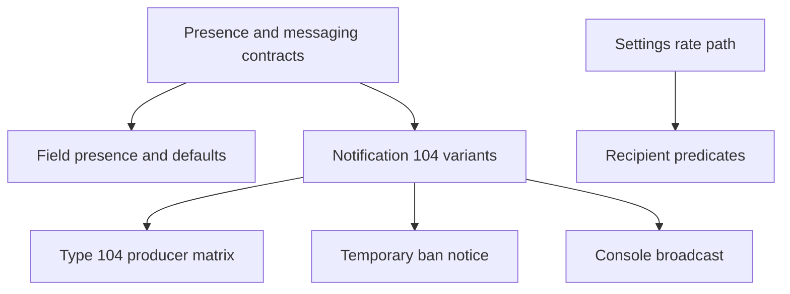

# Presence and messaging

This set covers how the native Hotline Server 1.9 handles presence and
messaging after a session is established. It records the settings and login
visibility, roster updates, private messages, chat rooms and invitations, and
the unsolicited [notification](../glossary.md#notification) type 104, which
carries messages from several producers. It also records the 304 settings rate
path, a counter for settings updates whose source reading predicts a close or
temporary-ban path. The documents state which of these are observed in a
captured run, which are read from source, and which remain
[unresolved](../glossary.md#unresolved). The set deliberately leaves the wire
layouts of fields and transactions to the [protocol](../protocol/README.md)
set, the account records and access bitmap to the accounts and privileges set,
and file and news transactions to their own sets. The identified client
evidence is in the peers set, and the validation of the mxd implementation is
in the [mxd](../mxd/README.md) set.

## Where to start

The [presence and messaging contracts](presence-messaging-contracts.md)
document is the entry point. It sets out the settings and login visibility, the
roster, the private-message routing and the room behaviour, and it links to the
type-104 documents and to the ban and console witnesses. Read the
[field presence and defaults](presence-defaults.md) document alongside it when
a field is absent, empty or zero.

Two documents inventory the producers of type 104: the
[notification 104 variants](notification-104-variants.md) and the
[type 104 producer matrix](native-104-variants.md). Both describe the field
sets of each producer. The matrix gives the field sets for each branch in more
detail. The ban and console documents are witnesses for particular producers.

The 304 rate path is a separate line of reading. The
[settings rate path](rate304-contract.md) is a
[source prediction](../glossary.md#source-prediction), and the
[recipient predicates](rate304-recipient-predicate.md) document is a static
reading that supports it. Neither is a native result.

For screen readers: the diagram shows the presence and messaging contracts at
the top. Arrows lead from them to the field presence and defaults and to the
notification 104 variants. From the variants, arrows lead to the type 104
producer matrix, the temporary ban notice and the console broadcast.
Separately, the settings rate path leads to the recipient predicates.

_Figure 1: Suggested reading order of the presence and messaging set. The
settings rate path is a separate line of reading._

## Documents

The kind names what a document is: a contract states the rules that its
evidence supports, a trace records a static reading of code, a matrix sets
cases against their outcomes, a witness records an observed run, and a
reference is a guide or catalogue.

| Document                                                                       | What it covers                                                                                                                                                                   | Kind      |
| ------------------------------------------------------------------------------ | -------------------------------------------------------------------------------------------------------------------------------------------------------------------------------- | --------- |
| [Presence and messaging contracts](presence-messaging-contracts.md)            | Settings and login visibility, roster snapshots, private-message routing, rooms and invitations, and disconnect teardown, from handler captures and static send order.           | contract  |
| [Notification 104 variants](notification-104-variants.md)                      | An inventory of the producers of unsolicited type-104 notifications, the fields each one produces, and the captures that show them.                                              | reference |
| [Native 1.9 type-104 producer matrix](native-104-variants.md)                  | The field set of each type-104 producer branch, and whether that field shape can identify its origin.                                                                            | matrix    |
| [Native 1.9 temporary ban notice](native-ban-notices.md)                       | A witness of the option-one temporary-ban notice, from one disposable Mac OS 9 lab, with its baseline identities.                                                                | witness   |
| [Native console broadcast and client 355](native-console-broadcast.md)         | A bounded witness from one controlled guest session of console messages and client 355 broadcasts, showing what each connection received.                                        | witness   |
| [Native 1.9 field presence and defaults](presence-defaults.md)                 | A context table that separates absent, empty, NUL and numeric-zero fields for each operation, with the remaining fixture cells named.                                            | matrix    |
| [Native 1.9 settings rate path](rate304-contract.md)                           | A source prediction of the 304 update counter and its close path, set against a later native sequence.                                                                           | trace     |
| [Native 1.9 notification recipient predicates](rate304-recipient-predicate.md) | A bounded static reading of the connection bit and the recipient gate used by notification predicates.                                                                           | trace     |
| [Evidence index](evidence.md)                                                  | The corpora, ledger identifiers and gap identifiers that the documents of this set cite, with the documents and sections that cite each. Generated by `tools/check_evidence.py`. | reference |

_Table 1: The documents of the presence and messaging set._

## Evidence

The documents in this set cite gap-remediation corpora most often. Each is
recorded under the evidence directory with a manifest. Examples are the
[rate 304 recipient predicate corpus](../../evidence/gap-remediation/2026-11-14/rate304-recipient-predicate-01/manifest.json),
the
[native console broadcast corpus](../../evidence/gap-remediation/2026-11-13/native-console-broadcast-01/manifest.json)
and the
[native ban corpus for option one](../../evidence/gap-remediation/2026-11-13/native-ban-one-01/manifest.json).
The static readings also cite decompilation query records. The procedure for
re-verifying the retained evidence is in the
[guide to recreating the evidence](../native-evidence/recreating-evidence.md).

## Open questions

The
[ledger of remaining evidence work](../provenance/remaining-evidence-work.md)
lists the gaps that are not Resolved. The [gap analysis](../../gap-analysis.md)
holds the full text of each gap.

The ledger lists these gaps as not Resolved, and this set cites them or names
its documents as the prepared work:

- [GAP-011]: frame, transaction and buffering
  limits.
- [GAP-016]: absent, empty and zero-valued
  fields.
- [GAP-018]: text encoding and transformations.
- [GAP-019]: semantic length limits and
  truncation.
- [GAP-026]: meaning and lifetime of login
  extras.
- [GAP-033]: identifier lifetimes. The ledger
  names the presence and messaging contracts as the prepared document.
- [GAP-036]: disconnect notification and cleanup.
- [GAP-045]: flood, spam and throttling outcomes.

The documents also cite the following gaps. The ledger does not list them as
not Resolved, and this overview does not restate their status: [GAP-015],
[GAP-017], [GAP-025], [GAP-027], [GAP-028], [GAP-029], [GAP-030], [GAP-034],
[GAP-035], [GAP-038], [GAP-042], [GAP-043], [GAP-044], [GAP-076], [GAP-080] and
[GAP-084].

## Related sets

- [Protocol](../protocol/README.md): the wire layouts, field types and
  transaction catalogue that these documents refine. Go there for the field
  schema behind a settings or message field.
- [Accounts and privileges](../accounts-and-privileges/README.md): the access
  bitmap and the ban file. Go there for the privilege that gates a message or a
  settings change.
- [Files and transfers](../files-and-transfers/README.md): the transfer
  contracts and the transfer stall that the ban and presence documents mention.
  Go there for transfer state.
- [News](../news/README.md): the news contracts, which the field presence
  document also cites. Go there for article fields.
- [Peers](../peers/identified-client-source.md): identified client evidence for
  how a client reads type-104 and roster messages.
- [mxd](../mxd/README.md): the separate server implementation and its checks of
  presence and messaging behaviour.
- [Native evidence](../native-evidence/recreating-evidence.md): the preparation
  and witness documents for each run named here, and how to re-verify them.
- [Provenance](../provenance/remaining-evidence-work.md): the ledger of
  remaining evidence work and the open gaps.

[GAP-011]: ../../gap-analysis.md#gap-011
[GAP-015]: ../../gap-analysis.md#gap-015
[GAP-016]: ../../gap-analysis.md#gap-016
[GAP-017]: ../../gap-analysis.md#gap-017
[GAP-018]: ../../gap-analysis.md#gap-018
[GAP-019]: ../../gap-analysis.md#gap-019
[GAP-025]: ../../gap-analysis.md#gap-025
[GAP-026]: ../../gap-analysis.md#gap-026
[GAP-027]: ../../gap-analysis.md#gap-027
[GAP-028]: ../../gap-analysis.md#gap-028
[GAP-029]: ../../gap-analysis.md#gap-029
[GAP-030]: ../../gap-analysis.md#gap-030
[GAP-033]: ../../gap-analysis.md#gap-033
[GAP-034]: ../../gap-analysis.md#gap-034
[GAP-035]: ../../gap-analysis.md#gap-035
[GAP-036]: ../../gap-analysis.md#gap-036
[GAP-038]: ../../gap-analysis.md#gap-038
[GAP-042]: ../../gap-analysis.md#gap-042
[GAP-043]: ../../gap-analysis.md#gap-043
[GAP-044]: ../../gap-analysis.md#gap-044
[GAP-045]: ../../gap-analysis.md#gap-045
[GAP-076]: ../../gap-analysis.md#gap-076
[GAP-080]: ../../gap-analysis.md#gap-080
[GAP-084]: ../../gap-analysis.md#gap-084
