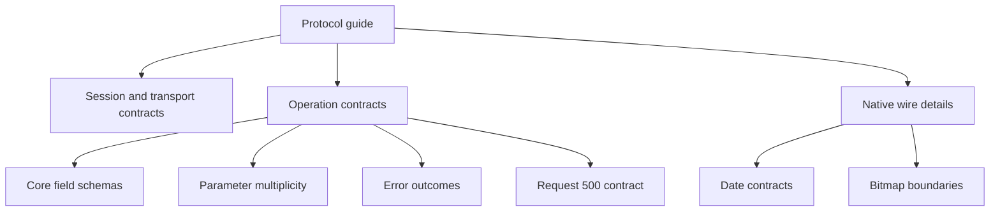
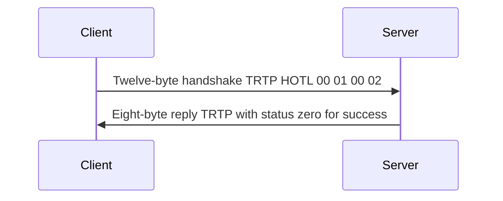

# Hotline 1.9 wire protocol

This set states the Hotline 1.9 wire protocol as the native Hotline Server 1.9
behaves, according to retained evidence. It covers the session handshake, the
[transaction](../glossary.md#transaction) envelope, the parameter stream and its
[field](../glossary.md#field) layouts, the dispatch of each request, and the
failure outcomes and boundary cases on which those depend. Each document labels
what is [observed](../glossary.md#observed), what is source-derived, and what is
[unresolved](../glossary.md#unresolved). The set deliberately leaves the
subject-specific behaviour of presence and messaging, accounts and privileges,
files and transfers, and news to their own sets. It also leaves the identified
client evidence, the validation of the separate mxd implementation, and the
records of each native run to the other sets named under related sets.

## Where to start

[The protocol guide](protocol.md) is the entry document for the whole
repository. Start there. Its sections give the handshake, the framing, the
parameter stream, the login path and the transaction catalogue. Each later
document in this set refines one part of the guide.

For screen readers: the diagram shows the protocol guide at the top. Arrows
lead from it to the session and transport contracts, to the operation contracts
and to the native wire details. From the operation contracts, arrows lead to
the core field schemas, the parameter multiplicity rules, the error outcomes
and the request 500 contract. From the native wire details, arrows lead to the
date contracts and the bitmap boundaries.

_Figure 1: Suggested reading order of the protocol set, starting from the
protocol guide._

The first exchange on the wire is the normal session handshake. Figure 2 shows
it step for step from section 1, "Session-initialization handshake", of the
[protocol guide](protocol.md). It covers the normal session only. The section
also describes the rejection of other sub-protocol tags and the sub-version 3
path into the transfer protocol, and neither is drawn.

For screen readers: the diagram shows a client sending a twelve-byte handshake
with the tags TRTP and HOTL, version 1 and sub-version 2. The server replies
with an eight-byte response that carries the TRTP tag and a status, which is
zero for success.

_Figure 2: The normal session-initialization handshake, taken step for step
from section 1, Session-initialization handshake, of the protocol guide._

## Documents

The kind names what a document is: a contract states the rules that its
evidence supports, a schema gives byte or field layouts, a trace records a
static reading of code, a matrix sets cases against their outcomes, a witness
records an observed run, and a reference is a guide or catalogue.

| Document                                                            | What it covers                                                                                                                                                                                          | Kind      |
| ------------------------------------------------------------------- | ------------------------------------------------------------------------------------------------------------------------------------------------------------------------------------------------------- | --------- |
| [Protocol guide](protocol.md)                                       | The baseline guide to the 1.9 wire format: handshake, transaction envelope, parameter stream and the observed transaction catalogue, with gaps marked where the evidence does not establish a contract. | reference |
| [Session and transport contracts](session-transport-contracts.md)   | Configured endpoints, handshake boundaries, activity clocks, transaction IDs and reassembly, and the handling of HTXF connections, refined from static analysis and captured boundary cases.            | contract  |
| [Operation contracts](operation-contracts.md)                       | The catalogue of the explicit client-request handlers, with session eligibility, direct replies and server notifications.                                                                               | contract  |
| [Native wire details](native-wire-details.md)                       | Parameter parsing, scalar access, scalar widths and field-level layouts that refine the protocol guide.                                                                                                 | reference |
| [Core field schemas](core-field-schemas.md)                         | Field types, occurrence and direction for session, settings, roster, chat, private message and room operations.                                                                                         | schema    |
| [Parameter multiplicity](parameter-multiplicity.md)                 | Which fields are scalar, repeated or packed in each transaction, and the order in which repeated fields arrive.                                                                                         | contract  |
| [Date contracts](date-contracts.md)                                 | The eight-byte date form, and the clock and catalogue values that feed it.                                                                                                                              | schema    |
| [Request 500 contract](request-500-contract.md)                     | The native reply to request 500, and one modern client's chosen schedule for it, which the document keeps separate from the server mechanism.                                                           | contract  |
| [Error outcomes](error-outcomes.md)                                 | Which native failure paths set reply status 1 with error text, and the boundaries that remain open for each.                                                                                            | matrix    |
| [Captured representative failures](failure-representatives.md)      | One retained request and its measured result for each of five failure classes, from native captures.                                                                                                    | witness   |
| [Receive-limit origin](receive-limit-origin.md)                     | A static reading of where the receive limit is assigned at startup, with an indexed reference boundary, from read-only queries.                                                                         | trace     |
| [Bitmap boundaries](bitmap-boundaries.md)                           | Replacement and width observations for the eight-byte access bitmap in field 110, from thirteen captures.                                                                                               | witness   |
| [Diagnostic transfer boundaries](diagnostic-transfer-boundaries.md) | A failed attempt to capture a 303 reply during an active transfer, which did not reach that state, with the idle examples from earlier captures cited as the positive evidence.                         | witness   |
| [Native 1.9 client diagnostics (303)](diagnostic-replies.md)        | Five bounded exchanges for transaction 303, with the reply fields and bytes recorded for each case.                                                                                                     | witness   |
| [Diagnostic formatting trace](diagnostic-formatting-trace.md)       | A static trace of how the 303 formatter writes field 101, including the source-derived 1,024-byte output budget.                                                                                        | trace     |

_Table 1: The documents of the protocol set._

## Evidence

Most of the links in this set point to two kinds of corpus under the evidence
directory. The first is the decompilation query records for named handlers,
kept in the `hotline-server-1.9/queries` directory. An example is the
[query record for handler 10018c00](../../evidence/hotline-server-1.9/queries/D-10018c00.c).
The second is the gap-remediation corpora, each with a manifest. Captured runs
cite their manifests, and static traces cite the query records. Two examples
are the
[native framing corpus](../../evidence/gap-remediation/2026-11-12/native-framing-01/manifest.json)
and the
[native bitmap corpus](../../evidence/gap-remediation/2026-11-13/native-bitmaps-01/manifest.json).
The procedure for re-verifying the retained evidence is in the
[guide to recreating the evidence](../native-evidence/recreating-evidence.md).

## Open questions

The
[ledger of remaining evidence work](../provenance/remaining-evidence-work.md)
lists the gaps that are not Resolved. The [gap analysis](../../gap-analysis.md)
holds the full text of each gap. The gaps below concern this set.

The ledger lists these gaps as not Resolved, and this set cites them:

- [GAP-005]: connection timers and liveness.
- [GAP-011]: frame, transaction and buffering
  limits.
- [GAP-016]: absent, empty and zero-valued
  fields.
- [GAP-018]: text encoding and transformations.
- [GAP-019]: semantic length limits and
  truncation.
- [GAP-020]: date and timestamp semantics.
- [GAP-026]: meaning and lifetime of login
  extras.
- [GAP-031]: complete privilege bitmap registry.
- [GAP-036]: disconnect notification and cleanup.
- [GAP-045]: flood, spam and throttling outcomes.
- [GAP-071]: account field 111.
- [GAP-072]: account update, placeholder and
  identity rules.

The documents also cite the following gaps. The ledger does not list them as
not Resolved, and this overview does not restate their status: [GAP-002],
[GAP-003], [GAP-004], [GAP-006], [GAP-007], [GAP-008], [GAP-010], [GAP-012],
[GAP-014], [GAP-015], [GAP-017], [GAP-022], [GAP-023], [GAP-024], [GAP-025],
[GAP-027], [GAP-028], [GAP-030], [GAP-032], [GAP-034], [GAP-037], [GAP-038],
[GAP-039], [GAP-040], [GAP-041], [GAP-042], [GAP-043], [GAP-044], [GAP-046],
[GAP-047], [GAP-048], [GAP-061], [GAP-073], [GAP-074], [GAP-075], [GAP-076],
[GAP-077], [GAP-078], [GAP-081] and [GAP-084].

## Related sets

- [Presence and messaging](../presence-and-messaging/README.md): chat, private
  messages, roster updates and the type-104 notices. Go there for the behaviour
  that the protocol guide's chat and private-message sections only summarize.
- [Accounts and privileges](../accounts-and-privileges/README.md): the account
  records and the access bitmap in field 110. Go there for privilege checks and
  the account writer.
- [Files and transfers](../files-and-transfers/README.md): file, folder, alias
  and download transactions, and the HTXF transfer connections.
- [News](../news/README.md): the threaded news transactions and the legacy
  message board.
- [Peers](../peers/identified-client-source.md): the identified Classic, SynHX
  and Mac peer evidence. Go there to see how a client behaves against the
  native server.
- [mxd](../mxd/README.md): the separate server implementation and its checks
  against this protocol.
- [Native evidence](../native-evidence/recreating-evidence.md): the preparation
  and witness documents for each native run, and how to re-verify them.
- [Provenance](../provenance/remaining-evidence-work.md): the ledger of
  remaining evidence work, which lists the open gaps in one place.

[GAP-002]: ../../gap-analysis.md#gap-002
[GAP-003]: ../../gap-analysis.md#gap-003
[GAP-004]: ../../gap-analysis.md#gap-004
[GAP-005]: ../../gap-analysis.md#gap-005
[GAP-006]: ../../gap-analysis.md#gap-006
[GAP-007]: ../../gap-analysis.md#gap-007
[GAP-008]: ../../gap-analysis.md#gap-008
[GAP-010]: ../../gap-analysis.md#gap-010
[GAP-011]: ../../gap-analysis.md#gap-011
[GAP-012]: ../../gap-analysis.md#gap-012
[GAP-014]: ../../gap-analysis.md#gap-014
[GAP-015]: ../../gap-analysis.md#gap-015
[GAP-016]: ../../gap-analysis.md#gap-016
[GAP-017]: ../../gap-analysis.md#gap-017
[GAP-018]: ../../gap-analysis.md#gap-018
[GAP-019]: ../../gap-analysis.md#gap-019
[GAP-020]: ../../gap-analysis.md#gap-020
[GAP-022]: ../../gap-analysis.md#gap-022
[GAP-023]: ../../gap-analysis.md#gap-023
[GAP-024]: ../../gap-analysis.md#gap-024
[GAP-025]: ../../gap-analysis.md#gap-025
[GAP-026]: ../../gap-analysis.md#gap-026
[GAP-027]: ../../gap-analysis.md#gap-027
[GAP-028]: ../../gap-analysis.md#gap-028
[GAP-030]: ../../gap-analysis.md#gap-030
[GAP-031]: ../../gap-analysis.md#gap-031
[GAP-032]: ../../gap-analysis.md#gap-032
[GAP-034]: ../../gap-analysis.md#gap-034
[GAP-036]: ../../gap-analysis.md#gap-036
[GAP-037]: ../../gap-analysis.md#gap-037
[GAP-038]: ../../gap-analysis.md#gap-038
[GAP-039]: ../../gap-analysis.md#gap-039
[GAP-040]: ../../gap-analysis.md#gap-040
[GAP-041]: ../../gap-analysis.md#gap-041
[GAP-042]: ../../gap-analysis.md#gap-042
[GAP-043]: ../../gap-analysis.md#gap-043
[GAP-044]: ../../gap-analysis.md#gap-044
[GAP-045]: ../../gap-analysis.md#gap-045
[GAP-046]: ../../gap-analysis.md#gap-046
[GAP-047]: ../../gap-analysis.md#gap-047
[GAP-048]: ../../gap-analysis.md#gap-048
[GAP-061]: ../../gap-analysis.md#gap-061
[GAP-071]: ../../gap-analysis.md#gap-071
[GAP-072]: ../../gap-analysis.md#gap-072
[GAP-073]: ../../gap-analysis.md#gap-073
[GAP-074]: ../../gap-analysis.md#gap-074
[GAP-075]: ../../gap-analysis.md#gap-075
[GAP-076]: ../../gap-analysis.md#gap-076
[GAP-077]: ../../gap-analysis.md#gap-077
[GAP-078]: ../../gap-analysis.md#gap-078
[GAP-081]: ../../gap-analysis.md#gap-081
[GAP-084]: ../../gap-analysis.md#gap-084
