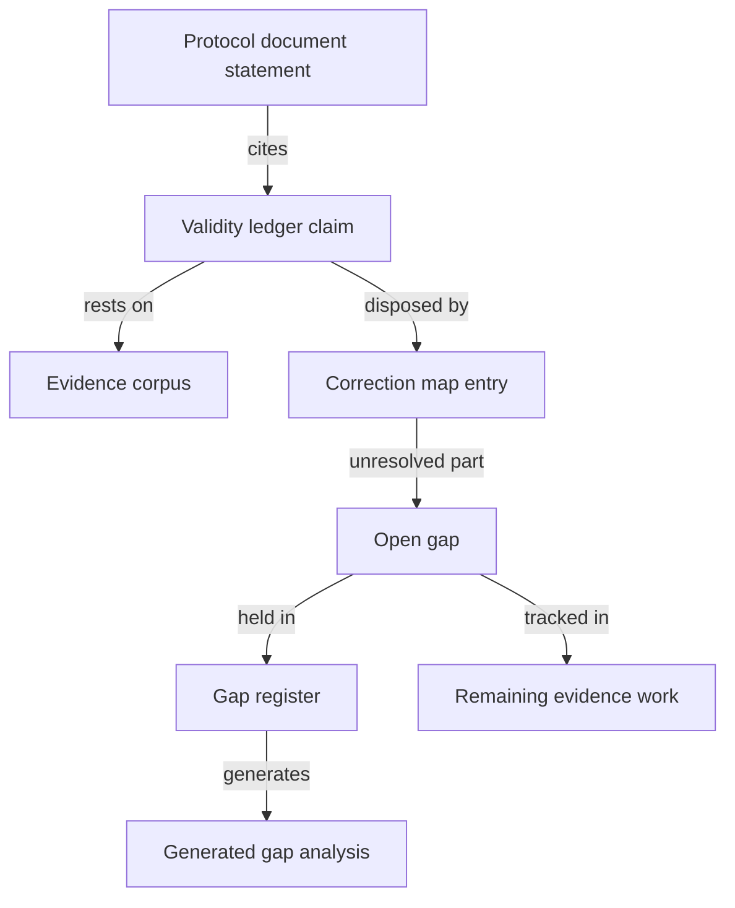

# Provenance

This set holds the instruments that trace the protocol documentation's
statements to their evidence and to the [gaps](../glossary.md#gap) that remain
open. It consists of four documents and four working records. The gap register
and its generated report sit at the repository root, the validity ledger sits in
`docs/`, and the audit revisions sit under `evidence/protocol-gap-analysis/`.
The set explains how those instruments relate, and it reports the state of the
remaining evidence work. It decides no gap. Where two of its sources disagree,
it records the disagreement and leaves it unresolved. The protocol claims are
in the [protocol guide](../protocol/protocol.md), and the native runs are in the
[native evidence](../native-evidence/README.md) set.

## Where to start

1. Read the section on how the instruments relate, and its diagram, to see how a
   statement reaches its evidence and an open gap.
2. Read the [validity ledger](../baseline-validity-ledger.md), which holds the
   numbered claims that statements cite. It sits outside this set.
3. Read the [baseline correction map](baseline-correction-map.md), which gives
   the disposition of each ledger entry for the current revision.
4. Read the [remaining evidence work](remaining-evidence-work.md) ledger, which
   lists the gaps that are not resolved, the kind of work each needs, and the
   prepared runs that have not started.
5. Read the [protocol handoff](protocol-handoff.md) for the state of the work
   when it was paused, and what must happen on resumption.
6. Read [evidence portability](evidence-portability.md) when the evidence needs
   to be packaged for use elsewhere. Open the
   [working records](#working-records) only for the work item that they concern.

## Documents

### How the instruments relate

A statement in the protocol guide cites a numbered claim in the
[validity ledger](../baseline-validity-ledger.md), and the claim names its
evidence. The [correction map](baseline-correction-map.md), which the
[glossary](../glossary.md#correction-map) defines, gives the disposition of
every ledger entry for the current revision. Where a statement is unresolved,
the [gap register](../../gap-register.json) records the question. The register
is the canonical list of gaps, and the
[generated gap analysis](../../gap-analysis.md) is produced from it and is not
edited by hand. Each audit revision is a numbered snapshot of that analysis,
stored with a manifest of its inputs. The
[remaining evidence work](remaining-evidence-work.md) ledger reads the register
and lists the gaps that are not resolved.

The diagram shows the route from a statement to its evidence and to an open gap.

For screen readers: the diagram reads from top to bottom. A protocol document
statement cites a validity ledger claim. The claim rests on an evidence corpus,
and a correction map entry disposes of it. The unresolved part of the entry
becomes an open gap. The gap is held in the gap register, which the generated
gap analysis reports, and it is tracked in the remaining evidence work.

_Figure 1: How a statement is traced from a protocol document to its evidence
and to an open gap._

The four documents of the set are listed in Table 1. The kinds are a workflow,
which is a procedure; a matrix, which is a table of cases or entries with their
dispositions; a record, which is a retained account kept as written; and a
ledger, which is a table of items with their state.

| Document                                              | What it covers                                                                                                                                                                         | Kind     |
| ----------------------------------------------------- | -------------------------------------------------------------------------------------------------------------------------------------------------------------------------------------- | -------- |
| [Evidence portability](evidence-portability.md)       | The procedure that builds a revision-pinned package of the protocol documents and their evidence, verifies it and extracts it elsewhere. It is the packaging procedure for GAP-087.    | workflow |
| [Baseline correction map](baseline-correction-map.md) | The disposition of each of the 83 ledger entries, applied to the protocol guide and the compatibility matrix for the current revision. Later closures are tracked in the gap analysis. | matrix   |
| [Protocol handoff](protocol-handoff.md)               | The state of the work when it was paused on 15 November 2026: what is parked, what resumption requires, and which operator packets stay outside this repository.                       | record   |
| [Remaining evidence work](remaining-evidence-work.md) | The gaps that are not resolved, the kind of work each needs, the prepared runs that have not started, and the places where the sources disagree. It does not decide any gap.           | ledger   |

_Table 1: The documents of the provenance set, with their kinds._

### Working records

The records under `records/` are working records. They are kept as they were
written, and they are not edited to match later findings. The
[remaining evidence work](remaining-evidence-work.md) ledger records under
"Source disagreements" the differences that concern them.

| Record                                                        | What it covers                                                                                                                                                                            |
| ------------------------------------------------------------- | ----------------------------------------------------------------------------------------------------------------------------------------------------------------------------------------- |
| [Missing-target alias plan](records/missing-target-alias.md)  | The plan for observing a genuinely missing Hotline alias target (GAP-054), with its progress checklist and undated revision notes.                                                        |
| [Classic proxy rehearsal](records/classic-proxy-rehearsal.md) | One synthetic rehearsal of the proxy's serve path (B29), and two real Classic UI attempts that opened no connection (B30 and B31).                                                        |
| [Mac peer candidate](records/mac-peer-candidate.md)           | The static identity of the Classic client candidate: its acquired archive, the hashes of its applications and its embedded version resource. The candidate was not launched or installed. |
| [mxd peer runtime](records/mxd-peer-runtime.md)               | The isolated mxd fixture for a Classic client capture (C14 to C19), which was prepared, started and then stopped.                                                                         |

_Table 2: The working records under records/, kept as written._

## Evidence

The protocol evidence sits under `evidence/hotline-server-1.9/`. The
[claims file](../../evidence/hotline-server-1.9/claims.json) lists the valid
ledger identifiers, and the
[program manifest](../../evidence/hotline-server-1.9/manifest.json) records the
server binary. The audit revisions sit under `evidence/protocol-gap-analysis/`,
one directory for each date and revision. For example, the
[revision 91 manifest](../../evidence/protocol-gap-analysis/2026-11-15/revision-91/manifest.json)
lists the inputs of that snapshot. The revision that is current is not stated
consistently across the sources; the
[remaining evidence work](remaining-evidence-work.md) ledger sets out the
differences under "Source disagreements". The
[withheld file list](../../evidence/withheld.json) records the files whose
bytes the repository does not publish. The most recent wind-down record is in
the
[wind-down manifest](../../evidence/gap-remediation/2026-11-15/wind-down-01/manifest.json).
The procedure for producing and re-verifying the corpora is in
[Recreating the evidence](../native-evidence/recreating-evidence.md).

## Open questions

The table lists the 25 gaps that are not resolved, in the order of the
[remaining evidence work](remaining-evidence-work.md) ledger. The priority, the
status and the title are those that the ledger gives. The register governs
where the two differ, as the ledger itself states.

| Gap                                      | Priority | Status        | Title                                                  |
| ---------------------------------------- | -------- | ------------- | ------------------------------------------------------ |
| [GAP-001](../../gap-analysis.md#gap-001) | P1       | Open          | Define the supported 1.9 subset                        |
| [GAP-005](../../gap-analysis.md#gap-005) | P0       | Investigating | Connection timers and liveness                         |
| [GAP-011](../../gap-analysis.md#gap-011) | P0       | Investigating | Frame, transaction and buffering limits                |
| [GAP-016](../../gap-analysis.md#gap-016) | P0       | Investigating | Absent, empty and zero-valued fields                   |
| [GAP-018](../../gap-analysis.md#gap-018) | P0       | Investigating | Text encoding and transformations                      |
| [GAP-019](../../gap-analysis.md#gap-019) | P0       | Investigating | Semantic length limits and truncation                  |
| [GAP-020](../../gap-analysis.md#gap-020) | P1       | Investigating | Date and timestamp semantics                           |
| [GAP-021](../../gap-analysis.md#gap-021) | P1       | Investigating | ACK versus completion, durability and retry            |
| [GAP-026](../../gap-analysis.md#gap-026) | P1       | Investigating | Meaning and lifetime of login extras                   |
| [GAP-031](../../gap-analysis.md#gap-031) | P1       | Investigating | Complete privilege bitmap registry                     |
| [GAP-033](../../gap-analysis.md#gap-033) | P1       | Investigating | User, room, article and reference identifier lifetimes |
| [GAP-036](../../gap-analysis.md#gap-036) | P1       | Investigating | Disconnect notification and cleanup                    |
| [GAP-045](../../gap-analysis.md#gap-045) | P1       | Investigating | Flood, spam and throttling outcomes                    |
| [GAP-050](../../gap-analysis.md#gap-050) | P1       | Investigating | Delete semantics and failures                          |
| [GAP-053](../../gap-analysis.md#gap-053) | P1       | Investigating | Move collision and metadata behaviour                  |
| [GAP-054](../../gap-analysis.md#gap-054) | P1       | Investigating | Alias creation and resolution                          |
| [GAP-064](../../gap-analysis.md#gap-064) | P1       | Investigating | Transfer completion, failure and persistence           |
| [GAP-067](../../gap-analysis.md#gap-067) | P1       | Investigating | Article navigation, flavour and date semantics         |
| [GAP-068](../../gap-analysis.md#gap-068) | P1       | Investigating | Posting and new-article discovery                      |
| [GAP-070](../../gap-analysis.md#gap-070) | P1       | Investigating | News hierarchy and structure mutations                 |
| [GAP-071](../../gap-analysis.md#gap-071) | P1       | Investigating | Account field 111                                      |
| [GAP-072](../../gap-analysis.md#gap-072) | P1       | Investigating | Account update, placeholder and identity rules         |
| [GAP-082](../../gap-analysis.md#gap-082) | P1       | Investigating | Heuristic text-decoding policy                         |
| [GAP-085](../../gap-analysis.md#gap-085) | P2       | Investigating | mxd implementation and test evidence                   |
| [GAP-086](../../gap-analysis.md#gap-086) | P2       | Investigating | Release/proof acceptance criteria                      |

_Table 3: Gaps that are not resolved, with the priority, status and title that
the remaining evidence work ledger gives them._

The records and the packaging procedure also name GAP-015, GAP-047, GAP-049 and
GAP-087. The ledger does not list them in its table of unresolved gaps, so this
overview gives no status for them.

## Related sets

- [Protocol guide](../protocol/protocol.md): the statements that the instruments
  trace.
- [Native evidence](../native-evidence/README.md): the runs and corpora that the
  open gaps need.
- [Peers](../peers/README.md): the peer records and the identity of the Classic
  client candidate.
- [mxd validation](../mxd/README.md): the parked mxd work and its resumption
  items.
- [Generated gap analysis](../../gap-analysis.md): the report generated from the
  gap register.
- [Repository rules](../../AGENTS.md): the rules that protect the evidence and
  govern the gates.
- [Glossary](../glossary.md): the defined terms used here.
